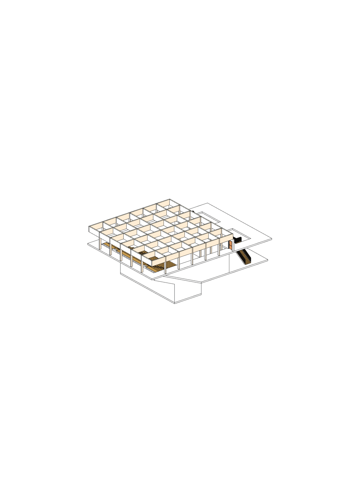
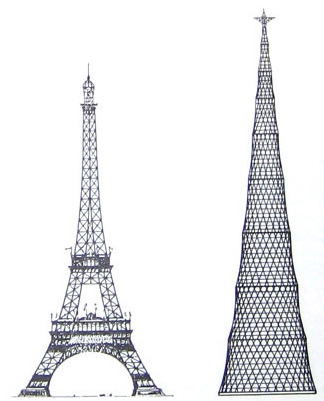
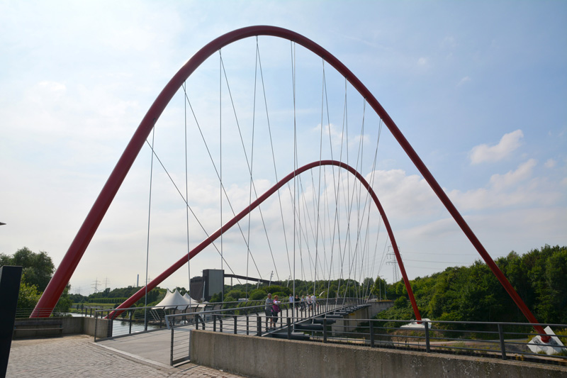
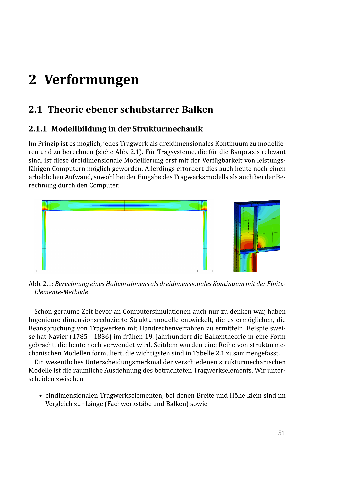
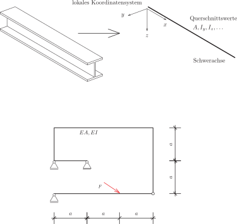
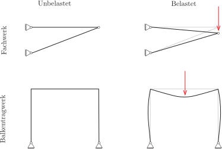
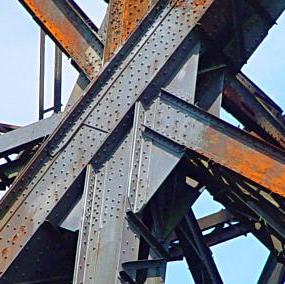
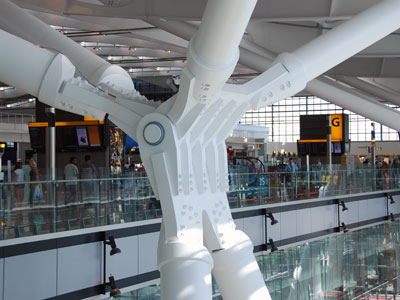

# Modellierung von Stabtragwerken

## Stabtragwerke

Wir alle kennen unzählige Beispiele von Konstruktionen, die aus stabartigen Bauteilen zusammengesetzt sind, @fig-stabtragwerke zeigt eine kleine Auswahl. Der Begriff stabartig besagt dabei, dass ein Bauteil in eine Richtung lang und in die beiden anderen Richtungen vergleichsweise dünn ist. Stabartige Bauteile sind nicht notwendigerweise gerade, wie an dem Beispiel der Emscherbrücke zu sehen ist.

::: {#fig-stabtragwerke layout="[[52, 48], [30, 70]]"}

Beispiele für Stabtragwerke (im Uhrzeigersinn): Glasdach der DZ Bank in Berlin, Hörsaal H9 HS Bochum, Brücke über die Emscher, Eiffelturm und Radioturm von Schuchow
:::

## Dimensionsreduzierte Modelle

Natürlich ist jedes Bauteil, auch ein stabartiges, ein dreidimensionales Objekt. Daher ist es prinzipiell denkbar, die Berechnung von Stabtragwerken an einem Volumenmodell durchzuführen. In @fig-everything-is-3d sehen Sie ein entsprechendes Beispiel, das mit einem Finite-Elemente-Programm berechnet wurde. Allerdings ist der Aufwand, ein Tragwerk auf diese Weise in den Computer einzugeben, sehr groß: Es muss jeder Querschnitt detailliert eingegeben werden, insbesondere Anschlüsse sind hier oft sehr kompliziert. Mit den heute zur Verfügung stehenden Programmen ist dieser Ansatz nicht praktikabel, dies mag sich in der Zukunft aber durchaus ändern [siehe etwa @niggl2007].

{#fig-everything-is-3d}

Um Stabtragwerke effizient berechnen zu können, erfasst man mittels geeigneter Annahmen die Verschiebung des Systems durch Funktionen, die auf die Stabachse bezogen sind. Die Form des Stabes wird durch Querschnittswerte wie die Fläche $A$ oder das Flächenträgheitsmoment $I_y$ erfasst. Weiterhin wird jeder Stab mit einem lokalen Koordinatensystem ausgestattet, dessen $x$-Achse in Richtung des Stabes zeigt. In der Skizze eines statischen Systems werden dann nur noch diese Stabachsen dargestellt (@fig-dimensionsreduziert-stabtragwerk).

{#fig-dimensionsreduziert-stabtragwerk}

Die Annahmen über die Art und Weise, wie sich ein solches vereinfachtes System verhält, werden als [mechanisches Modell]{.neuerbegriff} bezeichnet. Es gibt nun zwei verschiedene mechanische Modelle von Stabtragwerken: *Fachwerke* und *Balkentragwerke*. Der Unterschied zwischen beiden Modellen liegt in der Annahme darüber, wie sich das Tragwerk verformt und welche Schnittgrößen daraus resultieren.

**Fachwerke.** In einem [Fachwerk]{.neuerbegriff} (@fig-mechanische-modelle oben) sind Stäbe durch ein reibungsfreies Momentengelenk miteinander verbunden, Kräfte greifen immer an Knotenpunkten an und es gibt keine Streckenlasten. In Fachwerken gibt es keine gekrümmten Stäbe. Wenn alle Stäbe gelenkig miteinander verbunden sind, dann kann man sich sofort überlegen, wie sich ein solches System prinzipiell verformt: Alle Stäbe bleiben auch im verformten Zustand gerade! Es tritt zwar eine Änderung der Länge auf und die Stabachse kann sich drehen, es gibt jedoch keine Krümmung. Damit ist auch klar, dass in Fachwerkstäben nur Normalkräfte auftreten, Querkraft und Biegemoment sind demgegenüber auf der gesamten Länge des Stabes immer gleich null.

**Balkentragwerke.** In einem [Balkentragwerk]{.neuerbegriff} (@fig-mechanische-modelle unten) können Stäbe biegesteif miteinander verbunden sein und Kräfte können auch zwischen zwei Knotenpunkten angreifen. Darüber hinaus können Balkentragwerke auch durch Streckenlasten beansprucht sein. In einem Balkentragwerk tritt in den einzelnen Stäben neben einer Änderung der Länge auch eine Krümmung auf, die Stabachse bleibt also nicht gerade. Demzufolge gibt es in einem Balkentragwerk neben Normalkräften auch Querkräfte und Biegemomente.

{#fig-mechanische-modelle width="80%"}

Wenn Sie sich nun Fachwerkstrukturen, die Sie bisher gesehen haben, in Erinnerung rufen, dann werden Sie feststellen, dass die Knotenpunkte so gut wie nie als Gelenke ausgebildet sind (@fig-knotenpunkte-fachwerke). Anschlüsse sind genietet, geschraubt oder geschweißt, und selbst wenn ein Gelenk eingebaut ist, dann ist dies nie frei von Reibung. In der Realität gibt es also keine Tragwerke, auf die unsere Definition von Fachwerken zutrifft. Das ist der Grund, warum wir an dieser Stelle von einem mechanischen Modell sprechen. Ein Modell ist ein vereinfachtes Abbild der Realität [@stachowiak1973] und blendet immer Aspekte aus, deren Effekte für den jeweiligen Anwendungsfall vernachlässigbar sind. Wann macht es also Sinn, ein Tragwerk als Fachwerk zu berechnen? Es macht dann Sinn, wenn der Einfluss der Biegemomente gegenüber den Normalkräften vernachlässigbar ist, das System die Lasten also im Wesentlichen über Normalkräfte abträgt.

::: {#fig-knotenpunkte-fachwerke layout-ncol="3"}

Knotenpunkte von Fachwerken. Müngstener Brücke, Straßenbrücke bei Naumburg und Terminal Flughafen Heathrow
:::

Selbstverständlich stellt auch die Modellierung eines Systems als Balkentragwerk eine Vereinfachung dar. So werden zum Beispiel die in @fig-everything-is-3d zu erkennenden Spannungskonzentrationen bei der Schnittgrößenermittlung nicht erfasst. Das ist der Grund, warum die Tragfähigkeit für konstruktive Details in der Regel gesondert nachzuweisen ist.

## Rechenmethoden für Stabtragwerke

Zur Berechnung von Schnittgrößen und Spannungen gibt es zwei grundlegend verschiedene Ansätze.

**Kräfte zuerst.** Hier werden die Schnittgrößen mithilfe des Schnittprinzips und der Gleichgewichtsbedingungen ermittelt. Sind zusätzlich noch Verformungen von Interesse, dann lassen sich diese in einer Nachlaufrechnung durch Anwendung des Prinzips der virtuellen Kräfte berechnen.

- $+$ Gut geeignet für die Handrechnung (einfache Systeme).

- $+$ Anschaulich und intuitiv nachvollziehbar.

- $-$ Sehr aufwändig für statisch unbestimmte Systeme (Kraftgrößenverfahren).

- $-$ Schwer zu formalisieren.

Die letzten beiden Punkte sind der Grund, warum sich diese Methode nur sehr schlecht für die Umsetzung in einem Computerprogramm eignet.

**Verschiebungen zuerst.** Die Alternative besteht darin, zunächst die Verschiebungen zu ermitteln und in einem zweiten Schritt die zugehörigen Schnittgrößen zu berechnen.

- $+$ Funktioniert für statisch bestimmte und statisch unbestimmte Systeme.

- $+$ Einfach zu formalisieren und gut zu programmieren.

- $-$ Schlecht geeignet für die Handrechnung.

- $-$ Wenig intuitiv.

Wir werden uns nun mit diesem verschiebungsbasierten Verfahren befassen.
