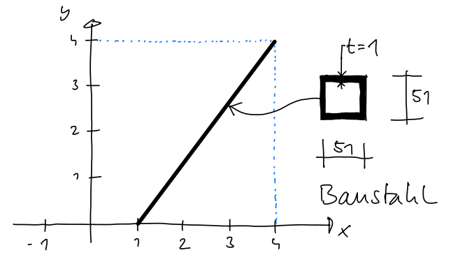

```{python}
#| label: setup
#| include: false
import numpy as np
```

::: {#exr-stabendkraefte}
## Stabendkräfte nach geometrisch exakter und vereinfachter Formulierung

Wir betrachten den dargestellten Fachwerkstab aus Baustahl ($E = \SI{210000}{\newton\per\milli\metre\squared}$) mit einem quadratischen Hohlprofil (Außenmaß 51 mm, Wandstärke 1 mm) und die beiden Verschiebungszustände
$$
  \mathbf{u}_1 = \mmat{0.1 \\ 0.05}, \quad
  \mathbf{u}_2 = \mmat{0.14 \\ 0.09}
  \qquad \text{und} \qquad
  \mathbf{v}_1 = \mmat{-1 \\ \phantom{-}0}, \quad
  \mathbf{v}_2 = \mmat{\phantom{-}1 \\ -4}.
$$
System und Verschiebungen sind in Metern angegeben, der Querschnitt in Millimetern.

{width="60%"}

Rechnen Sie im Notebook, Python dient dabei als Taschenrechner für Matrizen und Vektoren. Knoten und Verschiebungen sind dort bereits eingegeben.

```{python}
x1 = np.array([1.0, 0.0])
x2 = np.array([4.0, 4.0])

u1 = np.array([0.1, 0.05])
u2 = np.array([0.14, 0.09])
v1 = np.array([-1.0, 0.0])
v2 = np.array([1.0, -4.0])
```

### Geometrisch exakte Formulierung

Bestimmen Sie die Normalkraft $N$ und den Vektor der Stabendkräfte $\mathbf{P}$ für die Verschiebungen $\mathbf{u}_1, \mathbf{u}_2$ sowie $\mathbf{v}_1, \mathbf{v}_2$ nach der geometrisch exakten Formulierung.

::: {.lm-scaffold}
```{python}
# TODO
```
:::

::: {.lm-solution}
Dehnsteifigkeit in kN und Länge des unverformten Stabs in m

```{python}
A = 51**2 - 49**2
EA = 210000 * A * 1e-3
l0 = np.linalg.norm(x2 - x1)
print("EA =", EA)
print("l0 =", l0)
```

Verschiebungen $\mathbf{u}_1, \mathbf{u}_2$

```{python}
l = np.linalg.norm(x2 + u2 - (x1 + u1))
N = EA * (l - l0) / l0
d = (x2 + u2 - (x1 + u1)) / l
print("N =", N)
print("P =", N * np.concatenate((-d, d)))
```

Verschiebungen $\mathbf{v}_1, \mathbf{v}_2$

```{python}
l = np.linalg.norm(x2 + v2 - (x1 + v1))
N = EA * (l - l0) / l0
d = (x2 + v2 - (x1 + v1)) / l
print("N =", N)
print("P =", N * np.concatenate((-d, d)))
```

Der Stab hat nach der Verschiebung $\mathbf{v}_1, \mathbf{v}_2$ wieder die Länge $l = l_0 = 5$ m, er wird nur gedreht. Deshalb ist $N = 0$.
:::

### Elementsteifigkeitsmatrix

Stellen Sie die Elementsteifigkeitsmatrix $\mathbf{K}$ auf.

::: {.lm-scaffold}
```{python}
# TODO
```
:::

::: {.lm-solution}
```{python}
t0 = np.concatenate((x1 - x2, x2 - x1)) / l0
K = EA / l0 * np.outer(t0, t0)
print(K)
```
:::

### Formulierung für kleine Verformungen

Bestimmen Sie $N$ und $\mathbf{P}$ wie bei der geometrisch exakten Formulierung, jedoch mit der Formulierung für kleine Verformungen. Interpretieren Sie die Ergebnisse.

::: {.lm-scaffold}
```{python}
# TODO
```
:::

::: {.lm-solution}
Verschiebungen $\mathbf{u}_1, \mathbf{u}_2$

```{python}
u = np.concatenate((u1, u2))
print("N =", EA / l0 * np.dot(t0, u))
print("P =", K @ u)
```

Verschiebungen $\mathbf{v}_1, \mathbf{v}_2$

```{python}
v = np.concatenate((v1, v2))
print("N =", EA / l0 * np.dot(t0, v))
print("P =", K @ v)
```

Für die Verschiebungen $\mathbf{u}_1, \mathbf{u}_2$ unterscheiden sich die Ergebnisse kaum ($N = 470.5$ kN exakt, $N = 470.4$ kN linearisiert): Die Verschiebungen sind klein gegenüber der Stablänge. Die Verschiebungen $\mathbf{v}_1, \mathbf{v}_2$ drehen den Stab dagegen, ohne seine Länge zu ändern. Exakt ist deshalb $N = 0$, die Formulierung für kleine Verformungen liefert aber $N = -16800$ kN, weil sie nur die Projektion der Verschiebungen auf die unverformte Stabachse berücksichtigt. Für so große Verschiebungen ist die Vereinfachung nicht zulässig.
:::

::: {.callout-tip title="Tipps für Python"}
- Den Betrag eines Vektors berechnen Sie mit `np.linalg.norm`.
- Zwei Vektoren hängen Sie mit `np.concatenate((a, b))` aneinander.
- Das Produkt $\mathbf{a}\mathbf{b}\mtran$ zweier Spaltenvektoren berechnen Sie mit `np.outer(a, b)`, das Skalarprodukt mit `np.dot(a, b)`, Matrix mal Vektor mit `K @ u`.
:::
:::
