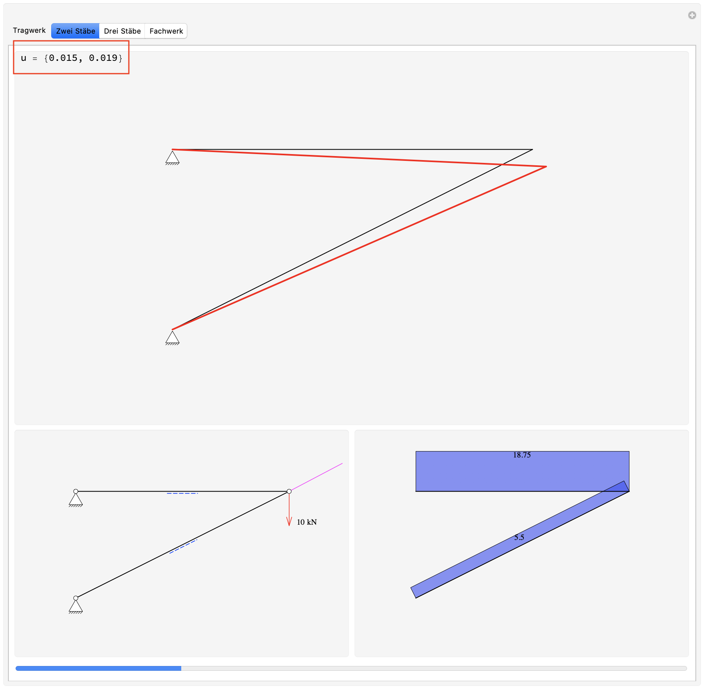
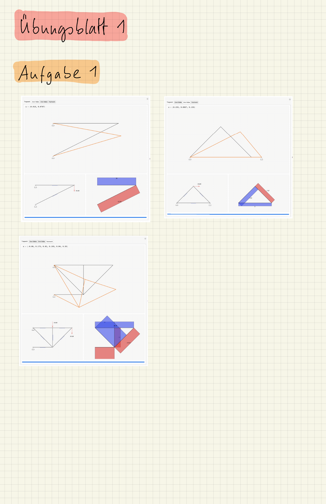

::: {#exr-grundidee}
## Grundidee der direkten Steifigkeitsmethode

Installieren Sie den kostenlosen [Wolfram Player](https://www.wolfram.com/player/) und laden Sie die [Demo zur direkten Steifigkeitsmethode](${site}/aufgaben/c/displacement-game.zip) herunter. Bestimmen Sie für das System mit zwei Stäben durch Verschieben des freien Knotens den Verschiebungsvektor $\mathbf{u}$, für den der Knoten im Gleichgewicht steht.

Zusätzlich: Probieren Sie das auch für die beiden anderen Systeme.

{width="50%"}

::: {.tinh-solution}
{width="60%"}
:::
:::
