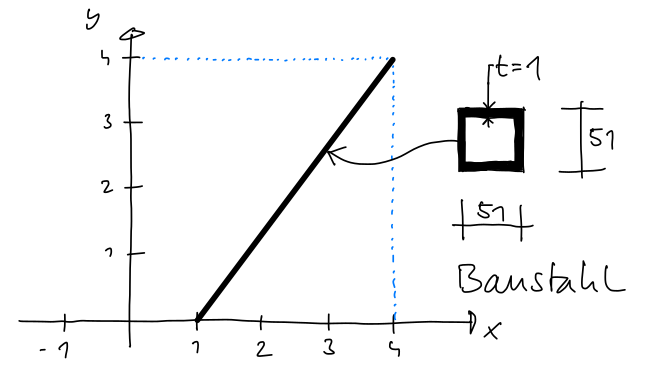
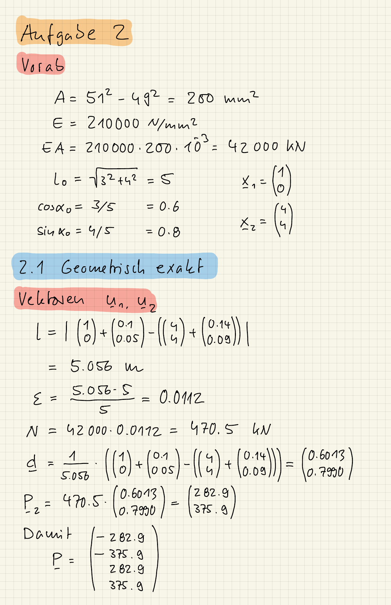
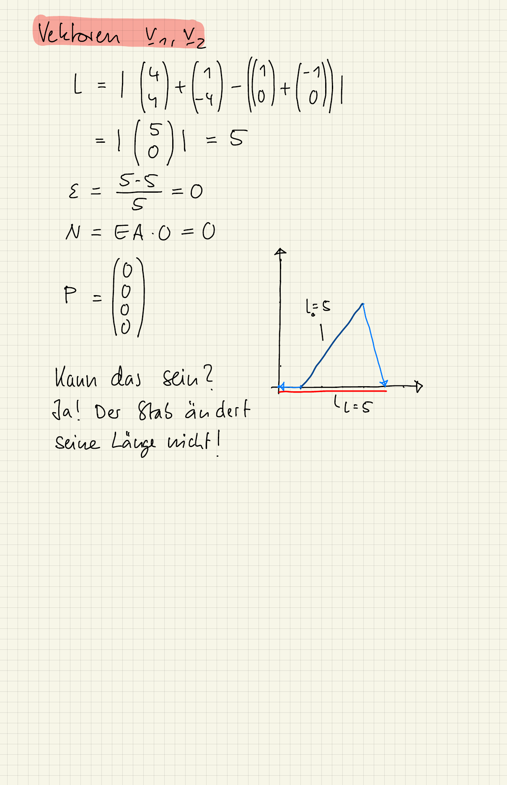
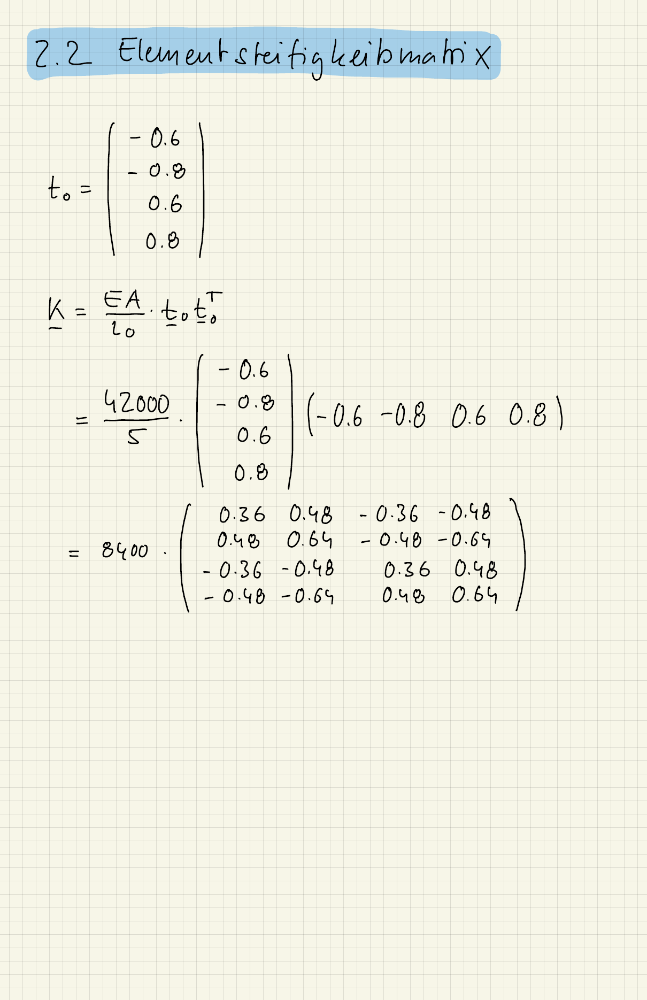
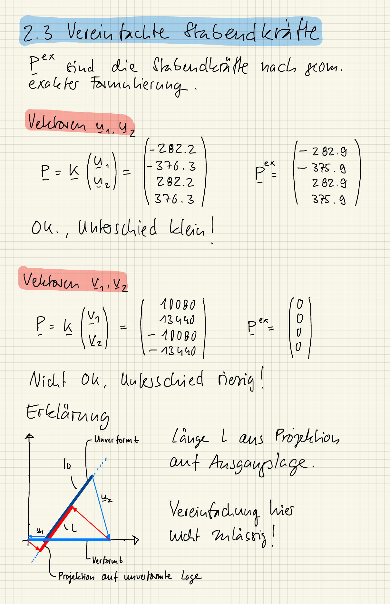

::: {#exr-stabendkraefte}
## Stabendkräfte nach geometrisch exakter und vereinfachter Formulierung

Wir betrachten den dargestellten Fachwerkstab aus Baustahl ($E = \SI{210000}{\newton\per\milli\metre\squared}$) mit einem quadratischen Hohlprofil (Außenmaß 51 mm, Wandstärke 1 mm) und die beiden Verschiebungszustände
$$
  \mathbf{u}_1 = \mmat{0.1 \\ 0.05}, \quad
  \mathbf{u}_2 = \mmat{0.14 \\ 0.09}
  \qquad \text{und} \qquad
  \mathbf{v}_1 = \mmat{-1 \\ \phantom{-}0}, \quad
  \mathbf{v}_2 = \mmat{\phantom{-}1 \\ -4}.
$$
System und Verschiebungen sind in Metern angegeben, der Querschnitt in Millimetern.

{width="60%"}

1. Bestimmen Sie die Normalkraft $N$ und den Vektor der Stabendkräfte $\mathbf{P}$ für die Verschiebungen $\mathbf{u}_1, \mathbf{u}_2$ sowie $\mathbf{v}_1, \mathbf{v}_2$ nach der geometrisch exakten Formulierung.

1. Stellen Sie die Elementsteifigkeitsmatrix $\mathbf{K}$ auf.

1. Bestimmen Sie $N$ und $\mathbf{P}$ wie im ersten Punkt, jedoch mit der Formulierung für kleine Verformungen. Interpretieren Sie die Ergebnisse.

Die Rechnung soll auf dem Papier erfolgen, Sie dürfen aber Python als Taschenrechner für Matrizen und Vektoren verwenden.

::: {.tinh-solution}
{width="60%"}

{width="60%"}

{width="60%"}

{width="60%"}

**Zu Punkt 3 (Interpretation)**

Für die Verschiebungen $\mathbf{u}_1, \mathbf{u}_2$ unterscheiden sich die Ergebnisse kaum ($N = 470.5$ kN exakt, $N = 470.4$ kN linearisiert): Die Verschiebungen sind klein gegenüber der Stablänge. Die Verschiebungen $\mathbf{v}_1, \mathbf{v}_2$ drehen den Stab dagegen, ohne seine Länge zu ändern. Exakt ist deshalb $N = 0$, die Formulierung für kleine Verformungen liefert aber $N = -16800$ kN, weil sie nur die Projektion der Verschiebungen auf die unverformte Stabachse berücksichtigt. Für so große Verschiebungen ist die Vereinfachung nicht zulässig.
:::
:::
