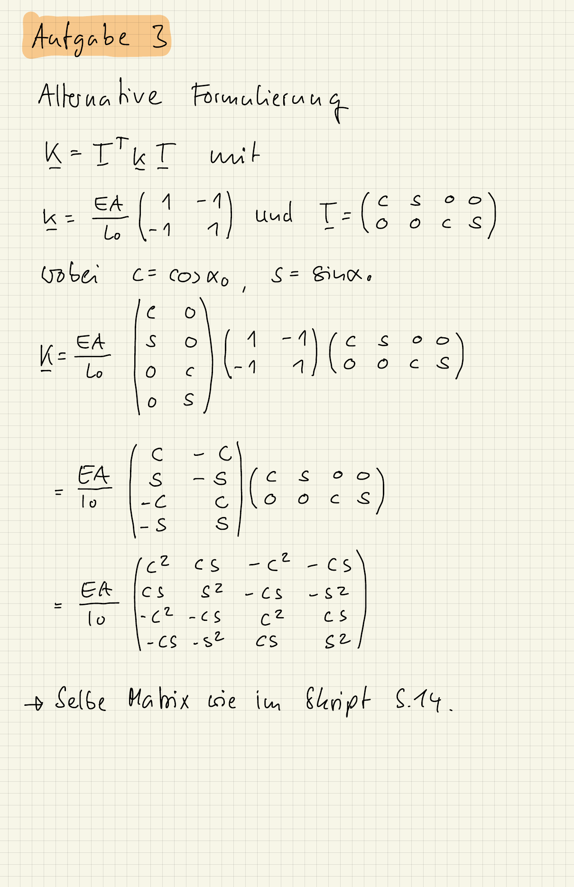

::: {#exr-alternative-herleitung}
## Alternative Herleitung der Elementsteifigkeitsmatrix (freiwillig)

In vielen Büchern zur Methode der finiten Elemente[^link] finden Sie für den Fachwerkstab die Elementsteifigkeitsmatrix
$$
  \mathbf{K} = \mathbf{T}\mtran \mathbf{k} \mathbf{T}
  \quad \text{mit} \quad
  \mathbf{k} = \frac{EA}{l_0}\mmat{\phantom{-}1 & -1 \\ -1 & \phantom{-}1}
  \quad \text{und} \quad
  \mathbf{T}
  =
  \mmat{
    \cos\alpha_0 & \sin\alpha_0 & 0 & 0 \\
    0 & 0 & \cos\alpha_0 & \sin\alpha_0
  },
$$
wobei $\mathbf{k}$ eine "lokale" Elementsteifigkeitsmatrix ist und $\mathbf{T}$ die Transformationsmatrix zwischen lokalen und globalen Koordinaten.

Zeigen Sie, dass diese Formulierung äquivalent zur Elementsteifigkeitsmatrix aus dem Skript ist.

[^link]: Ein Beispiel ist das Buch *Finite Elemente in der Statik und Dynamik* von M. Link, siehe Gleichung (2.4b) auf Seite 4.

::: {.tinh-solution}
{width="60%"}
:::
:::
