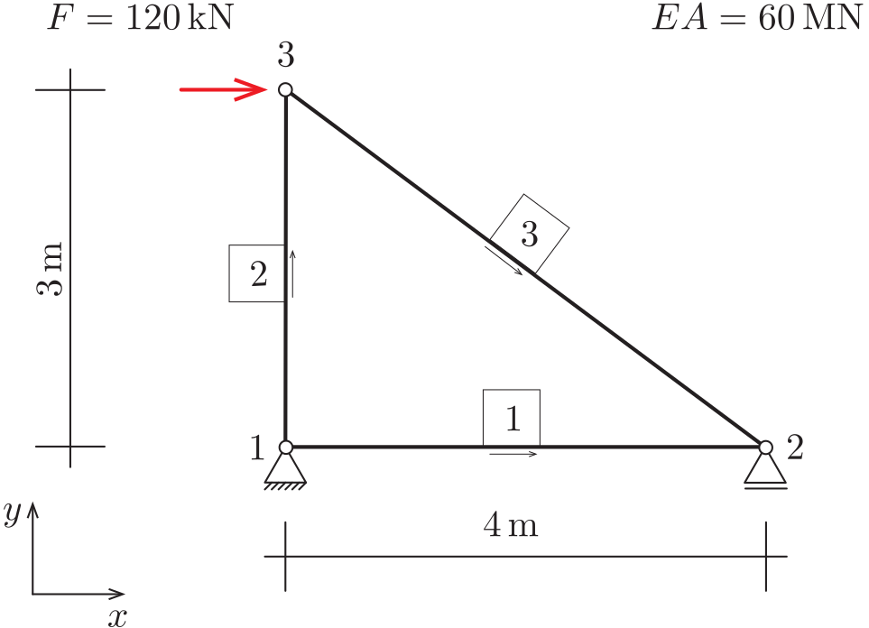
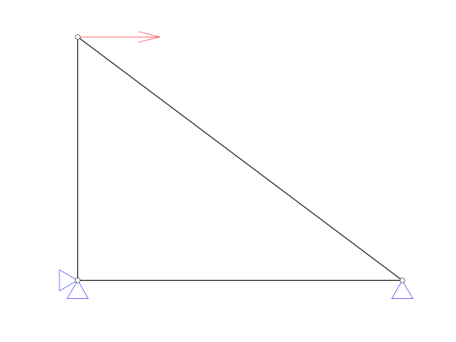
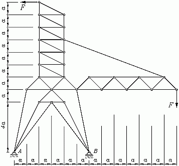
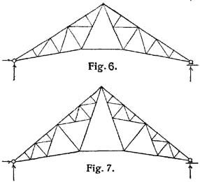
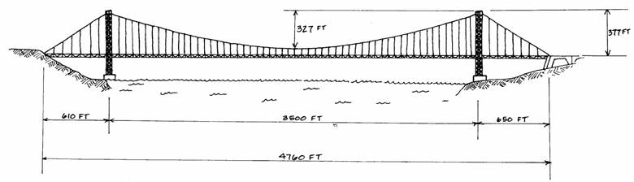

::: {#exr-erzeugung-und-darstellung}
## Erzeugung und Darstellung von Stabtragwerken

Wir halten zunächst fest, welche Informationen zur Beschreibung eines Stabtragwerks notwendig sind. Hierzu betrachten wir das dargestellte einfache System.

{width="40%"}

Um dieses System zu beschreiben, benötigen wir:

- Koordinaten der Knoten.
- Die Knotennummern der einzelnen Stäbe.
- Auflagerbedingungen in horizontaler und vertikaler Richtung.
- Auf die Knoten einwirkende Kräfte.
- Dehnsteifigkeit $EA$.

Zunächst verwenden wir für alle Stäbe eine einheitliche Dehnsteifigkeit, später lässt sich das einfach erweitern. Beachten Sie, dass Python ab 0 zählt: Der Knoten 1 aus der Abbildung hat in Python den Index 0.

Das Tragwerk erzeugen wir in einer Funktion, die in einer eigenen Datei abgelegt werden soll, das erleichtert später die Arbeit. In der Funktion wird eine Variable `s` verwendet, in der die verschiedenen Eigenschaften des Systems ($EA$, Knoten, Stäbe etc.) abgelegt werden. Der Zugriff auf die Eigenschaften erfolgt mit dem Punkt-Operator, zum Beispiel greift man mit `s.nodes` auf die Knoten des Systems zu.

```{.python}
import numpy as np
from objdict import ObjDict


def simple_example():
    """Fachwerk aus drei Stäben (Rechenbeispiel im Skript)"""
    s = ObjDict()
    s.EA = 60000
    s.nodes = np.array(
        [[0, 4, 0],
         [0, 0, 3]])
    s.elements = np.array(
        [[0, 0, 2],
         [1, 2, 1]])
    s.forces = np.zeros((2, 3))
    s.forces[0, 2] = 120
    s.supports = np.full((2, 3), False)
    s.supports[:, 0] = True
    s.supports[1, 1] = True
    return s


def girder(l=40, h1=2, h2=7, nn=11):
    """Fachwerkträger mit parabelförmigem Obergurt"""
    s = ObjDict()

    # Anzahl Knoten je Seite (ohne Mitte)
    ns = (nn - 1) // 2

    # Dehnsteifigkeit
    s.EA = 60000

    # Knoten
    x = np.linspace(-l / 2, l / 2, nn)
    y1 = 0 * x
    y2 = h2 - (h2 - h1) / (l / 2) ** 2 * x**2
    s.nodes = np.array([np.concatenate([x, x]), np.concatenate([y1, y2])])

    # Stäbe: Untergurt, Obergurt, Pfosten, Diagonalen links und rechts
    ne1 = []
    ne2 = []
    ne1 += range(0, nn - 1)
    ne2 += range(1, nn)
    ne1 += range(nn, 2 * nn - 1)
    ne2 += range(nn + 1, 2 * nn)
    ne1 += range(0, nn)
    ne2 += range(nn, 2 * nn)
    ne1 += range(nn, nn + ns)
    ne2 += range(1, 1 + ns)
    ne1 += range(ns, nn - 1)
    ne2 += range(nn + ns + 1, 2 * nn)
    s.elements = np.array([ne1, ne2])

    # Kräfte
    s.forces = np.zeros([2, 2 * nn])
    s.forces[1, 1:nn - 1] = -10

    # Auflager
    s.supports = np.full([2, 2 * nn], False)
    s.supports[:, 0] = True
    s.supports[1, nn - 1] = True

    return s
```

### Stabtragwerk erzeugen

1. Erzeugen Sie die Datei `src/structures.py` und fügen Sie den Code oben ein.

1. Erzeugen Sie im Notebook die beiden Tragwerke.

### Hilfsfunktion für die Größe des Systems

Erstellen Sie eine Funktion `struct_size(s)` (später in `src/truss.py`), mit der ein Maß für die Abmessungen des Tragwerks ermittelt wird. Sie benötigen das später zum Beispiel für das Zeichnen der Kräfte und Auflager. Eine gute Möglichkeit besteht darin, das geometrische Mittel von Breite und Höhe des Systems zu verwenden, also
$$
  s = \sqrt{(x_{\max} - x_{\min}) \cdot (y_{\max} - y_{\min})}.
$$
Bei einem flachen System, zum Beispiel einem einzelnen horizontalen Stab, ist das Produkt null. Verwenden Sie dann die größere der beiden Abmessungen.

### Stabtragwerk graphisch darstellen

Zeichnen Sie das Stabtragwerk, zum Beispiel so:

{width="40%"}

Es bietet sich an, den Code zunächst einfach in das Notebook zu schreiben und am Schluss in eine Funktion `draw_system(s)` in `src/truss.py` zu verschieben. Gehen Sie in den folgenden Schritten vor:

1. Knoten

1. Stäbe

1. Kräfte

1. Auflager

### Anwendungsbeispiel

Erstellen Sie das Modell einer interessanten ebenen Fachwerkstruktur, für die Sie später Verformungen und Schnittgrößen berechnen möchten. Beachten Sie, dass es mit einer Programmiersprache möglich ist, regelmäßige Tragwerke mit nur wenigen Anweisungen zu erzeugen, selbst wenn diese viele Knoten und Stäbe besitzen. Hier ein paar Bilder zur Anregung:

{width="30%"} {width="60%"}

{width="60%"}

::: {.tinh-solution}
Lösung im Lösungs-Notebook.
:::
:::
