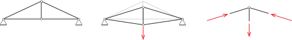
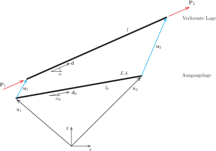
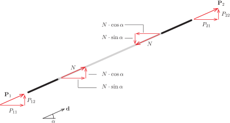
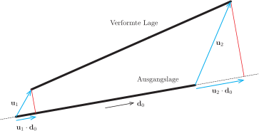

# Fachwerke: Stabendkräfte

Für die Herleitung numerischer Verfahren für Stabtragwerke gibt es eine Reihe verschiedener Zugänge. Die wichtigsten sind:

- Stabendkräfte und Gleichgewicht an Knoten (direkte Steifigkeitsmethode).

- Prinzip vom Minimum der potentiellen Energie (Ritz-Verfahren).

- Differentialgleichung in variationeller Formulierung (Galerkin-Verfahren).

Alle Varianten führen auf exakt dieselben Gleichungen und man kann auch zeigen, dass dies so sein muss. Dabei hat die direkte Steifigkeitsmethode den Vorteil, recht anschaulich zu sein, die beiden anderen Ansätze sind allgemeiner anwendbar, allerdings auch deutlich abstrakter. Wir werden daher die direkte Steifigkeitsmethode verwenden.

## Grundidee des Verfahrens

Die [direkte Steifigkeitsmethode]{.neuerbegriff} für Fachwerke beruht auf folgenden Überlegungen:

1. Das Fachwerk verformt sich unter der Belastung.

1. Durch die Verformung ändern die Stäbe ihre Länge.

1. Die Längenänderung ruft Normalkräfte in den Stäben hervor.

1. Die Verformung stellt sich genau so ein, dass jeder freigeschnittene Knoten im Gleichgewicht steht.

{#fig-dsm-idee}

Um die direkte Steifigkeitsmethode umzusetzen, gehen wir in zwei Schritten vor: Zunächst bestimmen wir für einen einzelnen Stab zu einer gegebenen Verformung die Stabendkräfte. Anschließend überlegen wir uns, wie man aus dem Kräftegleichgewicht an jedem Knoten die Verschiebungen des Systems bestimmen kann.

## Stabendkräfte

Wir bestimmen nun für einen Stab die Stabendkräfte, die von einer gegebenen Verformung hervorgerufen werden. Die betrachtete Situation ist in @fig-fachwerkstab dargestellt. Zunächst fassen wir die verwendeten Größen zusammen.

{#fig-fachwerkstab}

#### Definitionen

Der Fachwerkstab besitzt den E-Modul $E$ und die Querschnittsfläche $A$, die wir in der Größe $EA$ zusammenfassen. In der unverformten Ausgangslage sind die Ortsvektoren von Anfangs- und Endpunkt des Stabes durch
$$
  \mathbf{x}_1 = \mmat{x_{11} \\ x_{12}}
  \quad\text{und}\quad
  \mathbf{x}_2 = \mmat{x_{21} \\ x_{22}}
$$
gegeben. Die zugehörige Länge bezeichnen wir mit $l_0$, wobei
$$
  l_0
  =
  |\mathbf{x}_2 - \mathbf{x}_1|
  =
  \sqrt{(x_{21}-x_{11})^2 + (x_{22}-x_{12})^2}.
$$
Weiterhin definieren wir den Einheitsvektor
$$
  \mathbf{d}_0 = \frac{1}{l_0}(\mathbf{x}_2 - \mathbf{x}_1)
  =
  \mmat{\cos \alpha_0 \\ \sin \alpha_0}
  \quad\text{mit}\quad
  |\mathbf{d}_0| = 1,
$$
der vom Anfangspunkt des Stabes in Richtung der Stabachse zeigt.

Die Endpunkte des Stabes werden nun um die Verschiebungsvektoren
$$
  \mathbf{u}_1 = \mmat{u_{11} \\ u_{12}}
  \quad\text{und}\quad
  \mathbf{u}_2 = \mmat{u_{21} \\ u_{22}}
$$
aus ihrer spannungsfreien Ausgangslage bewegt. Die Länge des verformten Fachwerkstabes beträgt
$$
  l
  =
  |\mathbf{x}_2 + \mathbf{u}_2 - (\mathbf{x}_1 + \mathbf{u}_1)|
  =
  \sqrt{(x_{21}+u_{21}-(x_{11}+u_{11}))^2 + (x_{22}+u_{22}-(x_{12}+u_{12}))^2},
$$
der Einheitsvektor
$$
  \mathbf{d}
  =
  \frac{1}{l}(\mathbf{x}_2 + \mathbf{u}_2 - (\mathbf{x}_1 + \mathbf{u}_1))
  =
  \mmat{\cos \alpha \\ \sin \alpha}
  \quad\text{mit}\quad
  |\mathbf{d}| = 1
$$
zeigt in Richtung der ausgelenkten Stabachse.

Die durch die Verschiebung erzwungene Längenänderung des Stabes ruft eine Normalkraft $N$ hervor, die an den Stabenden aufgebracht werden muss. Die zugehörigen Kräfte sind
$$
  \mathbf{P}_1 = \mmat{P_{11} \\ P_{12}}
  \quad\text{und}\quad
  \mathbf{P}_2 = \mmat{P_{21} \\ P_{22}},
$$
wobei es sich als vorteilhaft erweisen wird, diese in Richtung der Stabachse positiv zu definieren. Diese Vereinbarung wird manchmal auch als Schnittgrößenkonvention II bezeichnet. Da keine weiteren Kräfte am Stab angreifen, gilt immer $\mathbf{P}_1 = - \mathbf{P}_2$.

Für die direkte Steifigkeitsmethode benötigen wir für einen Stab mit den Eigenschaften $EA$ sowie $\mathbf{x}_1, \mathbf{x}_2$ den funktionalen Zusammenhang zwischen den Verschiebungen $\mathbf{u}_1, \mathbf{u}_2$ und den Stabendkräften $\mathbf{P}_1, \mathbf{P}_2$. Um zu einer möglichst einfachen Schreibweise zu gelangen, fassen wir Verschiebungen und Stabendkräfte in jeweils einem Vektor zusammen und stellen uns die Frage: Wie können wir für den Verschiebungsvektor
$$
  \mathbf{u} = \mmat{\mathbf{u}_1 \\ \mathbf{u}_2} = \mmat{u_{11} \\ u_{12} \\ u_{21} \\ u_{22}}
$$
den zugehörigen Vektor der Stabendkräfte
$$
  \mathbf{P} = \mmat{\mathbf{P}_1 \\ \mathbf{P}_2} = \mmat{P_{11} \\ P_{12} \\ P_{21} \\ P_{22}}
$$
berechnen? Aus mathematischer Sicht geht es also um eine Abbildung, die einem Verschiebungsvektor $\mathbf{u} \in \R^4$ einen Vektor der Stabendkräfte $\mathbf{P} \in \R^4$ zuordnet. Wir schreiben hierfür (etwas salopp)
$$
  \mathbf{P} = \mathbf{P}(\mathbf{u})
$$
und verstehen unter $\mathbf{P}$ je nach Zusammenhang entweder den Vektor der Stabendkräfte oder die Abbildung, die zu einem gegebenen Verschiebungsvektor die Stabendkräfte liefert.

Diese Abbildung bestimmen wir nun zunächst geometrisch exakt und werden dann eine vereinfachte lineare Beziehung für kleine Verformungen herleiten.

### Geometrisch exakte Formulierung

Wenn wir einen Stab in die Länge ziehen oder zusammendrücken, ruft dies in dem Stab eine Normalkraft $N$ hervor. Dabei ist anschaulich klar, dass für eine gegebene Längenänderung $\Delta l$ die Normalkraft $N$ abhängt von

- der Querschnittsfläche $A$ (je dicker der Stab, umso größer $N$),

- dem Material (je größer der Elastizitätsmodul $E$, umso größer $N$),

- der Länge des Stabes $l_0$ (je größer, umso kleiner wird $N$).

Dabei bezeichnen wir die auf die Ausgangslänge bezogene Längenänderung als [Verzerrung]{.neuerbegriff} oder Dehnung
$$
  \varepsilon = \frac{\Delta l}{l_0} = \frac{l - l_0}{l_0}
$$
und erhalten die Normalkraft
$$
  N = EA \cdot \varepsilon = EA \frac{l - l_0}{l_0}.
$$
Zur Bestimmung der (vektoriellen) Stabendkräfte $\mathbf{P}_1$ und $\mathbf{P}_2$ schneiden wir die Stabenden frei und bringen die Normalkraft $N$ auf, siehe @fig-stabendkraefte. Aus dem Kräftegleichgewicht erhalten wir sofort
$$
  \mathbf{P}_1 = -N \cdot \mmat{\cos\alpha \\ \sin\alpha} = -N \cdot \mathbf{d}
  \quad\text{und}\quad
  \mathbf{P}_2 =  N \cdot \mmat{\cos\alpha \\ \sin\alpha} = N \cdot \mathbf{d}.
$$
Dieses Ergebnis fassen wir im Vektor der Stabendkräfte
$$
  \mathbf{P}
  =
  \mmat{\mathbf{P}_1 \\ \mathbf{P}_2}
  =
  N \cdot \mmat{-\mathbf{d} \\ \phantom{-}\mathbf{d}}
  =
  N \cdot \mmat{-\cos\alpha \\ -\sin\alpha \\ \phantom{-}\cos\alpha \\ \phantom{-}\sin\alpha}
$$
zusammen. Den Vektor
$$
  \mathbf{t}
  =
  \mmat{-\mathbf{d} \\ \phantom{-}\mathbf{d}}
  =
  \mmat{
    -\cos\alpha \\ -\sin\alpha \\
    \phantom{-}\cos\alpha \\ \phantom{-}\sin\alpha
  }
$$
bezeichnen wir als [Transformationsvektor]{.neuerbegriff}. Damit können wir die gesuchte Beziehung für die Stabendkräfte in der Form
$$
  \mathbf{P} = N \cdot \mathbf{t} = EA \frac{l - l_0}{l_0} \cdot \mathbf{t}
$$ {#eq-p-exakt}
aufschreiben.

{#fig-stabendkraefte}

Die Formulierung in @eq-p-exakt ist kompakt und in der Herleitung anschaulich. Allerdings hängen sowohl die Länge $l$ als auch der Transformationsvektor $\mathbf{t}$ nichtlinear von den Verschiebungen ab. Um einen Gleichgewichtszustand für das Gesamtsystem zu finden, müsste also ein nichtlineares Gleichungssystem gelöst werden. Das ist im Prinzip kein Problem, bringt allerdings doch eine Reihe von Schwierigkeiten mit sich. Diese lassen sich umgehen, wenn man berücksichtigt, dass im Bauwesen die Verformungen in der Regel klein sind und die Rechnung sich entsprechend vereinfachen lässt.

### Formulierung für kleine Verformungen

Wenn die Verformungen klein sind, dann sind die folgenden beiden Vereinfachungen gerechtfertigt:

1. Die Normalkraft $N$ hängt nichtlinear von den Verschiebungen ab. Wir ersetzen diesen nichtlinearen Zusammenhang durch ein Taylorpolynom ersten Grades. Man spricht hier von einer [Linearisierung]{.neuerbegriff} der Beziehung zwischen Verformungen und Normalkraft.

1. Das Gleichgewicht formulieren wir am unverformten System. Statt $\mathbf{d}$ setzen wir $\mathbf{d}_0$ ein. Das ist naheliegend und unkompliziert.

Gerechtfertigt heißt hier, dass die Abweichungen gegenüber der genaueren nichtlinearen Lösung klein sind.

#### 1. Linearisierung

Dies ist wahrscheinlich der schwierigste Schritt der gesamten Herleitung. Sie alle kennen das Taylorpolynom ersten Grades zu einer Funktion $f : \R \to \R$ am Entwicklungspunkt $x_0$, nämlich
$$
  T(x) = f(x_0) + f'(x_0)(x - x_0),
$$
dies ist genau die Gleichung der Tangente. Die Verallgemeinerung für eine Funktion $f : \R^2 \to \R$ von zwei Variablen ist die Tangentialebene mit der Funktionsgleichung
$$
  T(x, y)
  =
  f(x_0, y_0)
  +
  \frac{\partial f(x_0, y_0)}{\partial x}(x - x_0)
  +
  \frac{\partial f(x_0, y_0)}{\partial y}(y - y_0)
$$
zur Stelle $(x_0, y_0)$.

Wir übertragen diesen Gedanken auf die näherungsweise Berechnung der Normalkraft für kleine Verformungen. Zunächst einmal halten wir fest, dass die Normalkraft $N$ von den vier Verschiebungen $u_{11}, u_{12}, u_{21}, u_{22}$ abhängt, wir schreiben dafür wieder $N = N(u_{11}, u_{12}, u_{21}, u_{22})$. Ausgehend von der unverformten Lage mit $u_{11} = u_{12} = u_{21} = u_{22} = 0$ erhalten wir für die Normalkraft die verallgemeinerte Tangentialebene
$$
  \begin{aligned}
    N_{\text{lin}}(u_{11}, u_{12}, u_{21}, u_{22})
    =
    N(0,0,0,0)
    & +
    \frac{\partial N(0,0,0,0)}{\partial u_{11}}u_{11}
    +
    \frac{\partial N(0,0,0,0)}{\partial u_{12}}u_{12}
    \\[1ex]
    & +
    \frac{\partial N(0,0,0,0)}{\partial u_{21}}u_{21}
    +
    \frac{\partial N(0,0,0,0)}{\partial u_{22}}u_{22}.
  \end{aligned}
$$
Die partielle Ableitung der Normalkraft nach einer Verschiebungskomponente ist
$$
  \frac{\partial N(u_{11}, u_{12}, u_{21}, u_{22})}{\partial u_{ij}}
  =
  \frac{\partial}{\partial u_{ij}}
  \left(
    EA\frac{l(u_{11}, u_{12}, u_{21}, u_{22}) - l_0}{l_0}
  \right)
  =
  \frac{EA}{l_0}
  \cdot
  \frac{\partial l(u_{11}, u_{12}, u_{21}, u_{22})}{\partial u_{ij}},
$$
wobei verwendet wurde, dass nur die Länge des verformten Stabes von den Verschiebungen abhängt. Die partielle Ableitung der Länge $l$ nach der Verschiebungskomponente $u_{11}$ lautet
$$
  \begin{aligned}
    \frac{\partial l(u_{11}, u_{12}, u_{21}, u_{22})}{\partial u_{11}}
    & =
    \frac{\partial}{\partial u_{11}}
    \sqrt{(x_{21}+u_{21}-(x_{11}+u_{11}))^2 + (x_{22}+u_{22}-(x_{12}+u_{12}))^2}
    \\[1em]
    & =
    \frac
    {-(x_{21}+u_{21}-(x_{11}+u_{11}))}
    {\sqrt{(x_{21}+u_{21}-(x_{11}+u_{11}))^2 + (x_{22}+u_{22}-(x_{12}+u_{12}))^2}}.
  \end{aligned}
$$
Damit gilt
$$
  \frac{\partial l(0, 0, 0, 0)}{\partial u_{11}} =
  \frac
  {-(x_{21}-x_{11})}
  {\sqrt{(x_{21}-x_{11})^2 + (x_{22}-x_{12})^2}}
  =
  -\cos\alpha_0,
$$
ein dann doch wieder beruhigend einfaches Ergebnis. Auf dieselbe Art und Weise erhalten wir weiterhin
$$
  \frac{\partial l(0, 0, 0, 0)}{\partial u_{12}} = -\sin\alpha_0, \quad
  \frac{\partial l(0, 0, 0, 0)}{\partial u_{21}} = \cos\alpha_0
  \quad\text{und}\quad
  \frac{\partial l(0, 0, 0, 0)}{\partial u_{22}} = \sin\alpha_0.
$$
Für die linearisierte Normalkraft ergibt sich schließlich der Zusammenhang
$$
  N_{\text{lin}}
  =
  \frac{EA}{l_0}
  \bigl(
  -(\cos\alpha_0 u_{11} + \sin\alpha_0 u_{12})
  +
  \cos\alpha_0 u_{21} + \sin\alpha_0 u_{22}
  \bigr)
  =
  \frac{EA}{l_0} (\mathbf{u}_2 - \mathbf{u}_1) \cdot \mathbf{d}_0.
$$
Diese Darstellung der linearisierten Normalkraft besitzt eine anschauliche Interpretation (@fig-n-linear): Es wird nur die Projektion der Verschiebungsvektoren auf die Stabachse betrachtet, die Verschiebung quer zur Stabachse spielt keine Rolle.

{#fig-n-linear}

Zur Bestimmung des Vektors der Stabendkräfte $\mathbf{P}$ schreiben wir die linearisierte Normalkraft nochmals um zu
$$
  N_{\text{lin}}
  =
  \frac{EA}{l_0}
  \mmat{-\cos\alpha_0 & -\sin\alpha_0 & \cos\alpha_0 & \sin\alpha_0}
  \mmat{u_{11} \\ u_{12} \\ u_{21} \\ u_{22}}
  =
  \frac{EA}{l_0}
  \mathbf{t}_0\mtran \mathbf{u}.
$$
Dabei ist
$$
  \mathbf{t}_0
  =
  \mmat{-\mathbf{d}_0 \\ \phantom{-}\mathbf{d}_0}
  =
  \mmat{
    -\cos\alpha_0 \\ -\sin\alpha_0 \\
    \phantom{-}\cos\alpha_0 \\ \phantom{-}\sin\alpha_0
  }
$$
der Transformationsvektor des unverformten Stabes.

#### 2. Gleichgewicht am unverformten System

Für die Ermittlung der Stabendkräfte $\mathbf{P}_1$ und $\mathbf{P}_2$ setzen wir nun statt des Winkels $\alpha$ den Winkel $\alpha_0$ der unverformten Achse ein. Zusammen mit der linearisierten Normalkraft erhalten wir den vereinfachten Zusammenhang
$$
  \mathbf{P}_{\text{lin}}
  =
  N_{\text{lin}}
  \cdot
  \mathbf{t}_0
  =
  \mathbf{t}_0
  \cdot
  N_{\text{lin}}
  =
  \frac{EA}{l_0}\mathbf{t}_0\mathbf{t}_0\mtran
  \mathbf{u}.
$$
Vor dem Vektor $\mathbf{u}$ steht das Produkt eines Spaltenvektors mit einem Zeilenvektor, das heißt eine Matrix mit vier Zeilen und vier Spalten. Multipliziert mit der Dehnsteifigkeit ist das die [Elementsteifigkeitsmatrix]{.neuerbegriff}
$$
  \begin{aligned}
    \mathbf{K}
    & =
    \frac{EA}{l_0}\mathbf{t}_0\mathbf{t}_0\mtran
    \\[1em]
    & =
    \frac{EA}{l_0}
    \mmat{-\cos\alpha_0 \\ -\sin\alpha_0 \\ \phantom{-}\cos\alpha_0 \\ \phantom{-}\sin\alpha_0}
    \mmat{-\cos\alpha_0 & -\sin\alpha_0 & \cos\alpha_0 & \sin\alpha_0}
    \\[1em]
    & =
    \frac{EA}{l_0}
    \mmat{
      \phantom{-}c^2 & \phantom{-}c s & -c^2 & -c s \\[1ex]
      \phantom{-}c s & \phantom{-}s^2 & -c s & -s^2 \\[1ex]
      -c^2 & -c s & \phantom{-}c^2 & \phantom{-}c s \\[1ex]
      -c s & -s^2 & \phantom{-}c s & \phantom{-}s^2
    },
  \end{aligned}
$$ {#eq-elementsteifigkeitsmatrix}
wobei $c = \cos\alpha_0$ und $s = \sin\alpha_0$ gelten soll. Mit der Elementsteifigkeitsmatrix lautet der linearisierte Zusammenhang zwischen Verformungen und Stabendkräften
$$
  \mathbf{P}_{\text{lin}} = \mathbf{K} \mathbf{u}.
$$ {#eq-p-lin}
Gegenüber der nichtlinearen Beziehung in @eq-p-exakt stellt dieser lineare Zusammenhang eine erhebliche Vereinfachung dar.
