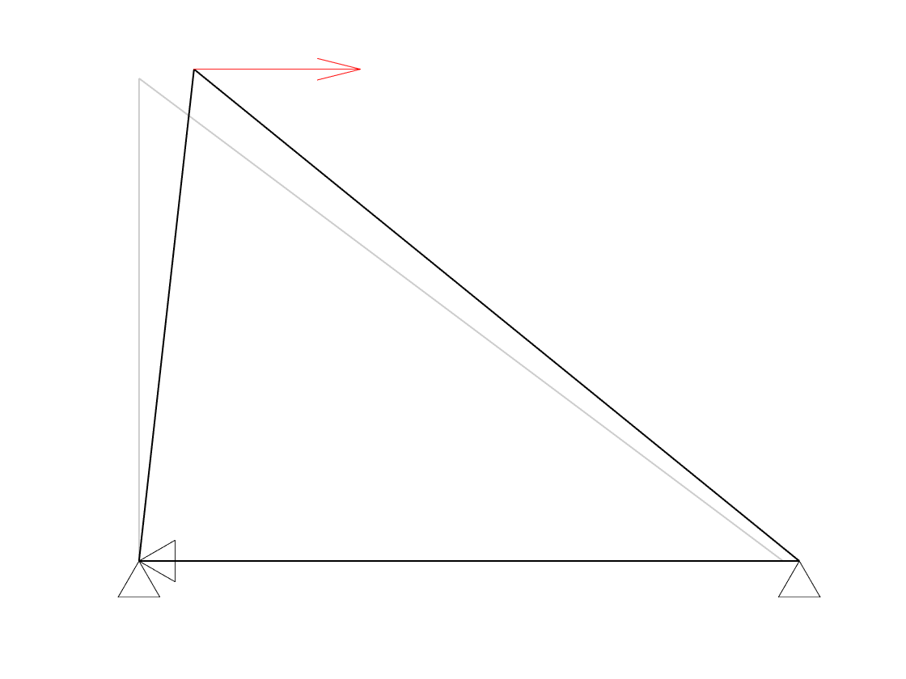
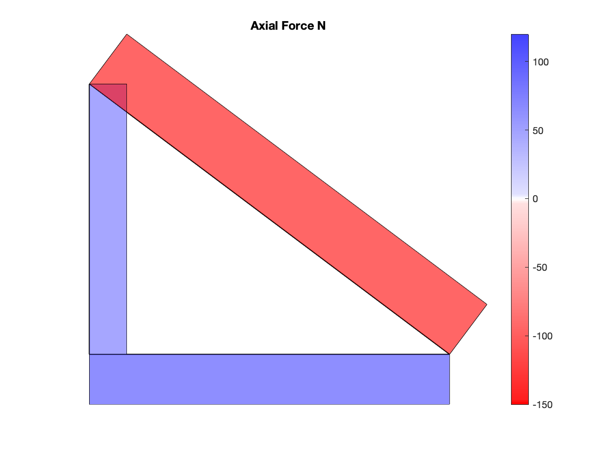
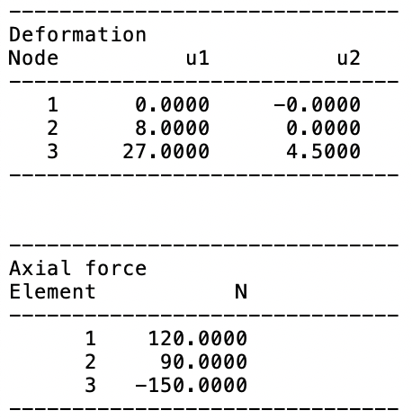

::: {#exr-darstellung}
## Darstellung der Berechnungsergebnisse

Die folgenden Abbildungen zeigen verschiedene Möglichkeiten, die berechneten Ergebnisse darzustellen. Sie sollen als Anregung dienen, Ihre eigenen Ergebnisse können (müssen aber nicht) auch anders dargestellt werden.

{width="34%"} {width="34%"} {width="25%"}

### Verformung

Erstellen Sie eine Funktion `draw_deformation(s, scale)` zum Plotten des verformten Systems. Mit `scale` werden die Verschiebungen vergrößert, damit sie sichtbar sind.

### Normalkräfte

Implementieren Sie eine Funktion `draw_member_forces(s, scale)`, mit der die Normalkräfte dargestellt werden können.

Tipp: Sie können den Vektor $\mathbf{d}_0$ um 90° drehen, mit der Normalkraft und einem geeigneten Faktor skalieren und zu den Knotenkoordinaten eines Stabes addieren. Flächen zeichnen Sie mit `Polygon` aus `matplotlib.patches`, man könnte aber auch Linien verwenden wie in RSTAB.

### Ausgabe der Berechnungsergebnisse

Geben Sie die berechneten Verschiebungen und Normalkräfte in einer Funktion `print_results(s)` als Tabellen aus.

::: {.tinh-solution}
Lösung im Lösungs-Notebook.
:::
:::
