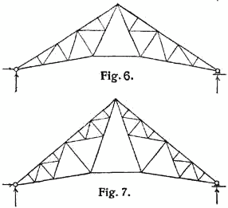
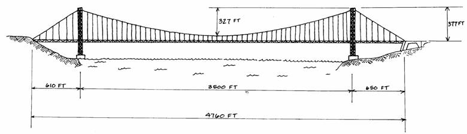

```{python}
#| label: setup
#| include: false
import numpy as np
%load_ext autoreload
%autoreload 2
from src.truss_lm_step03 import *
from src.structures_lm_step03 import *
```

::: {#exr-anwendungsbeispiel}
## Anwendungsbeispiel

Erstellen Sie das Modell einer interessanten ebenen Fachwerkstruktur, für die Sie später Verformungen und Schnittgrößen berechnen möchten. Beachten Sie, dass es mit einer Programmiersprache möglich ist, regelmäßige Tragwerke mit nur wenigen Anweisungen zu erzeugen, selbst wenn diese viele Knoten und Stäbe besitzen. Hier ein paar Bilder zur Anregung:

{width="30%"} {width="60%"}

{width="60%"}

::: {.lm-scaffold}
```{python}
# TODO
```
:::

::: {.lm-solution}
Ein Fachwerkträger mit parabelförmigem Obergurt, erzeugt mit wenigen Anweisungen.

```{python}
s = girder()
draw_system(s)
```

Code für `girder` im Anhang.
:::
:::
