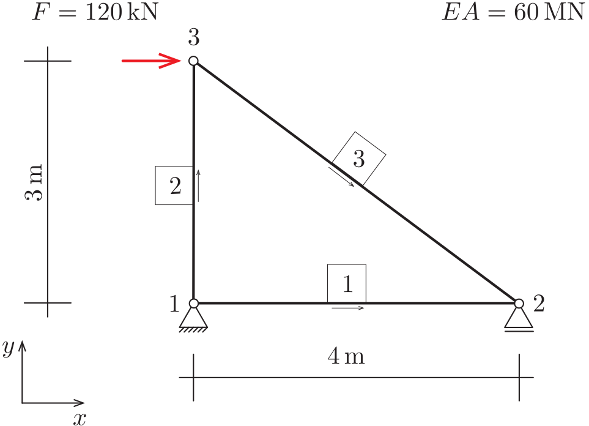
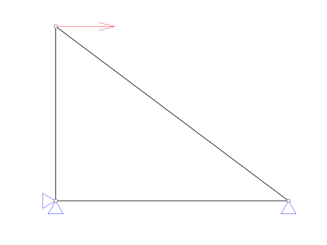
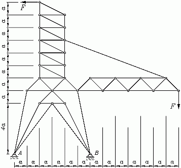
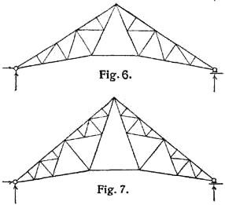
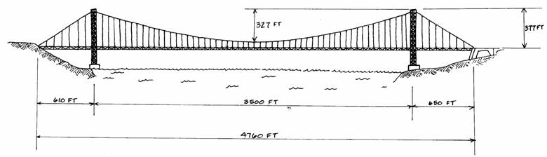

::: {#exr-erzeugung-und-darstellung}
## Erzeugung und Darstellung von Stabtragwerken

Wir halten zunächst fest, welche Informationen zur Beschreibung eines Stabtragwerks notwendig sind. Hierzu betrachten wir das dargestellte einfache System.

{width="40%"}

Um dieses System zu beschreiben, benötigen wir:

- Koordinaten der Knoten.
- Die Knotennummern der einzelnen Stäbe.
- Auflagerbedingungen in horizontaler und vertikaler Richtung.
- Auf die Knoten einwirkende Kräfte.
- Dehnsteifigkeit $EA$.

Zunächst verwenden wir für alle Stäbe eine einheitliche Dehnsteifigkeit, später lässt sich das einfach erweitern. Beachten Sie, dass Python ab 0 zählt: Der Knoten 1 aus der Abbildung hat in Python den Index 0.

Im Notebook ist die Funktion `simple_example()` vorgegeben, die das dargestellte System erzeugt. Darin wird eine Variable `s` verwendet, in der die verschiedenen Eigenschaften des Systems ($EA$, Knoten, Stäbe etc.) abgelegt werden. Der Zugriff auf die Eigenschaften erfolgt mit dem Punkt-Operator, zum Beispiel greift man mit `s.nodes` auf die Knoten des Systems zu.

### Stabtragwerk erzeugen

1. Vollziehen Sie nach, wie in `simple_example()` Knoten, Stäbe, Kräfte und Auflager beschrieben werden.

1. Verschieben Sie die Funktion in die Datei `src/structures.py` und importieren Sie sie von dort. Weitere Tragwerke legen Sie später ebenfalls als Funktion in dieser Datei ab.

### Hilfsfunktion für die Größe des Systems

Erstellen Sie eine Funktion `struct_size(s)` (später in `src/truss.py`), mit der ein Maß für die Abmessungen des Tragwerks ermittelt wird. Sie benötigen das später zum Beispiel für das Zeichnen der Kräfte und Auflager. Eine gute Möglichkeit besteht darin, das geometrische Mittel von Breite und Höhe des Systems zu verwenden, also
$$
  s = \sqrt{(x_{\max} - x_{\min}) \cdot (y_{\max} - y_{\min})}.
$$
Bei einem flachen System, zum Beispiel einem einzelnen horizontalen Stab, ist das Produkt null. Verwenden Sie dann die größere der beiden Abmessungen.

### Stabtragwerk graphisch darstellen

Zeichnen Sie das Stabtragwerk, zum Beispiel so:

{width="40%"}

Es bietet sich an, den Code zunächst einfach in das Notebook zu schreiben und am Schluss in eine Funktion `draw_system(s)` in `src/truss.py` zu verschieben. Gehen Sie in den folgenden Schritten vor:

1. Knoten

1. Stäbe

1. Kräfte

1. Auflager

### Anwendungsbeispiel

Erstellen Sie das Modell einer interessanten ebenen Fachwerkstruktur, für die Sie später Verformungen und Schnittgrößen berechnen möchten. Beachten Sie, dass es mit einer Programmiersprache möglich ist, regelmäßige Tragwerke mit nur wenigen Anweisungen zu erzeugen, selbst wenn diese viele Knoten und Stäbe besitzen. Hier ein paar Bilder zur Anregung:

{width="30%"} {width="60%"}

{width="60%"}

::: {.tinh-solution}
Lösung im Lösungs-Notebook.
:::
:::
