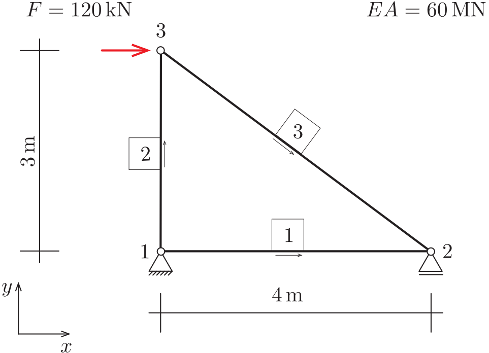

::: {#exr-stabtragwerk-erzeugen}
## Stabtragwerk erzeugen

Wir halten zunächst fest, welche Informationen zur Beschreibung eines Stabtragwerks notwendig sind. Hierzu betrachten wir das dargestellte einfache System.

{width="40%"}

Um dieses System zu beschreiben, benötigen wir:

- Koordinaten der Knoten.
- Die Knotennummern der einzelnen Stäbe.
- Auflagerbedingungen in horizontaler und vertikaler Richtung.
- Auf die Knoten einwirkende Kräfte.
- Dehnsteifigkeit $EA$.

Zunächst verwenden wir für alle Stäbe eine einheitliche Dehnsteifigkeit, später lässt sich das einfach erweitern. Beachten Sie, dass Python ab 0 zählt: Der Knoten 1 aus der Abbildung hat in Python den Index 0.

Im Notebook ist die Funktion `simple_example()` vorgegeben, die das dargestellte System erzeugt. Darin wird eine Variable `s` verwendet, in der die verschiedenen Eigenschaften des Systems ($EA$, Knoten, Stäbe etc.) abgelegt werden. Der Zugriff auf die Eigenschaften erfolgt mit dem Punkt-Operator, zum Beispiel greift man mit `s.nodes` auf die Knoten des Systems zu.

1. Vollziehen Sie nach, wie in `simple_example()` Knoten, Stäbe, Kräfte und Auflager beschrieben werden.

1. Verschieben Sie die Funktion in die Datei `src/structures.py` und importieren Sie sie von dort. Weitere Tragwerke legen Sie später ebenfalls als Funktion in dieser Datei ab.

::: {.tinh-solution}
Lösung im Lösungs-Notebook.
:::
:::
