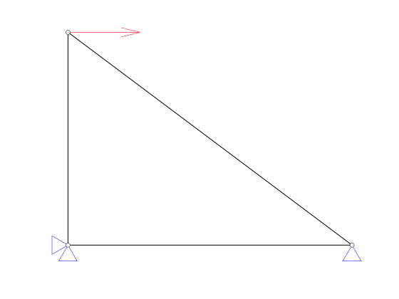

```{python}
#| label: setup
#| include: false
%load_ext autoreload
%autoreload 2

import numpy as np
import matplotlib.pyplot as plt
from src.truss import *
from src.structures import *
```

::: {#exr-darstellung}
## Graphische Darstellung

Zeichnen Sie das Stabtragwerk, zum Beispiel so:

{width="40%"}

Es bietet sich an, den Code zunächst einfach in das Notebook zu schreiben und am Schluss in eine Funktion `draw_system(s)` in `src/truss.py` zu verschieben. Gehen Sie schrittweise vor: Zeichnen Sie zuerst nur die Knoten. Wenn das funktioniert, ergänzen Sie die Stäbe, danach die Kräfte und zuletzt die Auflager. Führen Sie die Zelle nach jedem Schritt aus und prüfen Sie das Bild.

```{python}
s = simple_example()
```

::: {.lm-scaffold}
```{python}
# TODO
```
:::

::: {.lm-solution}
```{python}
draw_system(s)
```

Code für `draw_system` im Anhang.
:::

::: {.callout-tip title="Tipps für Python"}
- Stäbe als Linien mit `plt.plot`, Knoten als Punkte mit `plt.scatter`.
- Kräfte als Pfeile mit `plt.quiver`.
- Auflager als Dreiecke mit `plt.scatter` und `marker=5` (horizontal) bzw. `marker=6` (vertikal).
- Mit `plt.axis("equal")` werden beide Achsen gleich skaliert.
:::
:::
