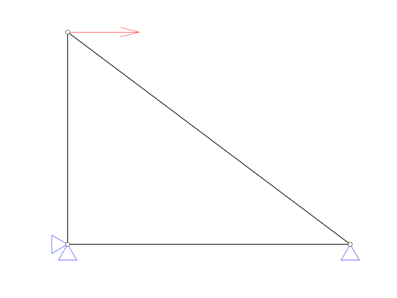

::: {#exr-darstellung}
## Graphische Darstellung

Zeichnen Sie das Stabtragwerk, zum Beispiel so:

{width="40%"}

Es bietet sich an, den Code zunächst einfach in das Notebook zu schreiben und am Schluss in eine Funktion `draw_system(s)` in `src/truss.py` zu verschieben. Gehen Sie in den folgenden Schritten vor:

1. Knoten

1. Stäbe

1. Kräfte

1. Auflager

::: {.tinh-solution}
Lösung im Lösungs-Notebook.
:::
:::
