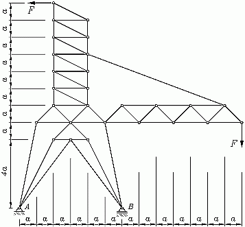
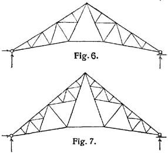
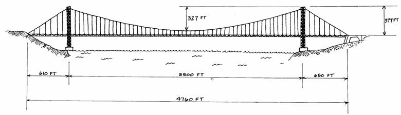

::: {#exr-anwendungsbeispiel}
## Anwendungsbeispiel

Erstellen Sie das Modell einer interessanten ebenen Fachwerkstruktur, für die Sie später Verformungen und Schnittgrößen berechnen möchten. Beachten Sie, dass es mit einer Programmiersprache möglich ist, regelmäßige Tragwerke mit nur wenigen Anweisungen zu erzeugen, selbst wenn diese viele Knoten und Stäbe besitzen. Hier ein paar Bilder zur Anregung:

{width="30%"} {width="60%"}

{width="60%"}

::: {.tinh-solution}
Lösung im Lösungs-Notebook.
:::
:::
