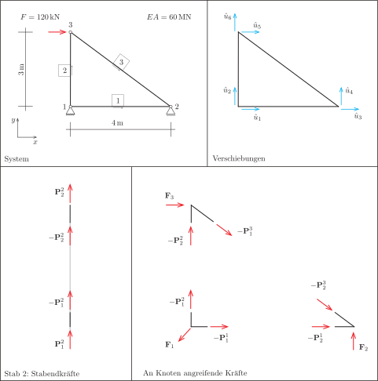

# Fachwerke: Berechnung

In diesem Kapitel setzen wir die einzelnen Stäbe zu einem Tragwerk zusammen und bestimmen mithilfe der Gleichgewichtsbedingungen für jeden freigeschnittenen Knoten die Knotenverschiebungen. Dabei setzen wir voraus, dass die Verformungen klein sind, und verwenden daher die lineare Theorie aus @eq-p-lin. Die Bezeichnung $\text{lin}$ wird weggelassen, es ist klar, was gemeint ist.

Die Berechnung erfolgt zunächst für ein einfaches Tragwerk, im Anschluss fassen wir die einzelnen Schritte nochmals allgemein zusammen.

## Rechenbeispiel: Fachwerk aus drei Stäben

Wir betrachten das in @fig-gesamtsystem dargestellte Beispiel. Für die Ermittlung der Verschiebungen rechnen wir für Kräfte in Meganewton und sparen damit Nullen, als Längeneinheit legen wir den Meter zu Grunde.

{#fig-gesamtsystem}

#### System

Das System besteht aus drei Stäben und ist statisch bestimmt. Knoten und Stäbe sind nummeriert, die Stäbe haben jeweils eine Richtung vom ersten zum zweiten Knoten.

#### Verschiebungen

Jeder Knoten kann sich prinzipiell in horizontaler und vertikaler Richtung verschieben. Insgesamt gibt es also, wieder prinzipiell, doppelt so viele unbekannte Verschiebungen wie Knoten. Bei dieser Betrachtung lassen wir die Auflager zunächst außer Betracht, darum kümmern wir uns später. Wir fassen die unbekannten Verschiebungen im Vektor der [Systemverschiebungen]{.neuerbegriff}
$$
  \hat{\mathbf{u}} = \mmat{\hat{u}_1 & \hat{u}_2 & \hat{u}_3 & \hat{u}_4 & \hat{u}_5 & \hat{u}_6}\mtran
$$
zusammen. Der Hut über einer Variablen bezeichnet dabei eine Systemgröße (im Unterschied zu Größen für einen einzelnen Stab ohne Hut). Die unbekannten Verschiebungen werden häufig auch als [Freiheitsgrade]{.neuerbegriff} bezeichnet. Bei der Nummerierung der Freiheitsgrade stützen wir uns auf die Nummerierung der Knoten, so dass der Knoten $n$ die Freiheitsgradnummern $2n - 1$ und $2n$ erhält.

#### Stabendkräfte

In @sec-stabendkraefte haben wir die Stabendkräfte ermittelt, die für einen einzelnen Fachwerkstab zu einer vorgegebenen Verschiebung gehören. Nun benötigen wir die Kräfte, die an einem freigeschnittenen Knoten angreifen. Hierzu schneiden wir die Stabenden von Stab 2 frei und sehen, dass an den beiden Schnittufern jeweils die negativen Stabendkräfte angreifen. Beachten Sie, dass die Nummer des Stabes bei den Stabendkräften mit einem hochgestellten Index angegeben ist.

#### An Knoten angreifende Kräfte

In @fig-gesamtsystem unten rechts sind die Kräfte dargestellt, die an jedem Knoten angreifen. Wichtig ist, dass wir die Kräfte als vektorielle Größen angetragen haben, bei der Addition sind also keine Vorzeichen zu beachten. Für die externen Kräfte können wir festhalten:
$$
  \mathbf{F}_1 = \mmat{R_{11} \\ R_{12}},
  \qquad
  \mathbf{F}_2 = \mmat{0 \\ R_{22}},
  \qquad
  \mathbf{F}_3 = \mmat{120 \cdot 10^{-3} \\ 0}.
$$
Dabei sind $R_{ij}$ die unbekannten Auflagerreaktionen, die angreifende Kraft $F$ wird auf Meganewton umgerechnet.

### Kräftegleichgewicht an den Knoten

Jetzt kommt der zentrale gedankliche Schritt des Verfahrens: die Formulierung des Knotengleichgewichts. In vektorieller Schreibweise erhalten wir aus der Summe der Kräfte an jedem Knoten die drei Gleichungen
$$
  \begin{aligned}
    -\mathbf{P}^1_1 - \mathbf{P}^2_1 + \mathbf{F}_1 & = \mathbf{0}
    & \iff &&
    \mathbf{P}^1_1 + \mathbf{P}^2_1 & = \mathbf{F}_1
    \\
    -\mathbf{P}^1_2 - \mathbf{P}^3_2 + \mathbf{F}_2 & = \mathbf{0}
    & \iff &&
    \mathbf{P}^1_2 + \mathbf{P}^3_2 & = \mathbf{F}_2
    \\
    -\mathbf{P}^2_2 - \mathbf{P}^3_1 + \mathbf{F}_3 & = \mathbf{0}
    & \iff &&
    \mathbf{P}^2_2 + \mathbf{P}^3_1 & = \mathbf{F}_3.
  \end{aligned}
$$
Komponentenweise aufgeschrieben und sortiert erhalten wir die Beziehungen
$$
  \begin{array}{ccccccc}
    P^1_{11} & + & P^2_{11} & + & 0 & = & R_{11} \\[1ex]
    P^1_{12} & + & P^2_{12} & + & 0 & = & R_{12} \\[1ex]
    P^1_{21} & + & 0 & + & P^3_{21} & = & 0      \\[1ex]
    P^1_{22} & + & 0 & + & P^3_{22} & = & R_{22} \\[1ex]
    0 & + & P^2_{21} & + & P^3_{11} & = & 120 \cdot 10^{-3}     \\[1ex]
    0 & + & P^2_{22} & + & P^3_{12} & = & 0
  \end{array}
$$
Wir können nun die Beiträge der einzelnen Stäbe und die rechte Seite jeweils in Vektoren zusammenfassen und erhalten die globale Gleichung
$$
  \hat{\mathbf{P}}^1 + \hat{\mathbf{P}}^2 + \hat{\mathbf{P}}^3 = \hat{\mathbf{F}}.
$$ {#eq-gleichgewicht}
Sie besagt, dass die Summe der Stabendkräfte mit den äußeren Lasten im Gleichgewicht stehen muss. Dabei ist klar, dass die Vektoren $\hat{\mathbf{P}}^1, \hat{\mathbf{P}}^2, \hat{\mathbf{P}}^3$ alle vom globalen Verschiebungsvektor $\hat{\mathbf{u}}$ abhängen.

### Systemgrößen

Wie diese Abhängigkeit erfasst werden kann, untersuchen wir exemplarisch am horizontalen Stab 1.

#### Beitrag von Stab 1

Entsprechend den Überlegungen in @sec-stabendkraefte erhalten wir mit
$$
  l_0 = 4,
  \quad
  \mathbf{d}_0 = \mmat{1 & 0}\mtran,
  \quad
  \mathbf{t}_0 = \mmat{-1 & 0 & 1 & 0}\mtran
$$
die Elementsteifigkeitsmatrix
$$
  \mathbf{K}^1 = \frac{EA}{l_0} \mathbf{t}_0 \mathbf{t}_0\mtran =
  \mmat{
    \phantom{-}15 & 0 & -15 & 0 \\[1ex]
    0 & 0 & 0 & 0 \\[1ex]
    -15 & 0 & \phantom{-}15 & 0 \\[1ex]
    0 & 0 & 0 & 0
  }
$$
und damit den Vektor der Stabendkräfte
$$
  \mmat{P^1_{11} \\[1ex] P^1_{12} \\[1ex] P^1_{21} \\[1ex] P^1_{22} }
  =
  \mmat{
    \phantom{-}15 & 0 & -15 & 0 \\[1ex]
    0 & 0 & 0 & 0 \\[1ex]
    -15 & 0 & \phantom{-}15 & 0 \\[1ex]
    0 & 0 & 0 & 0
  }
  \mmat{u_1 \\[1ex] u_2 \\[1ex] u_3 \\[1ex] u_4}
  \quad\text{oder kurz}\quad
  \mathbf{P}^1 = \mathbf{K}^1 \mathbf{u}^1.
$$
Dieser Zusammenhang gilt für den einzelnen Stab und muss nun in das Gesamtsystem eingebaut werden. Es fehlt also noch der Zusammenhang mit den globalen Vektoren $\hat{\mathbf{P}}^1$ und $\hat{\mathbf{u}}$.

Die Verknüpfung zwischen den lokalen und den globalen Vektoren stellen wir mit einer Matrix her, deren Einträge entweder 0 oder 1 sind. Wir finden schnell heraus, dass wir diese Idee in der Form
$$
  \mmat{
    \hat{P}^1_{11} \\[1ex] \hat{P}^1_{12} \\[1ex] \hat{P}^1_{21} \\[1ex] \hat{P}^1_{22} \\[1ex] 0 \\[1ex] 0
  }
  =
  \mmat{
    1 & 0 & 0 & 0 \\[1ex]
    0 & 1 & 0 & 0 \\[1ex]
    0 & 0 & 1 & 0 \\[1ex]
    0 & 0 & 0 & 1 \\[1ex]
    0 & 0 & 0 & 0 \\[1ex]
    0 & 0 & 0 & 0
  }
  \mmat{P^1_{11} \\[1ex] P^1_{12} \\[1ex] P^1_{21} \\[1ex] P^1_{22}}
  \quad\text{und}\quad
  \mmat{u_1 \\[1ex] u_2 \\[1ex] u_3 \\[1ex] u_4}
  =
  \mmat{
    1 & 0 & 0 & 0 & 0 & 0 \\[1ex]
    0 & 1 & 0 & 0 & 0 & 0 \\[1ex]
    0 & 0 & 1 & 0 & 0 & 0 \\[1ex]
    0 & 0 & 0 & 1 & 0 & 0
  }
  \mmat{\hat{u}_1 \\[1ex] \hat{u}_2 \\[1ex] \hat{u}_3 \\[1ex] \hat{u}_4 \\[1ex] \hat{u}_5 \\[1ex] \hat{u}_6}
$$
aufschreiben können. Offensichtlich handelt es sich um ein und dieselbe Matrix, einmal eben transponiert. Diese neue Matrix nennen wir [Assemblierungsmatrix]{.neuerbegriff}, bezeichnen sie mit $\mathbf{A}^1$ und erhalten die kompakte Darstellung
$$
  \hat{\mathbf{P}}^1 = \left(\mathbf{A}^1\right)\mtran \mathbf{P}^1
  \quad\text{und}\quad
  \mathbf{u}^1 = \mathbf{A}^1 \hat{\mathbf{u}}.
$$
Die Konvention ist, dass die Matrix zwischen $\hat{\mathbf{u}}$ und $\mathbf{u}$ mit $\mathbf{A}^1$ bezeichnet wird und nicht umgekehrt. Setzen wir nun diese beiden Gleichungen in die Stabendkräfte von Stab 1 ein, so ergibt sich
$$
  \hat{\mathbf{P}}^1
  =
  \left(\mathbf{A}^1\right)\mtran \mathbf{K}^1 \mathbf{A}^1\hat{\mathbf{u}}
  =
  \hat{\mathbf{K}}^1\hat{\mathbf{u}}.
$$
Die Matrix
$$
  \hat{\mathbf{K}}^1 = \left(\mathbf{A}^1\right)\mtran \mathbf{K}^1 \mathbf{A}^1
$$
heißt [globale Steifigkeitsmatrix]{.neuerbegriff} zu Stab 1. Mit
$$
  \mmat{
    1 & 0 & 0 & 0 \\[1ex]
    0 & 1 & 0 & 0 \\[1ex]
    0 & 0 & 1 & 0 \\[1ex]
    0 & 0 & 0 & 1 \\[1ex]
    0 & 0 & 0 & 0 \\[1ex]
    0 & 0 & 0 & 0
  }
  \mmat{
    \phantom{-}15 & 0 & -15 & 0 \\[1ex]
    0 & 0 & 0 & 0 \\[1ex]
    -15 & 0 & \phantom{-}15 & 0 \\[1ex]
    0 & 0 & 0 & 0
  }
  \mmat{
    1 & 0 & 0 & 0 & 0 & 0 \\[1ex]
    0 & 1 & 0 & 0 & 0 & 0 \\[1ex]
    0 & 0 & 1 & 0 & 0 & 0 \\[1ex]
    0 & 0 & 0 & 1 & 0 & 0
  }
  =
  \mmat{
    \phantom{-}15 & 0 & -15 & 0 & 0 & 0 \\[1ex]
    0 & 0 & 0 & 0 & 0 & 0 \\[1ex]
    -15 & 0 & \phantom{-}15 & 0 & 0 & 0 \\[1ex]
    0 & 0 & 0 & 0 & 0 & 0 \\[1ex]
    0 & 0 & 0 & 0 & 0 & 0 \\[1ex]
    0 & 0 & 0 & 0 & 0 & 0
  }
$$
erhalten wir schließlich den gesuchten Zusammenhang
$$
  \mmat{
    \hat{P}^1_{11} \\[1ex] \hat{P}^1_{12} \\[1ex] \hat{P}^1_{21} \\[1ex] \hat{P}^1_{22} \\[1ex] 0 \\[1ex] 0
  }
  =
  \mmat{
    \phantom{-}15 & 0 & -15 & 0 & 0 & 0 \\[1ex]
    0 & 0 & 0 & 0 & 0 & 0 \\[1ex]
    -15 & 0 & \phantom{-}15 & 0 & 0 & 0 \\[1ex]
    0 & 0 & 0 & 0 & 0 & 0 \\[1ex]
    0 & 0 & 0 & 0 & 0 & 0 \\[1ex]
    0 & 0 & 0 & 0 & 0 & 0
  }
  \mmat{\hat{u}_1 \\[1ex] \hat{u}_2 \\[1ex] \hat{u}_3 \\[1ex] \hat{u}_4 \\[1ex] \hat{u}_5 \\[1ex] \hat{u}_6}.
$$

#### Beiträge der Stäbe 2 und 3

Mit derselben Vorgehensweise bestimmen wir die globalen Steifigkeitsmatrizen
$$
  \hat{\mathbf{K}}^2 =
  \mmat{
    0 & 0 & 0 & 0 & 0 & 0 \\[1ex]
    0 & \phantom{-}20 & 0 & 0 & 0 & -20 \\[1ex]
    0 & 0 & 0 & 0 & 0 & 0 \\[1ex]
    0 & 0 & 0 & 0 & 0 & 0 \\[1ex]
    0 & 0 & 0 & 0 & 0 & 0 \\[1ex]
    0 & -20 & 0 & 0 & 0 & \phantom{-}20
  }
  \quad\text{und}\quad
  \hat{\mathbf{K}}^3 =
  \mmat{
    0 & 0 & 0 & 0 & 0 & 0 \\[1ex]
    0 & 0 & 0 & 0 & 0 & 0 \\[1ex]
    0 & 0 & \phantom{-}7.68 & -5.76 & -7.68 & \phantom{-}5.76 \\[1ex]
    0 & 0 & -5.76 & \phantom{-}4.32 & \phantom{-}5.76 & -4.32 \\[1ex]
    0 & 0 & -7.68 & \phantom{-}5.76 & \phantom{-}7.68 & -5.76 \\[1ex]
    0 & 0 & \phantom{-}5.76 & -4.32 & -5.76 & \phantom{-}4.32
  }
$$
für die beiden anderen Stäbe.

### Berechnung der Verschiebungen

Die globale Gleichgewichtsbedingung aus @eq-gleichgewicht können wir nun in der Form
$$
  \hat{\mathbf{K}}^1\hat{\mathbf{u}}
  +
  \hat{\mathbf{K}}^2\hat{\mathbf{u}}
  +
  \hat{\mathbf{K}}^3\hat{\mathbf{u}}
  =
  \hat{\mathbf{F}}
  \iff
  (
  \hat{\mathbf{K}}^1
  +
  \hat{\mathbf{K}}^2
  +
  \hat{\mathbf{K}}^3)
  \hat{\mathbf{u}}
  =
  \hat{\mathbf{F}}
$$
aufschreiben. Wir nennen die Matrix
$$
  \hat{\mathbf{K}}
  =
  \hat{\mathbf{K}}^1 + \hat{\mathbf{K}}^2 + \hat{\mathbf{K}}^3
  =
  \mmat{
    \phantom{-}15 & 0 & -15 & 0 & 0 & 0 \\[1ex]
    0 & \phantom{-}20 & 0 & 0 & 0 & -20 \\[1ex]
    -15 & 0 & \phantom{-}22.68 & -5.76 & -7.68 & \phantom{-}5.76 \\[1ex]
    0 & 0 & -5.76 & \phantom{-}4.32 & \phantom{-}5.76 & -4.32 \\[1ex]
    0 & 0 & -7.68 & \phantom{-}5.76 & \phantom{-}7.68 & -5.76 \\[1ex]
    0 & -20 & \phantom{-}5.76 & -4.32 & -5.76 & \phantom{-}24.32
  }
$$
[Gesamtsteifigkeitsmatrix]{.neuerbegriff} und erhalten das lineare Gleichungssystem
$$
  \mmat{
    \phantom{-}15 & 0 & -15 & 0 & 0 & 0 \\[1ex]
    0 & \phantom{-}20 & 0 & 0 & 0 & -20 \\[1ex]
    -15 & 0 & \phantom{-}22.68 & -5.76 & -7.68 & \phantom{-}5.76 \\[1ex]
    0 & 0 & -5.76 & \phantom{-}4.32 & \phantom{-}5.76 & -4.32 \\[1ex]
    0 & 0 & -7.68 & \phantom{-}5.76 & \phantom{-}7.68 & -5.76 \\[1ex]
    0 & -20 & \phantom{-}5.76 & -4.32 & -5.76 & \phantom{-}24.32
  }
  \mmat{\hat{u}_1 \\[1ex] \hat{u}_2 \\[1ex] \hat{u}_3 \\[1ex] \hat{u}_4 \\[1ex] \hat{u}_5 \\[1ex] \hat{u}_6}
  =
  \mmat{
    R_{11} \\[1ex]
    R_{12} \\[1ex]
    0 \\[1ex]
    R_{22} \\[1ex]
    120 \cdot 10^{-3} \\[1ex]
    0
  }.
$$

Schließlich sind noch die Auflagerbedingungen $\hat{u}_1 = \hat{u}_2 = \hat{u}_4 = 0$ zu berücksichtigen. Die einfachste Möglichkeit, dies zu erreichen, besteht darin, die betroffenen Zeilen gleich 0 zu setzen und eine 1 für das Diagonalelement zu vergeben. Damit lautet das modifizierte lineare Gleichungssystem
$$
  \mmat{
    \phantom{-}1 & 0 & 0 & 0 & 0 & 0 \\[1ex]
    0 & \phantom{-}1 & 0 & 0 & 0 & 0 \\[1ex]
    -15 & 0 & \phantom{-}22.68 & -5.76 & -7.68 & \phantom{-}5.76 \\[1ex]
    0 & 0 & 0 & \phantom{-}1 & 0 & 0 \\[1ex]
    0 & 0 & -7.68 & \phantom{-}5.76 & \phantom{-}7.68 & -5.76 \\[1ex]
    0 & -20 & \phantom{-}5.76 & -4.32 & -5.76 & \phantom{-}24.32
  }
  \mmat{\hat{u}_1 \\[1ex] \hat{u}_2 \\[1ex] \hat{u}_3 \\[1ex] \hat{u}_4 \\[1ex] \hat{u}_5 \\[1ex] \hat{u}_6}
  =
  \mmat{
    0 \\[1ex]
    0 \\[1ex]
    0 \\[1ex]
    0 \\[1ex]
    120 \cdot 10^{-3} \\[1ex]
    0
  }.
$$

Das lineare Gleichungssystem besitzt die Lösung
$$
  \hat{\mathbf{u}}
  =
  \mmat{
  0 \\
  0 \\
  0.008 \\
  0 \\
  0.027 \\
  0.0045
  },
$$
aus der wir die Knotenverschiebungen
$$
  \mathbf{u}_1 = \mmat{0 \\ 0}, \quad
  \mathbf{u}_2 = \mmat{0.008 \\ 0}, \quad
  \mathbf{u}_3 = \mmat{0.027 \\ 0.0045}
$$
ablesen können.

### Berechnung von Schnittgrößen

Mit den Knotenverschiebungen können wir schließlich die Normalkräfte $N = \frac{EA}{l_0} (\mathbf{u}_2 - \mathbf{u}_1) \cdot \mathbf{d}_0$ der einzelnen Stäbe berechnen, wobei $\mathbf{u}_1$ und $\mathbf{u}_2$ die Verschiebungen von Anfangs- und Endknoten des Stabes sind. Mit $EA = \SI{60000}{\kilo\newton}$ ergibt sich für Stab 1 (von Knoten 1 nach Knoten 2)
$$
  l_0 = 4,
  \quad
  \mathbf{d}_0 = \mmat{1 \\ 0},
  \quad
  N
  = \frac{60000}{4} \cdot \mmat{1 \\ 0} \cdot \mmat{0.008 - 0 \\ 0 - 0}
  = \SI{120}{\kilo\newton},
$$
für Stab 2 (von Knoten 1 nach Knoten 3)
$$
  l_0 = 3,
  \quad
  \mathbf{d}_0 = \mmat{0 \\ 1},
  \quad
  N
  = \frac{60000}{3} \cdot \mmat{0 \\ 1} \cdot \mmat{0.027 - 0 \\ 0.0045 - 0}
  = \SI{90}{\kilo\newton}
$$
und für Stab 3 (von Knoten 3 nach Knoten 2)
$$
  l_0 = 5,
  \quad
  \mathbf{d}_0 = \mmat{\phantom{-}0.8 \\ -0.6},
  \quad
  N
  = \frac{60000}{5} \cdot \mmat{\phantom{-}0.8 \\ -0.6} \cdot \mmat{0.008 - 0.027 \\ 0 - 0.0045}
  = \SI{-150}{\kilo\newton}.
$$

## Assemblierungsmatrix

Ein wichtiger Baustein bei der Herleitung der globalen Gleichgewichtsbeziehung war die Assemblierungsmatrix $\mathbf{A}^e$ für jeden Stab $e$. Wir sehen in diesem Abschnitt, dass diese Matrix für die Umsetzung in einem Computerprogramm gar nicht notwendig ist.

::: {#exm-indexvektor}
## Indexvektor von Stab 1

Stab 1 besitzt die Freiheitsgrade
$$
  \mathbf{I}^1 = \mmat{1 \\ 2 \\ 3 \\ 4}
  \quad\text{und die Assemblierungsmatrix}\quad
  \mathbf{A}^1
  =
  \mmat{
    1 & 0 & 0 & 0 & 0 & 0 \\
    0 & 1 & 0 & 0 & 0 & 0 \\
    0 & 0 & 1 & 0 & 0 & 0 \\
    0 & 0 & 0 & 1 & 0 & 0
  }.
$$
:::

Wir nennen $\mathbf{I}^1$ [Indexvektor]{.neuerbegriff} von Stab 1. Aus dem Indexvektor lässt sich also für jede Zeile ablesen, an welcher Stelle die 1 steht. Daraus können wir das allgemeine Schema
$$
  A^e_{ij} =
  \begin{cases}
    1 & \text{falls} \; I^e_i = j \\
    0 & \text{sonst}
  \end{cases}
  \quad\text{für}\quad i = 1, \dots, 4 \quad\text{und}\quad j = 1, \dots, 2 N_n
$$
ableiten, wobei $N_n$ die Anzahl der Knoten bezeichnet. Für den Fachwerkstab besitzt die Assemblierungsmatrix immer vier Zeilen, die Anzahl der Spalten ist gleich der Anzahl der Freiheitsgrade, also $2N_n$.

Interessant ist, dass durch das Produkt
$$
  \hat{\mathbf{K}}^e = \left(\mathbf{A}^e\right)\mtran\mathbf{K}^e\mathbf{A}^e
$$
die Einträge der $4 \times 4$-Matrix $\mathbf{K}^e$ auf die $2N_n \times 2N_n$-Matrix $\hat{\mathbf{K}}^e$ verteilt werden. Man kann sich überlegen, dass dies nach dem Schema
$$
  \hat{K}^e_{I^e_i I^e_j} = K^e_{ij}
$$
geschieht. In der Programmierung lässt sich das in einer Zeile mithilfe des Indexvektors bewerkstelligen. Für die Programmierung wird die Assemblierungsmatrix also gar nicht benötigt.

## Berechnungsprozedur

Wir fassen die Schritte aus den vorangegangenen Abschnitten nochmal allgemein zusammen:

1. Nützliche Variablen: $N_e$ (Anzahl Stäbe), $N_n$ (Anzahl Knoten), $N = 2N_n$ (Anzahl Freiheitsgrade)

1. Globale Steifigkeitsmatrix $\hat{\mathbf{K}}$ der Größe $N\times{}N$ mit Nullen vorbelegen

1. Schleife über alle Stäbe

    - Variablen: $n_1, n_2$ (Knotennummern), $\mathbf{x}_1, \mathbf{x}_2$ (Knotenkoordinaten)

    - Elementsteifigkeitsmatrix $\mathbf{K}$ berechnen

    - Indexvektor $\mathbf{I} = (2n_1-1, 2n_1, 2n_2-1, 2n_2)$ für Element aufstellen

    - Matrix $\mathbf{K}$ mit Indexvektor $\mathbf{I}$ auf globale Matrix $\hat{\mathbf{K}}$ aufaddieren

1. Äußere Lasten in Vektor $\hat{\mathbf{F}}$ anordnen

1. Auflagerbedingungen einbauen

1. Lineares Gleichungssystem lösen

## Postprocessing

**TODO:** Darstellung der Ergebnisse (Verformung, Normalkräfte, Ausgabe als Tabelle)
