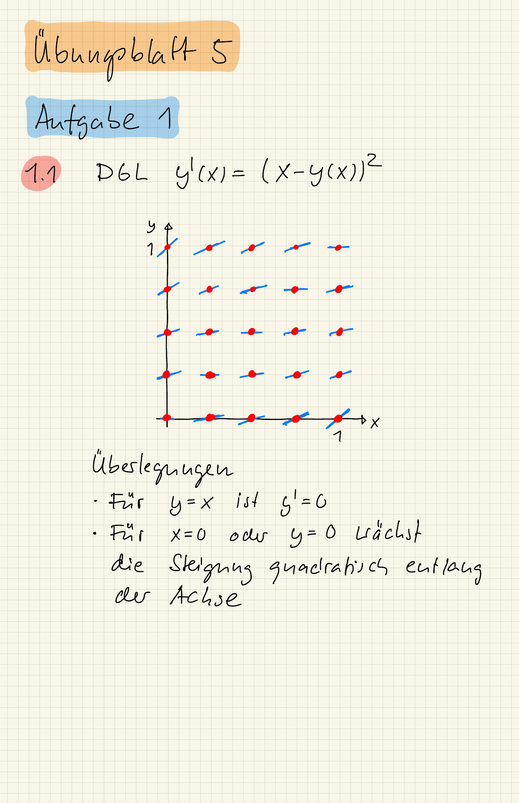

::: {#exr-richtungsfeld}
## Differentialgleichung und Richtungsfeld

Gegeben ist die Differentialgleichung
$$
  y'(x) = (x - y(x))^2.
$$
Geben Sie die Funktion $F : \R^2 \to \R$ der Differentialgleichung an und skizzieren Sie das Richtungsfeld für $0 \leq x, y \leq 1$.

::: {.tinh-solution}
{width="60%"}
:::
:::
