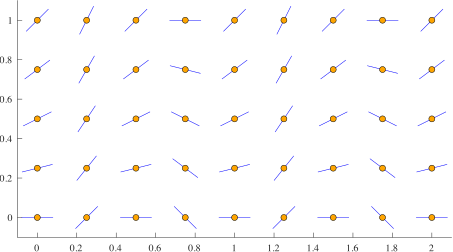
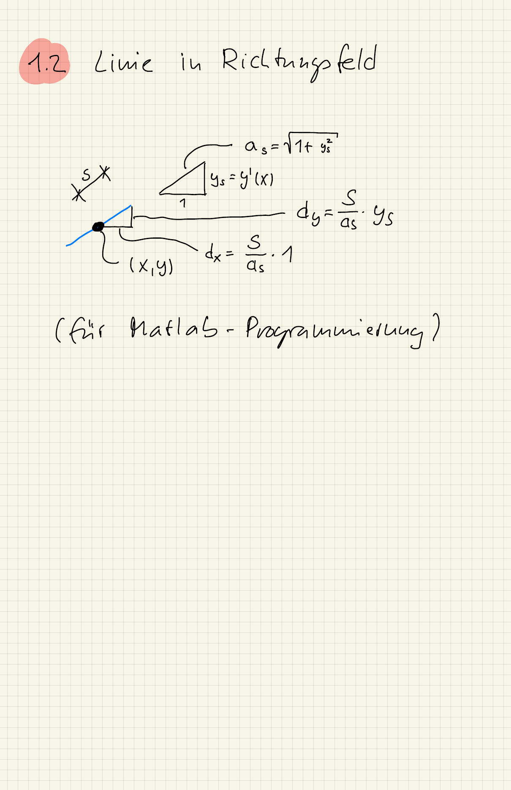

::: {#exr-richtungsfeld}
## Differentialgleichung und Richtungsfeld

1. Gegeben ist die Differentialgleichung
    $$
      y'(x) = (x - y(x))^2.
    $$
    Geben Sie die Funktion $F : \R^2 \to \R$ der Differentialgleichung an und skizzieren Sie das Richtungsfeld für $0 \leq x, y \leq 1$.

1. Laden Sie das [Notebook](${notebook}){download="${slug}-aufgaben.zip"} herunter, entpacken Sie es in den Ordner `projekt-aufgaben` und öffnen Sie es. Erstellen Sie in einer Datei `src/odesolve.py` eine Funktion `plot_slope_field(F, xrange, yrange, delta)`, um das Richtungsfeld einer Differentialgleichung darzustellen, zum Beispiel so:

    {width="60%"}

    Dieser Punkt ist freiwillig.

::: {.tinh-solution}
Der Code zum zweiten Punkt steht im Lösungs-Notebook.

{width="60%"}

{width="60%"}
:::
:::
