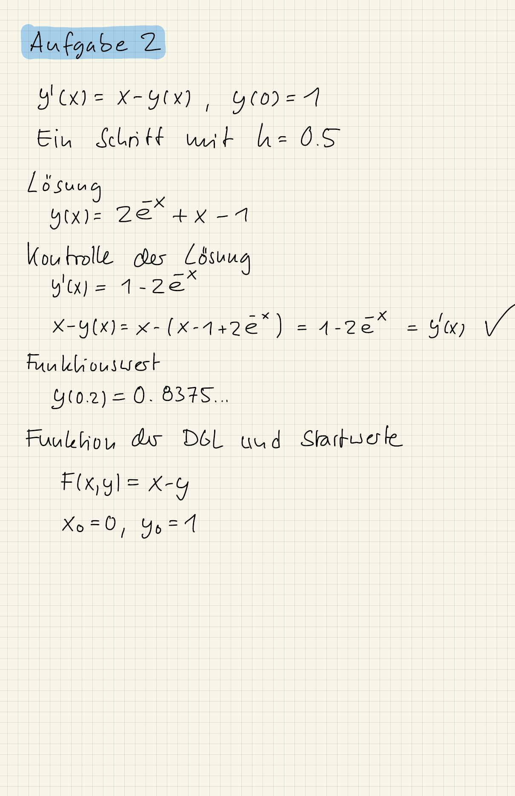
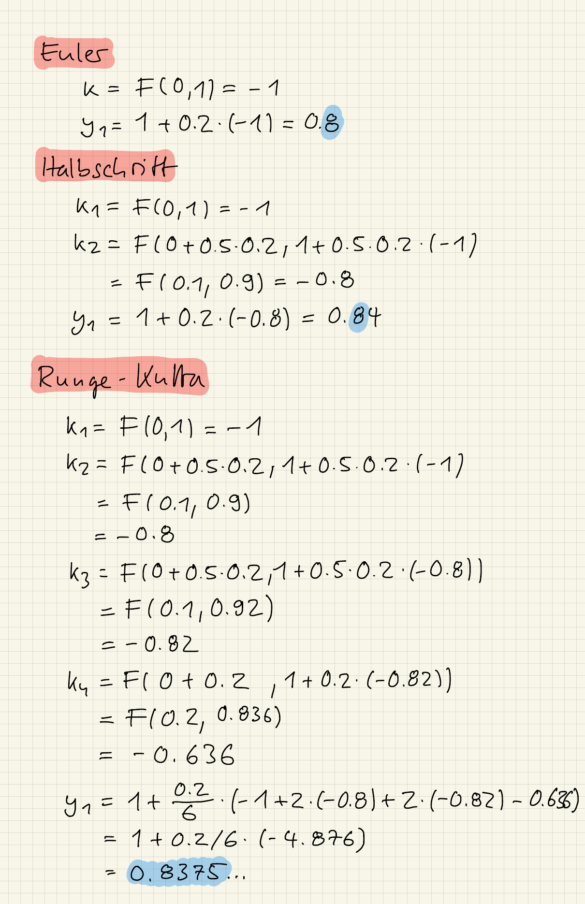

::: {#exr-ein-schritt}
## Ein Schritt mit drei Verfahren

Berechnen Sie für das Anfangswertproblem
$$
  y'(x) = x - y(x) \quad \text{mit} \quad y(0) = 1
$$
und die Schrittweite $h = 0.2$ jeweils einen Schritt mit dem Euler-Verfahren, dem Halbschrittverfahren und dem Runge-Kutta-Verfahren vierter Ordnung.

Vergleichen Sie die Ergebnisse mit der exakten Lösung
$$
  y(x) = 2e^{-x} + x - 1.
$$

::: {.tinh-solution}
{width="60%"}

{width="60%"}

**Zum Vergleich**

Die exakte Lösung ist $y(0.2) = 0.83746$. Das Euler-Verfahren liefert $y_1 = 0.8$, das Halbschrittverfahren $y_1 = 0.84$ und das Runge-Kutta-Verfahren $y_1 = 0.83747$. Mit jeder zusätzlichen Auswertung von $F$ innerhalb des Schritts wird die Näherung deutlich besser.
:::
:::
