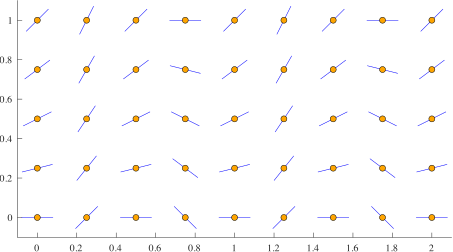
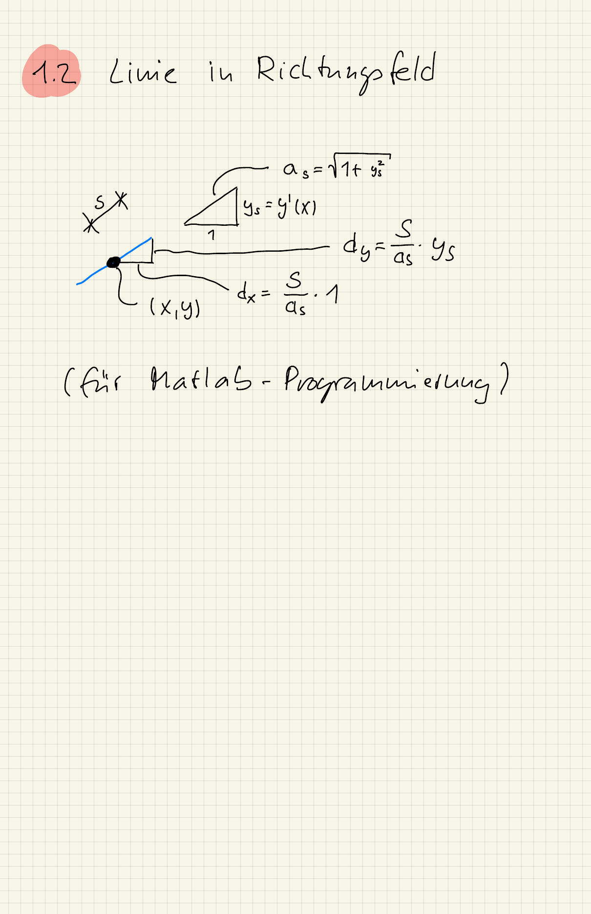

::: {#exr-richtungsfeld-programmieren}
## Richtungsfeld programmieren (freiwillig)

Erstellen Sie eine Funktion `plot_slope_field(F, xrange, yrange, delta)`, um das Richtungsfeld einer Differentialgleichung darzustellen, zum Beispiel so:

{width="60%"}

Testen Sie die Funktion mit der Differentialgleichung aus der Aufgabe zum Richtungsfeld im ersten Teil.

::: {.tinh-solution}
Der Code steht im Lösungs-Notebook. Für die Richtung der kurzen Strecken hilft die folgende Überlegung:

{width="60%"}
:::
:::
