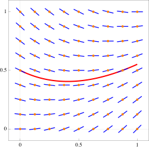
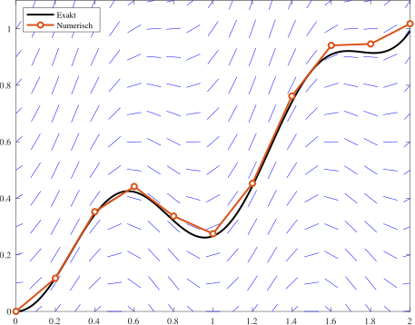
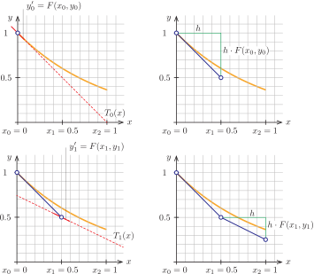
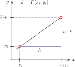
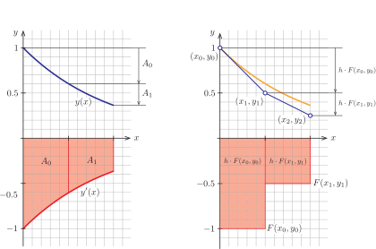
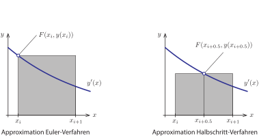
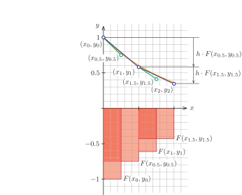
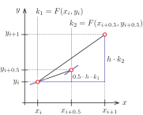
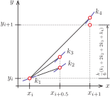

# Anfangswertprobleme erster Ordnung {#sec-anfangswertprobleme}

In Natur und Technik gibt es viele Vorgänge, bei denen der Zustand des betrachteten Systems sich über die Zeit verändert. Häufig ist dabei der Zustand des Systems zu einem bestimmten Zeitpunkt bekannt und man fragt sich, wie sich die Dinge über die Zeit verändern werden. Beispiele hierfür sind

- Erwärmung und Abkühlung von Bauteilen,

- Schwingungsvorgänge zum Beispiel bei Erdbeben,

- Ausbreitung von Schadstoffen in Wasser, Boden und Luft,

- Flugsimulatoren,

- Strömung von Fluiden (Luft, Wasser, Öl, …),

- Ausbreitung von Wellen (akustisch, elektromagnetisch, im Wasser, …),

- Wettervorhersage und Klimaprognosen,

- Ausbreitung von Infektionskrankheiten (zum Beispiel Covid-19).

Typisch bei solchen Aufgaben ist, dass die zeitliche Änderung des Zustandes vom aktuellen Zustand abhängt. Zum Beispiel ändert sich die Temperatur eines Metallstabes dann besonders schnell, wenn ein Ende des Stabes sehr warm und das andere Ende sehr kalt ist. Mathematisch werden solche Vorgänge durch Differentialgleichungen beschrieben. Zusammen mit den Anfangsbedingungen erhält man auf diese Weise ein Anfangswertproblem, das sich nur in seltenen Fällen auf dem Papier lösen lässt.

In diesem Kapitel beginnen wir mit dem einfachsten Fall aus dieser Problemklasse: Anfangswertprobleme erster Ordnung (es kommen nur erste Ableitungen vor) mit einer unbekannten Funktion.

## Grundlagen

::: {#def-anfangswertproblem}
## Anfangswertproblem

In einem [Anfangswertproblem]{.neuerbegriff} ist eine Funktion gesucht, die eine Differentialgleichung erster Ordnung erfüllt und gleichzeitig an einer vorgegebenen Stelle einen bestimmten Funktionswert annimmt. Mathematisch formuliert lautet das Problem: Gesucht ist eine Funktion $y : \R \to \R$ mit
$$
  y'(x) = F(x, y(x)) \quad\text{und}\quad y(x_0) = y_0.
$$
Dabei definiert die Funktion $F : \R^2 \to \R$ die Differentialgleichung und $y_0$ ist der vorgegebene Funktionswert zur Stelle $x_0$.
:::

::: {#exm-anfangswertproblem}
## Anfangswertproblem mit Richtungsfeld

Das Anfangswertproblem
$$
  y'(x) = x - y(x) \quad\text{mit}\quad y(0) = 1
$$
besitzt $F(x, y) = x - y$ als Funktion der Differentialgleichung und die Lösung
$$
  y(x) = x + 2 e^{-x} - 1.
$$
In @fig-beispiel-dgl sind das Richtungsfeld und die Lösungsfunktion des Anfangswertproblems dargestellt.

{#fig-beispiel-dgl width="45%"}
:::

Wir halten fest:

- Die Differentialgleichung $y'(x) = F(x, y(x))$ besagt: Wenn die Lösungsfunktion $y$ durch den Punkt $(x, y(x))$ verläuft, dann besitzt sie an der Stelle $x$ die Ableitung $F(x, y(x))$.

- In einem [Richtungsfeld]{.neuerbegriff} wird dieser Zusammenhang graphisch dargestellt. Dabei berechnet man für ausgewählte Punkte $(x_i, y_j)$ die Steigung $F(x_i, y_j)$ und stellt diese mit einer kurzen Strecke dar.

- Bei zeitabhängigen Prozessen verwenden wir $t$ als unabhängige Variable und schreiben $\dot{y}(t)$ statt $y'(x)$.

In bestimmten Fällen lassen sich Lösungen von Anfangswertproblemen analytisch bestimmen. Allgemeiner anwendbar sind jedoch numerische Lösungsverfahren.

## Numerische Lösungsverfahren

Bei der numerischen Lösung von Anfangswertproblemen gibt man sich damit zufrieden, Funktionswerte der Lösungsfunktion an einzelnen Stellen $x_i$ durch Werte $y_i$ anzunähern. Je besser die Näherungslösung ist, umso näher liegen die berechneten Zahlen $y_i$ an der exakten Lösung $y(x_i)$. @fig-numerische-loesung zeigt eine solche numerische Lösung zusammen mit der exakten Lösung des Anfangswertproblems.

{#fig-numerische-loesung width="70%"}

Um eine numerische Lösung zu bestimmen, benötigen wir also

- eine Funktion der Differentialgleichung $F$,

- einen Bereich $I = [x_0, x_\mathrm{e}]$, für den die Lösung gesucht wird,

- eine Schrittweite[^schrittweite] $h$,

- einen Anfangswert $y_0$.

[^schrittweite]: Es gibt auch adaptive Verfahren, in denen die Schrittweite basierend auf vorgegebenen Genauigkeitsanforderungen automatisch bestimmt und im Verlauf der Berechnung angepasst wird. Wir werden jedoch von einer festen Schrittweite ausgehen.

Mit einem numerischen Lösungsverfahren berechnet man auf dieser Grundlage die Werte
$$
  x_i = x_0 + i \cdot h \quad\text{und}\quad y_i, \quad i = 1, \dots, N,
$$
wobei $y_i$ die gesuchten Näherungen für $y(x_i)$ sind.

### Explizites Euler-Verfahren

Das explizite Euler-Verfahren wurde 1768 von Leonhard Euler veröffentlicht und ist das einfachste Verfahren zur numerischen Lösung von Anfangswertproblemen. Praktisch relevant wurde das Verfahren (und eine große Klasse verwandter Methoden) mit der Verfügbarkeit von elektronischen Computern. Ein frühes Anwendungsbeispiel ist die Berechnung der Bahnkurve einer Raumkapsel bei der NASA[^hidden-figures].

[^hidden-figures]: Der aus verschiedenen Gründen sehenswerte Film Hidden Figures beleuchtet die Rolle von drei afroamerikanischen Mathematikerinnen in dem Vorhaben.

::: {#exm-euler-tangenten}
## Euler-Verfahren mit Tangenten

Wir lösen näherungsweise das Anfangswertproblem
$$
  y'(x) = -y(x) \quad\text{mit}\quad y(0) = 1
$$
für $I = [0, 1]$ und eine Schrittweite $h = 0.5$ mit dem expliziten Euler-Verfahren.

Zunächst halten wir fest, dass die Funktion der Differentialgleichung die Zuordnungsvorschrift
$$
  F(x, y) = -y
$$
besitzt und
$$
  x_0 = 0,\; x_1 = 0.5,\; x_2 = 1
$$
die gegebenen Stellen auf der $x$-Achse sind. Weiterhin folgt aus dem vorgegebenen Startwert $y_0 = 1$. Die zugehörige Steigung ist
$$
  y_0' = F(x_0, y_0) = -1.
$$
Damit können wir die Lösungsfunktion durch die Tangentenfunktion
$$
  T_0(x) = 1 - x
$$
approximieren. Natürlich ist die Tangentenfunktion nur in der unmittelbaren Umgebung von $x_0$ eine vernünftige Näherung an die gesuchte Lösungsfunktion. Die Idee von Euler bestand daher darin, diesen Approximationsschritt zu wiederholen. Wir gehen also das Stück $h$ entlang der Tangentenfunktion und erhalten einen neuen Punkt mit den Koordinaten
$$
  x_1 = 0.5 \quad\text{und}\quad y_1 = T_0(0.5) = 1 - 0.5 = 0.5,
$$
wie in @fig-euler oben rechts dargestellt. Mithilfe der Steigung
$$
  y_1' = F(x_1, y_1) = -0.5
$$
können wir die Tangentenfunktion
$$
  T_1(x) = 0.5 - 0.5(x - 0.5)
$$
aufstellen (@fig-euler unten links) und erhalten den nächsten Punkt
$$
  x_2 = 1 \quad\text{und}\quad y_2 = T_1(1) = 0.5 - 0.5(1-0.5) = 0.25,
$$
siehe @fig-euler unten rechts.
:::

{#fig-euler}

In @fig-euler ist zu sehen, dass die Aufstellung der Tangentenfunktion gar nicht notwendig ist: Wir erhalten die Höhendifferenz aus der Schrittweite multipliziert mit der Steigung. Dies führt uns auf die Rechenvorschrift für das explizite Euler-Verfahren.

::: {#def-euler}
## Explizites Euler-Verfahren

{width="40%"}

$$
  \begin{aligned}
    k & = F(x_i, y_i) \\[1ex]
    y_{i + 1} & = y_i + h \cdot k
  \end{aligned}
$$
:::

::: {#exm-euler-kompakt}
## Euler-Verfahren kompakt

Zurück zum Beispiel
$$
  F(x, y) = -y, \quad I = [0, 1], \quad h = 0.5 \quad\text{und}\quad y_0 = 1,
$$
das wir nun kompakt mit dem expliziten Euler-Verfahren lösen (so wie man das auch programmieren könnte). Zunächst stellen wir fest, dass wir $N = 2$ Schritte benötigen. Damit lassen sich sofort die Stellen
$$
  x_0 = 0,\; x_1 = 0.5,\; x_2 = 1
$$
angeben und wir erhalten für die gesuchten Näherungen
$$
  \begin{aligned}
    &          & y_0 & = 1 \\
    k & = -1   & y_1 & = 1 + 0.5 \cdot (-1) = 0.5 \\
    k & = -0.5 & y_2 & = 0.5 + 0.5 \cdot (-0.5) = 0.25.
  \end{aligned}
$$
:::

### Numerische Integration

Eine andere Sicht auf das explizite Euler-Verfahren eröffnet sich, wenn wir den Schritt $y_{i+1} = y_i + h \cdot F(x_i, y_i)$ als numerische Integration interpretieren.

Aus der Integralrechnung kennen wir den Zusammenhang
$$
  \int_{x_i}^{x_{i+1}} y'(x) \; \mathrm{d}x
  =
  \Bigl[y(x)\Bigr]_{x_i}^{x_{i+1}}
  =
  y(x_{i+1}) - y(x_i).
$$
Umstellen nach $y(x_{i+1})$ liefert die Beziehung
$$
  y(x_{i+1}) = y(x_i) + \int_{x_i}^{x_{i+1}} y'(x) \; \mathrm{d}x.
$$ {#eq-integration}
Der Funktionswert an der Stelle $x_{i+1}$ ergibt sich somit aus dem Funktionswert für $x_i$ zusammen mit dem orientierten Flächeninhalt unter dem Graphen von $y'$ zwischen $x_i$ und $x_{i+1}$ (vergleiche @fig-euler-integration links).

Der Vergleich mit der Rechenvorschrift des Euler-Verfahrens
$$
  y_{i+1} = y_i + h \cdot \underbrace{F(x_i, y_i)}_{y'(x_i)}
$$
erlaubt eine neue Interpretation des Zuwachses $h \cdot F(x_i, y_i)$: Es handelt sich um eine numerische Approximation des Integrals $\int_{x_i}^{x_{i+1}} y'(x) \; \mathrm{d}x$. Die Approximation ist recht grob (vergleiche @fig-euler-integration), was auch die signifikante Abweichung der Näherung von der exakten Lösung erklärt. Eine verbesserte Approximation liefert das Halbschrittverfahren.

{#fig-euler-integration}

### Halbschrittverfahren

Die Idee des Halbschrittverfahrens besteht darin, das Integral $\int_{x_i}^{x_{i+1}} y'(x) \; \mathrm{d}x$ mithilfe des Funktionswertes bei der halben Schrittweite zu approximieren, siehe @fig-halbschritt-integration. Offensichtlich wird der Flächeninhalt unter dem Graphen von $y'$ damit wesentlich besser approximiert als mit dem Anfangswert des Euler-Verfahrens.

{#fig-halbschritt-integration}

Problematisch dabei ist, dass wir den Funktionswert $y(x_{i+0.5})$ bei der halben Schrittweite nicht kennen. Dieser wird daher in einem Zwischenschritt nach der Vorschrift des Euler-Verfahrens approximiert.

::: {#exm-halbschritt}
## Halbschrittverfahren

Wir lösen das Anfangswertproblem
$$
  F(x, y) = -y, \quad I = [0, 1], \quad h = 0.5 \quad\text{und}\quad y_0 = 1
$$
mit dem Halbschrittverfahren (@fig-halbschritt-integration-2).

**1. Schritt.** Die Steigung im Punkt $(x_0 = 0, y_0 = 1)$ ist
$$
  k_1 = F(x_0, y_0) = -1.
$$
Damit erhalten wir den Hilfspunkt im halben Schritt
$$
  x_{0.5} = x_0 + 0.5 \cdot h = 0.25 \quad\text{und}\quad y_{0.5} = y_0 + 0.5 \cdot h \cdot k_1 = 1 + 0.5 \cdot 0.5 \cdot (-1) = 0.75.
$$
Die Steigung im Hilfspunkt ist
$$
  k_2 = F(x_{0.5}, y_{0.5}) = -0.75
$$
und somit
$$
  x_1 = x_0 + h = 0.5 \quad\text{und}\quad y_1 = y_0 + h \cdot k_2 = 1 + 0.5 \cdot (-0.75) = 0.625.
$$

**2. Schritt.** Die Berechnung erfolgt analog.
:::

{#fig-halbschritt-integration-2}

Wir verallgemeinern das Vorgehen aus dem Beispiel zur Rechenvorschrift für das Halbschrittverfahren.

::: {#def-halbschritt}
## Halbschrittverfahren

{width="40%"}

$$
  \begin{aligned}
    k_1 & = F(x_i, y_i) \\[1ex]
    k_2 & = F(x_i + 0.5 \cdot h, y_i + 0.5 \cdot h \cdot k_1) \\[1ex]
    y_{i + 1} & = y_i + h \cdot k_2
  \end{aligned}
$$
:::

Da wir im Halbschrittverfahren zwei Auswertungen der Funktion $F$ der Differentialgleichung benötigen, nennt man das Verfahren auch zweistufig.

Wie das Beispiel gezeigt hat, haben wir mit dem Halbschrittverfahren eine gegenüber dem expliziten Euler-Verfahren deutlich verbesserte Vorschrift zur Approximation des Integrals in @eq-integration erhalten. Nun liegt es nahe, dass sich auch die Vorschrift des Halbschrittverfahrens noch weiter verbessern lässt, und in der Tat, das ist so. Es gibt eine große Vielfalt von numerischen Verfahren zur Lösung von Anfangswertproblemen, die sich in der Anzahl der Stufen und den Stellen, an denen die Hilfsgrößen bestimmt werden, unterscheiden. Herleiten lassen sich die Verfahren auf der Grundlage einer Taylor-Entwicklung und mithilfe sogenannter Butcher-Bäume [@butcher_1963]. Allerdings ist dies alles andere als trivial und in keiner Weise anschaulich.

### Runge-Kutta-Verfahren vierter Ordnung

Einen sehr guten Kompromiss aus Genauigkeit und Rechenaufwand liefert das Runge-Kutta-Verfahren (nach Carl Runge und Martin Wilhelm Kutta), das für eine Vielzahl von Problemstellungen hervorragend geeignet ist und in der Praxis häufig eingesetzt wird (meist mit automatischer Schrittweitensteuerung).

::: {#def-runge-kutta}
## Runge-Kutta-Verfahren

{width="40%"}

$$
  \begin{aligned}
    k_1 & = F(x_i, y_i) \\[1ex]
    k_2 & = F(x_i + 0.5 \cdot h, y_i + 0.5 \cdot h \cdot k_1) \\[1ex]
    k_3 & = F(x_i + 0.5 \cdot h, y_i + 0.5 \cdot h \cdot k_2) \\[1ex]
    k_4 & = F(x_i +  h, y_i + h \cdot k_3) \\[2ex]
    y_{i+1} & = y_{i}+\frac{h}{6}(k_{1}+2k_{2}+2k_{3}+k_{4})
  \end{aligned}
$$
:::
