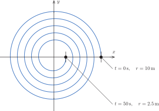
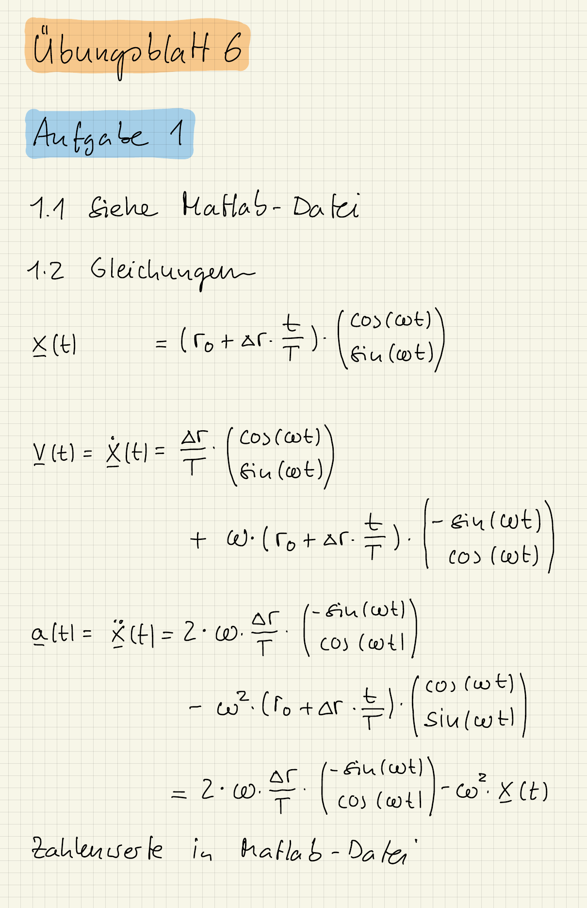

::: {#exr-kinematik}
## Kinematik: Bewegung auf einer Spirale

Die Gleichung eines Punktes, der sich auf einer archimedischen Spirale bewegt, lautet
$$
  \mathbf{x}(t)
  =
  \left(r_0 + \Delta r \cdot \frac{t}{T}\right)
  \cdot
  \mmat{\cos(\omega t) \\[1ex] \sin(\omega t)},
$$
wobei $\omega = 2\pi/T$ ist. Der Radius ändert sich also bei jeder Umdrehung um $\Delta r$.

{width="60%"}

1. Bestimmen Sie für den dargestellten Massepunkt die Bewegungsgleichung, also die Werte von $r_0$, $\Delta r$ und $T$.

1. Bestimmen Sie allgemein den Geschwindigkeitsvektor $\mathbf{v}(t)$ und den Beschleunigungsvektor $\mathbf{a}(t)$.

1. Geben Sie die Geschwindigkeits- und Beschleunigungsvektoren am Anfangs- und Endpunkt an.

::: {.tinh-solution}
{width="60%"}

**Zu Punkt 1 (Bewegungsgleichung)**

Nach $t = 50$ s ist der Punkt nach fünf Umdrehungen wieder auf der $x$-Achse, also ist $T = 10$ s und $\omega = \pi/5$. Mit $r_0 = 10$ m und dem Radius $2.5$ m am Ende ist $\Delta r = (2.5 - 10)/5 = -1.5$ m.

**Zu Punkt 3 (Anfangs- und Endpunkt)**

Mit den Formeln aus der Lösung zum zweiten Punkt ist
$$
  \mathbf{v}(0) = \mmat{-0.15 \\ 6.283}, \quad
  \mathbf{a}(0) = \mmat{-3.948 \\ -0.188}, \quad
  \mathbf{v}(50) = \mmat{-0.15 \\ 1.571}, \quad
  \mathbf{a}(50) = \mmat{-0.987 \\ -0.188}
$$
(in m/s und m/s²). Die Zahlenwerte stehen auch im Lösungs-Notebook.
:::
:::
