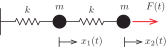
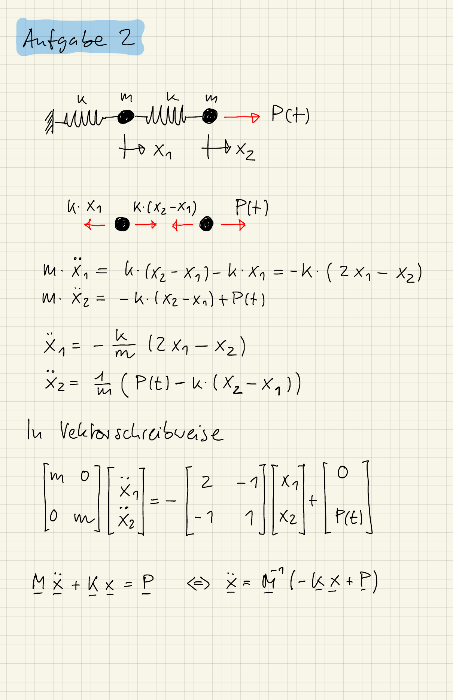

::: {#exr-kinetik}
## Kinetik: Zweimassenschwinger

Stellen Sie für den dargestellten Zweimassenschwinger die Differentialgleichungen auf.

{width="60%"}

::: {.tinh-solution}
{width="60%"}
:::
:::
