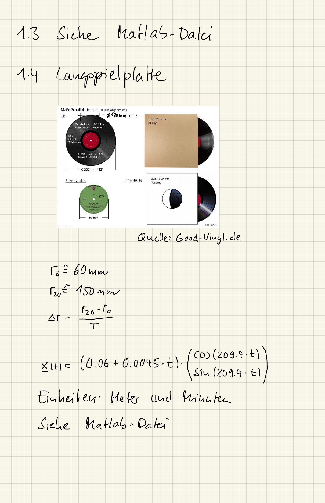

::: {#exr-spirale-in-python}
## Spirale in Python

1. Plotten Sie die Bahnkurve des Massepunkts aus der Aufgabe zur Kinematik und überprüfen Sie damit Ihre Bewegungsgleichung.

1. Plotten Sie die Geschwindigkeit $v(t) = |\mathbf{v}(t)|$ (als Zahlenwert) über die Zeit.

1. Zusatzaufgabe: Wie könnte die (vereinfachte) Gleichung für die Rille einer Langspielplatte lauten, wenn wir davon ausgehen, dass sich der Radius bei jeder Umdrehung um das gleiche Maß ändert und wir 20 Minuten Musik unterbringen wollen? Eine Langspielplatte dreht sich mit $33\frac{1}{3}$ Umdrehungen pro Minute, die Rille beginnt bei einem Radius von etwa 150 mm und endet bei etwa 60 mm. Wie lang ist dann die Rille? Approximieren Sie die Länge numerisch.

::: {.callout-tip title="Tipps für Python"}
- Mit `t = np.linspace(0, 50, 1000)` erhalten Sie viele Zeitpunkte, mit denen Sie Bahnkurve und Geschwindigkeit als Linien plotten können.
- Die Länge der Rille ist das Integral der Geschwindigkeit über die Zeit. Eine einfache Näherung ist die Summe der Abstände zwischen aufeinanderfolgenden Punkten der Bahnkurve, `np.diff` und `np.linalg.norm(..., axis=0)` helfen dabei.
:::

::: {.tinh-solution}
Der Code steht im Lösungs-Notebook.

{width="60%"}

**Zu Punkt 3 (Langspielplatte)**

In 20 Minuten macht die Platte $20 \cdot 33\frac{1}{3} \approx 667$ Umdrehungen, der Radius ändert sich also je Umdrehung um $\Delta r = -90/667 \approx -0.135$ mm. Die Rille ist etwa 440 m lang. Zur Kontrolle: Das ist ungefähr die Anzahl der Umdrehungen mal dem Umfang beim mittleren Radius, $667 \cdot 2\pi \cdot 0.105$ m $\approx 440$ m. In der handschriftlichen Lösung läuft die Rille von innen nach außen, an der Länge ändert das nichts.
:::
:::
