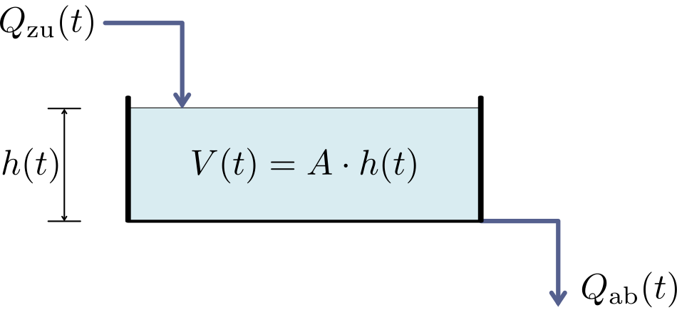
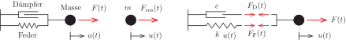
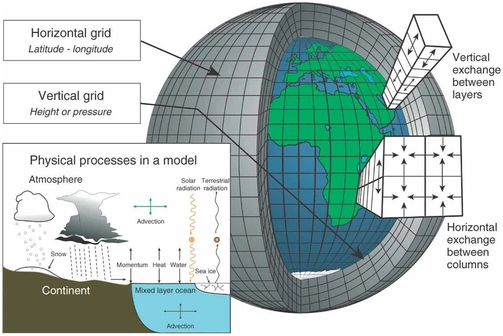

# Beispiele aus Natur und Technik

```{=typst}
#vollbild("bilder/thermogramm.jpg")
#vollbild("bilder/tacoma-narrows.jpg")
#vollbild("bilder/oelteppich.jpg")
#vollbild("bilder/wirbelstrasse.jpg")
#vollbild("bilder/raumakustik-comsol.jpg")
#vollbild("bilder/klimaprojektionen-ipcc.png")
#vollbild("bilder/covid-19-neuinfektionen.png")
```

## Gemeinsamkeiten

[]{.down40}

- Alles hochgradig relevante Fragestellungen!

- Zustand eines Systems ändert sich mit der Zeit

- Bekannt: Zustand zu einem Anfangszeitpunkt (mehr oder weniger genau)

- Gesucht: Vorhersage über das zeitliche Verhalten des Systems

- Aus mathematischer Sicht wird das Verhalten durch Funktionen beschrieben

- Wir werden gleich sehen: Wichtig sind die Ableitungen!

# Beispiele für die mathematische Modellierung

## Auskühlen eines Gebäudes

::: {.columns}
::: {.column width=40%}

:::
::: {.column width=60%}
Wärmeverlust durch Transmission und Lüftung
$$
\begin{aligned}
  \Phi(t) &= \bigl(H_\mathrm{T} + H_\mathrm{V}\bigr) \, \bigl(\theta(t) - \theta_\mathrm{U}\bigr) \quad \text{mit} \\
  H_\mathrm{T} &= \sum_j U_j A_j, \quad H_\mathrm{V} = \rho c_p \, n \, V
\end{aligned}
$$

Auskühlzeitkonstante nach DIN/TS 18599-2

$$
  \tau = \frac{C_\mathrm{wirk}}{H_\mathrm{T} + H_\mathrm{V}}
$$
:::
:::

Raumtemperatur $\theta(t)$ bei Außentemperatur $\theta_\mathrm{U}$ (newtonsches Abkühlungsgesetz)

$$
  \theta'(t) = -\frac{1}{\tau} \, \bigl(\theta(t) - \theta_\mathrm{U}\bigr) \quad \text{mit} \quad \theta(0) = \theta_0
$$

## Regenrückhaltebecken

[]{.down20}

{width="50%"}

Füllhöhe $h(t)$ bei Zufluss $Q_\mathrm{zu}(t)$ und Abfluss nach Torricelli

$$
  h'(t) = \frac{1}{A}\left(Q_\mathrm{zu}(t) - \beta \sqrt{h(t)}\right) \quad \text{mit} \quad h(0) = h_0
$$

## Einmassenschwinger

[]{.down30}

{width="90%"}

[]{.down30}

Bewegungsgleichung

$$
  m \, u''(t) + c \, u'(t) + k \, u(t) = F_\mathrm{ext}(t)
$$

Anfangsbedingungen

$$
  u(0) = u_0, \quad u'(0) = v_0
$$

## Einmassenschwinger als System erster Ordnung

[]{.down30}

Mit der Geschwindigkeit $v(t) = u'(t)$

[]{.down30}

Differentialgleichungen

$$
\begin{aligned}
  u'(t) &= v(t) \\
  v'(t) &= \frac{1}{m}\left(F_\mathrm{ext}(t) - c \, v(t) - k \, u(t) \right)
\end{aligned}
$$

Anfangsbedingungen

$$
u(0) = u_0, \quad v(0) = v_0
$$

## Wetter und Klima

{width="50%"}

- Gleichungen für Temperatur, Druck, Feuchtigkeit usw. in jeder Gitterzelle

- Bis zu Milliarden gekoppelter nichtlinearer Differentialgleichungen erster Ordnung

# Klassifikation von Differentialgleichungen

## Gewöhnliche und partielle Differentialgleichungen

[]{.down20}

[Gewöhnliche Differentialgleichung]{.neuerbegriff}: Gesuchte Funktion hängt von einer Variablen ab

[]{.down5}

Beispiel: Mathematisches Pendel

$$
  \varphi''(t) + \frac{g}{l} \cdot \sin\bigl(\varphi(t)\bigr) = 0
$$

[]{.down20}

[Partielle Differentialgleichung]{.neuerbegriff}: Gesuchte Funktion hängt von mehreren Variablen ab

[]{.down5}

Beispiel: Temperatur in einem Stab

$$
  \frac{\partial \theta}{\partial t}(x, t) = \frac{\lambda}{\rho \, c} \, \frac{\partial^2 \theta}{\partial x^2}(x, t)
$$

## Ordnung

[]{.down20}

[Ordnung einer Differentialgleichung]{.neuerbegriff}: Ordnung der höchsten vorkommenden Ableitung der gesuchten Funktion

[]{.down20}

Erste Ordnung

$$
  y'(x) = y(x)
$$

Vierte Ordnung (Biegelinie eines Balkens)

$$
  EI \cdot w''''(x) = q(x)
$$

## Lineare Differentialgleichungen

[]{.down20}

[Lineare Differentialgleichung]{.neuerbegriff}: Gesuchte Funktion und Ableitungen nur in erster Potenz, nicht miteinander multipliziert, nicht als Argument einer Funktion

[]{.down5}

Linear

$$
  y'(x) = \sin(x) \cdot y(x)
$$

Gegenbeispiel

$$
  y''(x) + a \cdot y'(x) + \sin(y(x)) = 0
$$

[]{.down10}

[Lineare Differentialgleichung mit konstanten Koeffizienten]{.neuerbegriff}: Alle Koeffizienten unabhängig von $x$ 

$$
  a \cdot y'''(x) + b \cdot y''(x) + c \cdot y'(x) + d \cdot y(x) = f(x)
$$


## Systeme von Differentialgleichungen

[]{.down20}

[System von Differentialgleichungen]{.neuerbegriff}: Mehrere gesuchte Funktionen und Gleichungen

[]{.down20}

Beispiel: Räuber-Beute-Modell

$$
\begin{aligned}
  \text{🐇}'(t) &= \phantom{-}a \cdot \text{🐇}(t) - b \cdot \text{🐇}(t) \cdot \text{🦊}(t) \\
  \text{🦊}'(t) &= -c \cdot \text{🦊}(t) + d \cdot \text{🐇}(t) \cdot \text{🦊}(t)
\end{aligned}
$$

→ Gleichungen gekoppelt (🐇 und 🦊 in beiden Gleichungen)

→ Nichtlineares System von zwei Differentialgleichungen erster Ordnung

## Wie es weitergeht

[]{.down50}

Anfangswertprobleme und numerische Lösungsverfahren

1. Für eine unbekannte Funktion

1. Für mehrere unbekannte Funktionen

1. Genauigkeit und Abhängigkeit von Startwerten

1. Anwendung auf Wärmeleitung in einer Wand, Stabilität

## Bildquellen

Beispiele aus Natur und Technik in der Reihenfolge der Folien

- Thermogramm eines Passivhauses: Wikimedia Commons, Passivhaus Institut, CC BY-SA 3.0
- Einsturz der Tacoma-Narrows-Brücke 1940, Ölteppich auf dem Meer, Kármánsche Wirbelstraße hinter der Insel Alejandro Selkirk: C&EN; NASA; Jules, CC BY-SA 4.0
- Schallausbreitung in einem Büro (Simulation): COMSOL
- Projektionen der globalen Temperatur bis 2100: IPCC 2021
- Tägliche Covid-19-Neuinfektionen je Million Einwohner 2021–2022: Our World in Data, CC BY 4.0
- Wetter- und Klimamodell: NOAA
