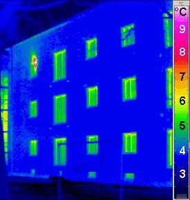
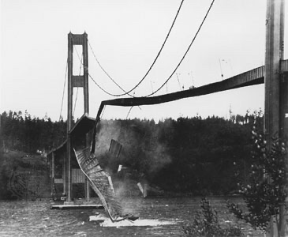
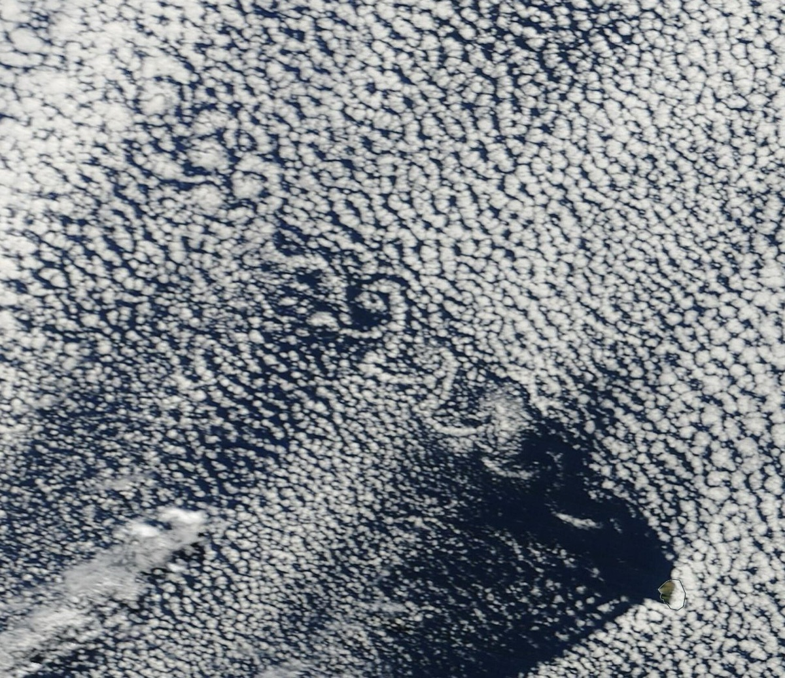
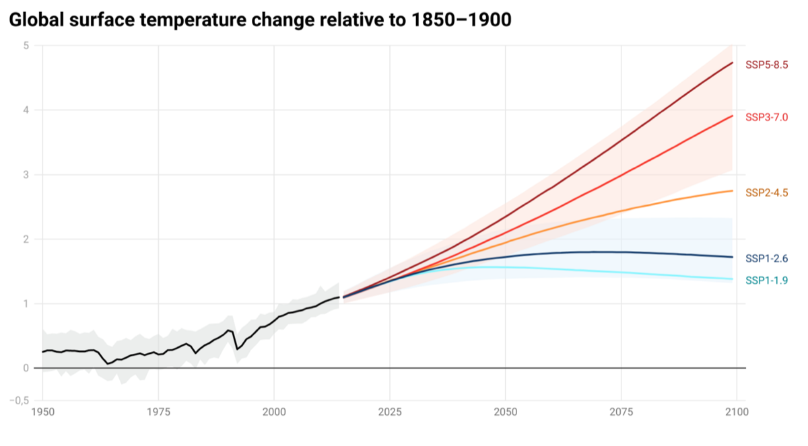
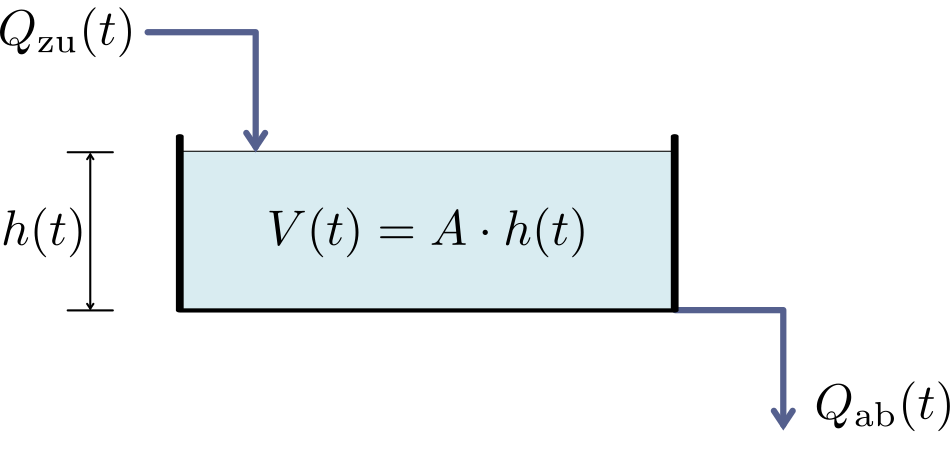
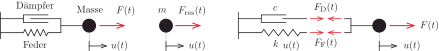
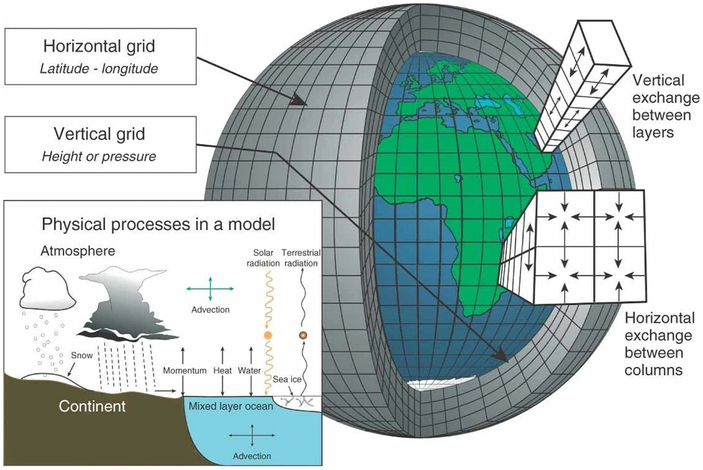

In Natur und Technik gibt es viele Vorgänge, bei denen sich der Zustand des betrachteten Systems mit der Zeit verändert. Häufig ist dabei der Zustand des Systems zu einem bestimmten Zeitpunkt bekannt, und gesucht ist, wie er sich weiterentwickelt. Beispiele hierfür sind

- Wärmeleitungsprozesse, zum Beispiel in Bauteilen oder im Erdreich,

- Schwingungsvorgänge in Tragwerken wie Brücken oder Hochhäusern,

- Ausbreitung von Schadstoffen in Wasser, Boden und Luft,

- Strömung von Fluiden (Luft, Wasser, Öl, …),

- Ausbreitung von Wellen (akustisch, elektromagnetisch, im Wasser, …),

- Wettervorhersagen und Klimaprognosen,

- Ausbreitung von Infektionskrankheiten (zum Beispiel Covid-19).

Alle diese Aufgaben sind von hoher praktischer Relevanz. Um fundierte Entscheidungen über unser eigenes Leben, die Planung von Infrastruktur, den Betrieb von Anlagen oder gesellschaftliche Zielsetzungen treffen zu können, sind wir auf Methoden angewiesen, mit denen sich das Verhalten solcher Systeme vorhersagen lässt.

::: {#fig-zeitabhaengige-vorgaenge}
{width="19.4%"} {width="24.9%"} {width="30%"} {width="23.7%"}

{width="27.3%"} {width="37%"} {width="29%"}

Beispiele für zeitabhängige Vorgänge (zeilenweise von links): Thermogramm eines Passivhauses, Einsturz der Tacoma-Narrows-Brücke 1940, Ölteppich auf dem Meer, Kármánsche Wirbelstraße in den Wolken hinter der Insel Alejandro Selkirk, Schallausbreitung in einem Büro (Simulation), Projektionen der globalen Temperatur bis 2100 für verschiedene Emissionsszenarien (Klimamodelle, IPCC 2021), tägliche Covid-19-Neuinfektionen je Million Einwohner 2021–2022 (Quellen: C&EN; COMSOL; Wikimedia Commons: Passivhaus Institut, CC BY-SA 3.0; NASA; Jules, CC BY-SA 4.0; Our World in Data, CC BY 4.0)
:::

Aus mathematischer Sicht ist bei diesen Fragestellungen ein Problem zu lösen, in dem das zeitliche Verhalten eines Systems von einer oder mehreren Funktionen beschrieben wird. Für diese Funktionen kennt man die Werte zu einem Anfangszeitpunkt und weiß, wie Funktionswerte und Werte von Ableitungen zusammenhängen. In seltenen Fällen lassen sich solche Probleme auf dem Papier lösen, in der Regel wird man aber numerische Berechnungen auf dem Computer durchführen.

## Beispiele

### Auskühlen eines Gebäudes bei dem Ausfall der Heizung

Fällt im Winter die Heizung eines Gebäudes aus, kühlt es allmählich aus. Wie lange dauert es, bis die Raumtemperatur von $\SI{20}{\degreeCelsius}$ auf $\SI{15}{\degreeCelsius}$ gesunken ist?

#### Newtonsches Abkühlungsgesetz

Wir betrachten zunächst allgemein einen Körper mit der Temperatur $\theta(t)$, der sich in einer Umgebung mit der konstanten Temperatur $\theta_\mathrm{U}$ befindet. Vereinfachend nehmen wir an, dass die Temperatur im ganzen Körper gleich ist. Mit der Wärmekapazität $C$ des Körpers (in $\si{\joule\per\kelvin}$) ist die gespeicherte Wärmemenge, gemessen gegenüber einer beliebigen Bezugstemperatur,
$$
  E(t) = C \, \theta(t).
$$
Ist der Körper wärmer als die Umgebung, gibt er Wärme an diese ab. Nach dem newtonschen Abkühlungsgesetz ist der abgegebene Wärmestrom (Wärmemenge pro Zeit, in $\si{\watt}$) proportional zur Temperaturdifferenz,
$$
  \Phi(t) = H \, \bigl(\theta(t) - \theta_\mathrm{U}\bigr),
$$
mit dem Wärmetransferkoeffizienten $H$ (in $\si{\watt\per\kelvin}$). In einem kurzen Zeitintervall der Länge $\Delta t$ gibt der Körper näherungsweise die Wärmemenge $\Phi(t) \, \Delta t$ ab, um die seine gespeicherte Wärmemenge abnimmt:
$$
  C \, \theta(t + \Delta t) - C \, \theta(t) \approx -H \, \bigl(\theta(t) - \theta_\mathrm{U}\bigr) \, \Delta t.
$$
Wir teilen durch $C \, \Delta t$ und lassen $\Delta t$ gegen null gehen. Aus dem Differenzenquotienten wird die Ableitung, und wir erhalten die Differentialgleichung für die Temperatur zusammen mit der Anfangstemperatur $\theta_0$ zum Zeitpunkt $t = 0$,
$$
  \boxed{
    \theta'(t) = -\frac{1}{\tau} \, \bigl(\theta(t) - \theta_\mathrm{U}\bigr)
    \quad\text{mit}\quad
    \theta(0) = \theta_0
  }
$$
mit der Zeitkonstanten $\tau = C / H$. Eine große Wärmekapazität und ein kleiner Wärmetransferkoeffizient führen auf eine große Zeitkonstante, der Körper kühlt dann langsam ab.

#### Anwendung auf Gebäude

Für ein Gebäude ist $\theta(t)$ die Raumtemperatur und $\theta_\mathrm{U}$ die Außentemperatur. Die Kenngrößen $C$ und $H$ werden bei der energetischen Bewertung von Gebäuden ohnehin bestimmt (DIN/TS 18599-2:2025-10, Abschnitte 5.5.2 und 6.7). Eine Gebäudezone ist dort ein Teil des Gebäudes mit einheitlicher Nutzung, der mit einer einheitlichen Temperatur gerechnet wird. Bei Wohngebäuden ist das meist das ganze Gebäude, Nichtwohngebäude werden in mehrere Zonen aufgeteilt (zum Beispiel Büros, Flure und Serverraum). Eine Gebäudezone entspricht damit genau dem Körper mit einheitlicher Temperatur, den wir oben betrachtet haben. Die Norm bezeichnet $C = C_\mathrm{wirk}$ als wirksame Wärmekapazität der Gebäudezone. Sie kann pauschal aus der Nettogrundfläche $A_\mathrm{NGF}$ ermittelt werden, mit $C_\mathrm{wirk} = \SI{50}{\watt\hour\per\metre\squared\per\kelvin} \cdot A_\mathrm{NGF}$ für leichte, $\SI{90}{\watt\hour\per\metre\squared\per\kelvin} \cdot A_\mathrm{NGF}$ für mittelschwere und $\SI{130}{\watt\hour\per\metre\squared\per\kelvin} \cdot A_\mathrm{NGF}$ für schwere Bauweise. Der Wärmetransferkoeffizient ergibt sich aus der Transmission durch die Bauteile der Gebäudehülle,
$$
  H = \sum_j U_j A_j,
$$
mit den Wärmedurchgangskoeffizienten $U_j$ und den Flächen $A_j$ der Bauteile. Die Norm bezeichnet $\tau = C_\mathrm{wirk} / H$ als Auskühlzeitkonstante der Gebäudezone. Mit $C_\mathrm{wirk}$ in $\si{\watt\hour\per\kelvin}$ und $H$ in $\si{\watt\per\kelvin}$ ergibt sich $\tau$ direkt in Stunden.

### Regenrückhaltebecken

Regenrückhaltebecken dienen bei Starkregenereignissen als Puffer, um eine Überlastung der Kanalisationsnetze zu vermeiden. Wie ein solches Becken gebaut wird und funktioniert, zeigt ein [Video der LWG Lausitzer Wasser](https://youtu.be/0e77g5sij5I).

::: {#fig-regenrueckhaltebecken}
{width="45%"} {width="45%"}

Bau eines unterirdischen Regenrückhaltebeckens aus Kunststoff-Füllkörpern (links, Quelle: [LWG Lausitzer Wasser](https://lausitzer-wasser.de/de/aktuelles-und-presse/aktuelles/artikel-was-ist-ein-regenrueckhaltebecken.html)) und Prinzipskizze (rechts)
:::

Das Funktionsprinzip eines einfachen Rückhaltebeckens ist in @fig-regenrueckhaltebecken rechts dargestellt. Wir betrachten ein prismatisches Becken mit der Grundfläche $A$. Die zeitlich veränderliche Füllhöhe ist $h(t)$, so dass für das Füllvolumen
$$
  V(t) = A \cdot h(t)
$$
gilt. Weiterhin sei $Q_\mathrm{zu}(t)$ der Zufluss und $Q_\mathrm{ab}(t)$ der Abfluss, jeweils als Volumen pro Zeit gemessen (zum Beispiel in $\si{\metre\cubed\per\second}$). Für das Füllvolumen zum Zeitpunkt $t + \Delta t$ werden Zu- und Abfluss über das Zeitintervall integriert, so dass wir
$$
  V(t + \Delta t)
  =
  V(t) + \int_t^{t+\Delta t} \bigl(Q_\mathrm{zu}(s) - Q_\mathrm{ab}(s)\bigr) \, ds
$$
erhalten. Der Mittelwertsatz der Integralrechnung besagt, dass es ein $s$ zwischen $t$ und $t + \Delta t$ gibt, für das
$$
  V(t + \Delta t) 
  = 
  V(t) + \bigl(Q_\mathrm{zu}(s) - Q_\mathrm{ab}(s)\bigr) \cdot \Delta t
$$
gilt. Die Gleichung stellen wir um zu
$$
  \frac{V(t + \Delta t)  - V(t)}{\Delta t} = Q_\mathrm{zu}(s) - Q_\mathrm{ab}(s)
$$
und lassen $\Delta t$ gegen null gehen. Aus dem Differenzenquotienten wird damit die Ableitung, und weil $s$ zwischen $t$ und $t + \Delta t$ liegt, geht $s$ dabei gegen $t$. Wir erhalten
$$
  V'(t) = Q_\mathrm{zu}(t) - Q_\mathrm{ab}(t),
$$
die Änderung des Füllvolumens ist gleich der Differenz von Zu- und Abfluss.

Der italienische Physiker Evangelista Torricelli (1608–1647) hat festgestellt, dass die Geschwindigkeit, mit der Wasser durch ein Loch in der Wand eines Behälters ausströmt, gleich der Geschwindigkeit eines Körpers im freien Fall aus derselben Höhe ist. Damit gilt $v = \sqrt{2 g h}$. Mit dem Beiwert $\beta$, der die Erdbeschleunigung sowie Querschnitt und Form des Auslasses zusammenfasst, ergibt sich die Formel
$$
  Q_\mathrm{ab}(t) = \beta \sqrt{h(t)}
$$
für den Abfluss. Wir setzen dieses Zwischenergebnis zusammen mit $V(t) = A \cdot h(t)$ ein und erhalten
$$
  \bigl(A \cdot h(t)\bigr)' = Q_\mathrm{zu}(t) - \beta \sqrt{h(t)}
  \iff
  h'(t) = \frac{1}{A}\left(Q_\mathrm{zu}(t) - \beta \sqrt{h(t)}\right).
$$

Mit einer gegebenen Funktion $Q_\mathrm{zu}$ für den Zufluss über die Zeit und der Füllhöhe $h_0$ zum Zeitpunkt $t = 0$ erhalten wir die Differentialgleichung für die Füllhöhe zusammen mit der Anfangsbedingung
$$
  \boxed{
    h'(t) = \frac{1}{A}\left(Q_\mathrm{zu}(t) - \beta \sqrt{h(t)}\right)
    \quad\text{mit}\quad
    h(0) = h_0
  }
$$
Gesucht ist die Füllhöhe $h(t)$ für $t \geq 0$. Wegen der Wurzel ist die Differentialgleichung nichtlinear und lässt sich nur schwer oder gar nicht von Hand lösen.

### Einmassenschwinger

Der [Einmassenschwinger]{.neuerbegriff} wird im Ingenieurwesen als Modell für eine Vielzahl mechanischer Systeme verwendet. In der klassischen Modellierung setzt er sich aus drei Bestandteilen zusammen: einem Massepunkt, einer Feder und einem Dämpfer (@fig-einmassenschwinger).

{#fig-einmassenschwinger}

#### Massepunkt

Der Massepunkt mit der Masse $m$ kann sich in horizontaler Richtung reibungslos hin- und herbewegen. Zum Zeitpunkt $t$ ist er um die Verschiebung $u(t)$ aus der Ruhelage ausgelenkt. Damit ist $u : \R_+ \to \R$ eine Funktion, die jedem Zeitpunkt eine Auslenkung des Massepunkts zuordnet. Für den Massepunkt gilt das 2. newtonsche Gesetz
$$
  F_{\mathrm{res}}(t) = m \, u''(t).
$$
Es besagt: Die auf den Massepunkt einwirkende resultierende Kraft ist gleich der Masse mal der Beschleunigung.

#### Feder

Die Feder bewirkt bei einer Auslenkung des Massepunkts eine Rückstellkraft, die den Massepunkt zurück in die Ausgangslage zieht beziehungsweise drückt. Vereinfachend nimmt man hierbei an, dass die Kraft proportional zur Auslenkung ist,
$$
  F_{\mathrm{F}}(t) = k \, u(t),
$$
und zwar mit der Federkonstanten $k$.

#### Dämpfer

Mit dem Dämpfungselement können wir abbilden, dass Bewegung in Wirklichkeit immer irgendeine Form von Reibung (Luftwiderstand, innere Reibung des Materials, Lagerung etc.) verursacht und dadurch Bewegungsenergie in Wärme umgewandelt wird. Die einfachste Form der Dämpfung ist die viskose Dämpfung, in der die Dämpfungskraft mit der Dämpfungskonstanten $c$ proportional zur Geschwindigkeit ist:
$$
  F_{\mathrm{D}}(t) = c \, u'(t).
$$
Die viskose Dämpfung bildet zum Beispiel in guter Näherung den Stoßdämpfer eines Autos ab, in dem eine Lochscheibe durch ein viskoses Dämpfungsöl bewegt wird.

#### Bewegungsgleichung

Zusammen mit der äußeren Kraft $F_\mathrm{ext}(t)$, der Federkraft sowie der Dämpferkraft und unter Berücksichtigung der positiven Richtung (nach rechts) ist die auf den Massepunkt einwirkende resultierende Kraft
$$
  F_{\mathrm{res}}(t) = F_\mathrm{ext}(t) - F_{\mathrm{D}}(t) - F_{\mathrm{F}}(t).
$$
Die resultierende Kraft ist gleich Masse mal Beschleunigung, so dass wir zusammen mit dem Feder- und Dämpfergesetz die Bewegungsgleichung
$$
  F_\mathrm{ext}(t) - c \, u'(t) - k \, u(t) = m \, u''(t)
$$
beziehungsweise
$$
  m \, u''(t) + c \, u'(t) + k \, u(t) = F_\mathrm{ext}(t)
$$
erhalten.

*Anmerkung:* In der Physik hat es sich eingebürgert, für die Ableitung einer Größe $u(t)$ nach der Zeit die Schreibweise $\dot{u}(t)$ zu verwenden (beziehungsweise $\ddot{u}(t)$ für die zweite Ableitung). Gleichwertig dazu sind die in der Mathematik üblichen Schreibweisen $u'(t)$ und $u''(t)$, die Bewegungsgleichung lautet also auch
$$
  m \, \ddot{u}(t) + c \, \dot{u}(t) + k \, u(t) = F_\mathrm{ext}(t).
$$
Gemeint ist jeweils dasselbe, und wir verwenden im Folgenden beide Schreibweisen.

#### Anfangsbedingungen

Ziel bei der Berechnung eines Einmassenschwingers ist es vorherzusagen, wie sich die Auslenkung der Masse über die Zeit verändert. Dazu muss ein Ausgangszustand für einen festgelegten Zeitpunkt definiert werden. In der Regel beginnt man bei $t = 0$ zu rechnen, so dass wir die Auslenkung $u_0$ und die Geschwindigkeit $v_0$ zu Beginn vorgeben müssen. Insgesamt erhalten wir die Bewegungsgleichung zusammen mit den Anfangsbedingungen
$$
  \boxed{
    m \, u''(t) + c \, u'(t) + k \, u(t) = F_\mathrm{ext}(t)
    \quad\text{mit}\quad
    u(0) = u_0
    \quad\text{und}\quad
    u'(0) = v_0
  }
$$
Gesucht ist die Auslenkung $u(t)$ für $t \geq 0$. 

#### Als System erster Ordnung

In der Differentialgleichung des Einmassenschwingers steht die zweite Ableitung der Funktion $u$. In bestimmten Situationen ist es vorteilhaft, wenn in dem Problem nur erste Ableitungen vorkommen. Dies gelingt mit einem Trick.

Zunächst stellen wir die Gleichung nach $u''$ um und erhalten
$$
u''(t) = \frac{1}{m}\left(F_\mathrm{ext}(t) - c \, u'(t) - k \, u(t) \right)
$$

Anschließend führen wir mit der Geschwindigkeit
$$
v(t) = u'(t)
$$
eine zweite unbekannte Funktion ein. Einsetzen und Umstellen liefert die beiden gekoppelten Differentialgleichungen
$$
\begin{aligned}
  u'(t) &= v(t) \\
  v'(t) &= \frac{1}{m}\left(F_\mathrm{ext}(t) - c \, v(t) - k \, u(t) \right)
\end{aligned}
$$
erster Ordnung. Die Anfangsbedingungen lauten dann $u(0) = u_0$ und $v(0) = v_0$.

### Wettervorhersage und Klimasimulation

Besonders große und komplexe Modelle kommen in der Wettervorhersage und bei der Simulation des Klimas zum Einsatz.

{#fig-klimamodell width="70%"}

Das Grundprinzip der Modelle für Wetter- und Klimasimulationen ist in @fig-klimamodell dargestellt. Die Erdatmosphäre (bei Klimamodellen auch die Ozeane) wird zunächst mit einem Gitter überzogen. In den Gitterzellen werden dann Gleichungen für die Zustandsgrößen wie Luftdruck, Temperatur, Luftfeuchtigkeit und Windgeschwindigkeit formuliert, wobei die Größen mit den jeweils benachbarten Zellen zusammenhängen. Am Ende erhält man ein System von sehr vielen (bis zu mehreren Milliarden) nichtlinearen Differentialgleichungen erster Ordnung, die untereinander gekoppelt sind. Die näherungsweise Lösung ist mit extrem hohem Rechenaufwand verbunden. Wettervorhersagen und insbesondere Klimasimulationen gehören zu den schwierigsten Simulationsaufgaben, mit denen sich die wissenschaftliche Gemeinschaft heutzutage befasst.

## Klassifikation

Um Differentialgleichungen einzuordnen und um zu entscheiden, wie man sie lösen kann, verwendet man die folgenden Merkmale.

### Gewöhnlich und partiell

Hängt die gesuchte Funktion nur von einer Variablen ab, spricht man von einer [gewöhnlichen Differentialgleichung]{.neuerbegriff}. Eine Differentialgleichung, bei der die gesuchte Funktion von mehreren Variablen abhängt, wird [partielle Differentialgleichung]{.neuerbegriff} genannt.

Hält man beispielsweise einen kalten Metallstab an einem Ende in eine Flamme, dann erwärmt sich mit der Zeit der gesamte Stab. Die Temperatur $\theta$ hängt also sowohl von der Stelle $x$ als auch von der Zeit $t$ ab. Die zugehörige Differentialgleichung lautet (ohne Herleitung)
$$
  \frac{\partial \theta}{\partial t}(x, t) = \frac{\lambda}{\rho \, c} \, \frac{\partial^2 \theta}{\partial x^2}(x, t)
$$
mit der Wärmeleitfähigkeit $\lambda$, der Dichte $\rho$ und der spezifischen Wärmekapazität $c$. Weil Ableitungen nach $x$ und nach $t$ auftreten, handelt es sich um eine partielle Differentialgleichung. Im Folgenden befassen wir uns mit gewöhnlichen Differentialgleichungen.

### Ordnung

Die [Ordnung]{.neuerbegriff} einer Differentialgleichung ist die Ordnung der höchsten Ableitung der gesuchten Funktion, die in ihr vorkommt. Beispielsweise ist 
$$
y'(x) = y(x)
$$
eine Differentialgleichung erster Ordnung, demgegenüber besitzt die Gleichung der Biegelinie eines Balkens
$$
EI \, w''''(x) = q(x)
$$
die Ordnung vier.

### Linear und nichtlinear

Eine Differentialgleichung, in der die gesuchten Funktionen und ihre Ableitungen nur in der ersten Potenz auftauchen, nicht miteinander multipliziert werden und nicht als Argument einer Funktion (wie $\sin$) vorkommen, heißt [lineare]{.neuerbegriff} Differentialgleichung. Demzufolge ist
$$
y'(x) = \sin(x) \cdot y(x)
$$
eine lineare und
$$
y''(x) + a \cdot y'(x) + \sin(y(x)) = 0
$$
eine nichtlineare Differentialgleichung. Sind die Koeffizienten einer linearen Differentialgleichung unabhängig von $x$, spricht man von einer [linearen Differentialgleichung mit konstanten Koeffizienten]{.neuerbegriff}.

### Einzelne Gleichung und Systeme von Differentialgleichungen

Ein weiteres Unterscheidungskriterium ist, ob man eine einzelne gesuchte Funktion bestimmen möchte oder ob es sich um mehrere Funktionen handelt, die miteinander gekoppelt sind. Ein bekanntes Beispiel ist das Räuber-Beute-Modell
$$
\begin{aligned}
  \text{🐇}'(t) &= a \, \text{🐇}(t) - b \, \text{🐇}(t) \, \text{🦊}(t) \\
  \text{🦊}'(t) &= -c \, \text{🦊}(t) + d \, \text{🐇}(t) \, \text{🦊}(t)
\end{aligned}
$$
für die Größe einer Beutepopulation $\text{🐇}(t)$ und einer Räuberpopulation $\text{🦊}(t)$. Es handelt sich um ein nichtlineares System von zwei Differentialgleichungen erster Ordnung. Auch der Einmassenschwinger lässt sich, wie oben gezeigt, als System von zwei Differentialgleichungen erster Ordnung schreiben.

In den folgenden Kapiteln befassen wir uns zunächst mit der numerischen Lösung von Differentialgleichungen erster Ordnung mit einer unbekannten Funktion. Anschließend betrachten wir Systeme von Differentialgleichungen.
