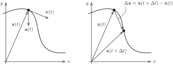
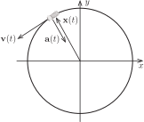
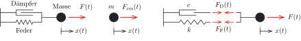
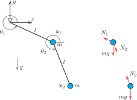
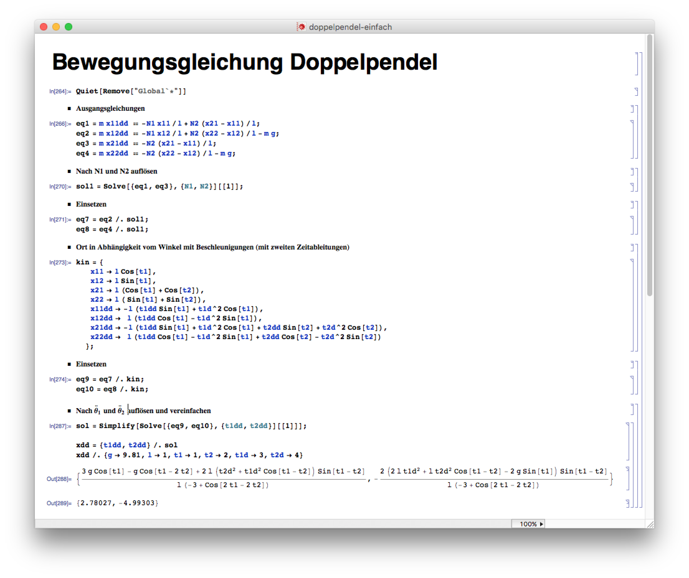

Dieses Kapitel ist ein kurzer Einschub, der die Grundlage für eine Reihe interessanter Anfangswertprobleme legt, die sich aus der Untersuchung der Bewegung von Punktmassen ergeben. Anwendungen sind zum Beispiel

- Schwingungsvorgänge im Bauwesen,

- dynamische Systeme in der Mechanik,

- Visualisierung von Strömungsvorgängen.

Die Erläuterungen in diesem Kapitel erfolgen für einen Massepunkt, der sich in der Ebene bewegt, im Raum kommt einfach eine Komponente hinzu, sonst bleibt alles gleich.

## Kinematik des Massepunkts

In der [Kinematik]{.neuerbegriff} geht es um die mathematische Beschreibung der Bewegung eines Massepunkts (wobei die Masse hier gar keine Rolle spielt), ohne nach den Ursachen der Bewegung zu fragen.

@fig-kinematik (links) zeigt einen Massepunkt, der sich über die Zeit entlang einer Bahnkurve bewegt. Mathematisch wird die Position durch die parametrische Kurve $\mathbf{x} : \R_+ \to \R^2$ mit
$$
  \mathbf{x}(t) = \mmat{x_1(t) \\ x_2(t)}
$$
beschrieben.

{#fig-kinematik}

Die zeitliche Änderung des Ortes heißt [Geschwindigkeit]{.neuerbegriff}. Wir betrachten hierzu zunächst den Weg
$$
  \Delta \mathbf{x} = \mathbf{x}(t + \Delta t) - \mathbf{x}(t),
$$
den der Massepunkt im Zeitintervall $[t, t + \Delta t]$ zurücklegt (siehe auch @fig-kinematik rechts). Die mittlere Geschwindigkeit in diesem Zeitintervall ist dann der Vektor
$$
  \mathbf{v}_{\mathrm{mit}} = \frac{1}{\Delta t} \cdot \Delta \mathbf{x}.
$$
Die aktuelle Geschwindigkeit zum Zeitpunkt $t$ erhalten wir mithilfe des Grenzwerts
$$
  \mathbf{v}(t)
  =
  \lim_{\Delta t \to 0} \frac{1}{\Delta t} \cdot \Delta \mathbf{x}
  =
  \lim_{\Delta t \to 0} \frac{1}{\Delta t} \cdot (\mathbf{x}(t + \Delta t) - \mathbf{x}(t)).
$$
Wird der Grenzwert komponentenweise in der Form
$$
  \lim_{\Delta t \to 0} \frac{1}{\Delta t} \cdot (\mathbf{x}(t + \Delta t) - \mathbf{x}(t))
  =
  \mmat{
    \lim\limits_{\Delta t \to 0} \frac{x_1(t+\Delta t) - x_1(t)}{\Delta t}
    \\[1em]
    \lim\limits_{\Delta t \to 0} \frac{x_2(t+\Delta t) - x_2(t)}{\Delta t}
  }
  =
  \mmat{
    \dot{x}_1(t) \\ \dot{x}_2(t)
  }
$$
aufgeschrieben, dann ist sofort zu erkennen, dass die Geschwindigkeit die Ableitung des Ortes nach der Zeit ist
$$
  \mathbf{v}(t)
  =
  \dot{\mathbf{x}}(t)
  =
  \mmat{
    \dot{x}_1(t) \\ \dot{x}_2(t)
  },
$$
wobei die Ableitung komponentenweise durchzuführen ist. Wie in der Physik üblich kennzeichnet der hochgestellte Punkt eine Ableitung nach der Zeit, $\dot{x}_1(t)$ ist also nichts anderes als $x_1'(t)$.

Damit ist klar, dass die Geschwindigkeit eine vektorielle Größe ist: Zum Zeitpunkt $t$ bewegt sich der Massepunkt in Richtung $\mathbf{v}(t)$, wobei die Geschwindigkeit (so wie man sie auf dem Tacho eines Autos ablesen würde) der Länge des Geschwindigkeitsvektors entspricht, es gilt also
$$
  v(t) = |\mathbf{v}(t)|,
$$
wobei hier auf die Unterscheidung zwischen der Zahl $v(t)$ und dem Vektor $\mathbf{v}(t)$ zu achten ist. Und klar: Die Bezeichnung $\mathbf{v}$ für die Geschwindigkeit kommt vom englischen Wort *velocity*.

Weiterhin bezeichnen wir die zeitliche Änderung der Geschwindigkeit als [Beschleunigung]{.neuerbegriff}. Die Herleitung erfolgt wie bei der Geschwindigkeit über einen Grenzwert und wir erhalten
$$
  \mathbf{a}(t) = \dot{\mathbf{v}}(t) = \ddot{\mathbf{x}}(t),
$$
wobei der Buchstabe $\mathbf{a}$ dem englischen Wort *acceleration* entnommen ist.

::: {#exm-auto-im-kreis}
## Auto im Kreis

Wir betrachten ein Auto, das mit einer konstanten Geschwindigkeit von $\SI{50}{\kilo\metre\per\hour}$ in einem Kreis mit dem Radius $\SI{50}{\metre}$ fährt. Gesucht sind die Gleichung des Ortes des Masseschwerpunkts für das Auto und die Beschleunigung.

Fährt das Auto auf einem Kreis, dann ist die Bewegungsgleichung durch
$$
  \mathbf{x}(t) = r \cdot \mmat{\cos(\omega t) \\ \sin(\omega t)}
$$
gegeben. Für den Radius gilt natürlich $r = \SI{50}{\metre}$. Um die Winkelgeschwindigkeit $\omega$ zu ermitteln, bestimmen wir zunächst allgemein den Geschwindigkeitsvektor
$$
  \mathbf{v}(t)
  =
  \dot{\mathbf{x}}(t)
  =
  50 \cdot \omega \cdot \mmat{-\sin(\omega t) \\ \phantom{-}\cos(\omega t)}
$$
und die Geschwindigkeit auf dem Tachometer
$$
  v(t) = \sqrt{
    (-50 \cdot \omega \cdot \sin(\omega t))^2
    +
    (50 \cdot \omega \cdot \cos(\omega t))^2
  }
  =
  50 \cdot \omega.
$$
Wenn wir, wie das meist am praktischsten ist, mit Metern und Sekunden rechnen, dann gilt
$$
  50 \cdot \omega = 50 \cdot \frac{1000}{60 \cdot 60} \iff \omega = \frac{5}{18}\,\mathrm{rad/s}
$$
und somit
$$
  \mathbf{x}(t)
  =
  50 \cdot \mmat{\cos(5/18 \cdot t) \\ \sin(5/18 \cdot t)},
  \quad
  \mathbf{v}(t)
  =
  \frac{125}{9} \cdot \mmat{-\sin(5/18 \cdot t) \\ \phantom{-}\cos(5/18 \cdot t)}
$$
sowie
$$
  \mathbf{a}(t)
  =
  -\frac{625}{162} \cdot \mmat{\cos(5/18 \cdot t) \\ \sin(5/18 \cdot t)}.
$$
Wir halten fest, dass die Passagiere im Auto mit $(625/162) / 9.81 \approx 0.39\,g$ zur Seite gedrückt werden (also dem 0.39-fachen der Erdbeschleunigung). Der Geschwindigkeitsvektor ist gegenüber dem Ortsvektor um $90^\circ$ gedreht, der Beschleunigungsvektor ist antiparallel zum Ortsvektor und zeigt somit zum Mittelpunkt des Kreises.

{#fig-auto-im-kreis}

@fig-auto-im-kreis veranschaulicht die Situation, das Auto ist allerdings nicht maßstäblich dargestellt, ebenso die Pfeile für Geschwindigkeit und Beschleunigung (hier passen ja nicht mal die Einheiten zusammen).
:::

## Dynamik des Massepunkts

Grundlage für die Untersuchung der Bewegung eines Massepunkts ist das zweite newtonsche Gesetz
$$
  \mathbf{F}(t) = m \cdot \ddot{\mathbf{x}}(t).
$$
Es besagt, dass die zeitliche Änderung des Geschwindigkeitsvektors proportional zur auf die Masse einwirkenden (resultierenden) Kraft ist.

Im einfachsten Fall ist die Bahnkurve vorgegeben und man kann einfach die zugehörige Kraft ausrechnen.

::: {#exm-auto-kraft}
## Kraft auf das Auto

Wir nehmen an, dass unser Auto aus @exm-auto-im-kreis mit Insassen und Gepäck eineinhalb Tonnen wiegt, es gilt demnach $m = \SI{1500}{\kilo\gram}$. Die zugehörige Kraft, die durch Reibung auf die Räder übertragen wird, ist
$$
  \mathbf{F} = - 1500 \cdot \frac{625}{162} \cdot \mmat{\cos(5/18 \cdot t) \\ \sin(5/18 \cdot t)},
$$
so dass die resultierende Kraft (der Betrag von $\mathbf{F}$)
$$
  F = \frac{156250}{27}\,\mathrm{N} \approx \SI{5.79}{\kilo\newton}
$$
beträgt. Nicht mitgerechnet ist natürlich die Motorkraft, die zur Überwindung des Luftwiderstandes notwendig ist.
:::

Im Allgemeinen hängt allerdings die auf die Masse einwirkende Kraft vom Bewegungszustand ab, so dass eine Differentialgleichung zu lösen ist. Ein klassisches Beispiel ist der Einmassenschwinger.

### Einmassenschwinger

Der [Einmassenschwinger]{.neuerbegriff} ist ein System, das in unterschiedlichsten Zusammenhängen als mechanisches Modell dienen kann, zum Beispiel

- Schwingung von Gebäuden,

- Helmholtz-Resonator in der Akustik,

- Radaufhängung.

In der klassischen Modellierung setzt sich der Einmassenschwinger aus drei Bestandteilen zusammen: einem Massepunkt, einer Feder und einem Dämpfer (@fig-einmassenschwinger).

{#fig-einmassenschwinger}

#### Massepunkt

Der Massepunkt mit der Masse $m$ kann sich in horizontaler Richtung reibungslos hin- und herbewegen. Zum Zeitpunkt $t$ ist er um die Verschiebung $x(t)$ aus der Ruhelage ausgelenkt. Damit ist $x : \R_+ \to \R$ eine Funktion, die jedem Zeitpunkt eine Auslenkung des Massepunkts zuordnet. Für den Massepunkt gilt das 2. newtonsche Gesetz
$$
  F_{\mathrm{res}}(t) = m \, \ddot{x}(t).
$$
Es besagt: Die auf den Massepunkt einwirkende resultierende Kraft ist gleich der Masse mal der Beschleunigung.

#### Feder

Die Feder bewirkt bei einer Auslenkung des Massepunkts eine Rückstellkraft, die den Massepunkt zurück in die Ausgangslage zieht beziehungsweise drückt. Vereinfachend nimmt man hierbei an, dass die Kraft proportional zur Auslenkung ist,
$$
  F_{\mathrm{F}}(t) = k \, x(t),
$$
und zwar mit der Federkonstanten $k$.

#### Dämpfer

Mit dem Dämpfungselement können wir abbilden, dass Bewegung in Wirklichkeit immer irgendeine Form von Reibung (Luftwiderstand, innere Reibung des Materials, Lagerung etc.) verursacht und dadurch Bewegungsenergie in Wärme umgewandelt wird. Die einfachste Form der Dämpfung ist die viskose Dämpfung, in der die Dämpfungskraft mit der Dämpfungskonstanten $c$ proportional zur Geschwindigkeit ist:
$$
  F_{\mathrm{D}}(t) = c \, \dot{x}(t).
$$
Die viskose Dämpfung bildet zum Beispiel in guter Näherung den Stoßdämpfer eines Autos ab, in dem eine Lochscheibe durch ein viskoses Dämpfungsöl bewegt wird.

#### Bewegungsgleichung

Zusammen mit der äußeren Kraft, der Federkraft sowie der Dämpferkraft und unter Berücksichtigung der positiven Richtung (nach rechts) ist die auf den Massepunkt einwirkende resultierende Kraft
$$
  F_{\mathrm{res}}(t) = F(t) - F_{\mathrm{D}}(t)  - F_{\mathrm{F}}(t).
$$
Die resultierende Kraft ist gleich Masse mal Beschleunigung, so dass wir zusammen mit dem Feder- und Dämpfergesetz die Bewegungsgleichung
$$
  F(t) - c \, \dot{x}(t) - k \, x(t) = m \, \ddot{x}(t)
$$
beziehungsweise
$$
  m \, \ddot{x}(t) + c \, \dot{x}(t) + k \, x(t) = F(t)
$$ {#eq-einmassenschwinger}
erhalten.

Aus mathematischer Sicht handelt es sich um eine lineare Differentialgleichung (die gesuchte Funktion taucht nicht als Argument einer Funktion auf) zweiter Ordnung (es gibt zweite Ableitungen) mit konstanten Koeffizienten (die Vorfaktoren $m, c$ und $k$ vor $\ddot{x}(t), \dot{x}(t)$ und $x(t)$ hängen nicht von der Zeit ab).

#### Anfangsbedingungen

Ziel bei der Berechnung eines Einmassenschwingers ist es vorherzusagen, wie sich die Auslenkung der Masse über die Zeit verändert. In (fast) allen Fällen muss dazu ein Ausgangszustand für einen festgelegten Zeitpunkt definiert werden. In der Regel beginnt man bei $t = 0$ zu rechnen, so dass wir
$$
  x(0) = u_0 \quad\text{und}\quad \dot{x}(0) = v_0
$$
vorgeben müssen.

### Doppelpendel

Wir betrachten das in @fig-doppelpendel dargestellte Doppelpendel unter Einwirkung der senkrecht nach unten wirkenden Erdbeschleunigung $g = \SI{9.81}{\metre\per\second\squared}$. Die beiden Massepunkte der Masse $m$ sind reibungsfrei mit Stäben der Länge $l$ verbunden. Die Ortsvektoren der Massepunkte
$$
  \mathbf{x}_1 = \mmat{x_{11} \\ x_{12}}
  \quad \text{und} \quad
  \mathbf{x}_2 = \mmat{x_{21} \\ x_{22}}
$$
sind Funktionen der Zeit.

{#fig-doppelpendel width="60%"}

Den Ausgangspunkt für die Herleitung der Bewegungsgleichungen für das System bildet die Grundgleichung der Mechanik, aufgeschrieben für die beiden Massepunkte
$$
  \mathbf{F}_1 = m\ddot{\mathbf{x}}_1
  \quad \text{und} \quad
  \mathbf{F}_2 = m\ddot{\mathbf{x}}_2.
$$
Auf die Massen wirken die Stabkräfte $N_1$ und $N_2$ sowie die Erdbeschleunigung. In Vektorschreibweise folgen damit für die Kräfte die Beziehungen
$$
  \mathbf{F}_1 = -\frac{N_1}{l}\mathbf{x}_1 + \frac{N_2}{l}(\mathbf{x}_2 - \mathbf{x}_1) - \mmat{0 \\ mg}
  \quad \text{und} \quad
  \mathbf{F}_2 = \frac{N_2}{l}(\mathbf{x}_1 - \mathbf{x}_2) - \mmat{0 \\ mg}.
$$
Einsetzen der Kräfte liefert in Komponentenschreibweise die vier Gleichungen
$$
  m \ddot x_{11} = -\frac{N_1}{l}x_{11} + \frac{N_2}{l}(x_{21} - x_{11}),
$$ {#eq-b-1}
$$
  m \ddot x_{12} = -\frac{N_1}{l}x_{12} + \frac{N_2}{l}(x_{22} - x_{12}) - mg,
$$ {#eq-b-2}
$$
  m \ddot x_{21} = \frac{N_2}{l}(x_{11} - x_{21}),
$$ {#eq-b-3}
$$
  m \ddot x_{22} = \frac{N_2}{l}(x_{12} - x_{22}) - mg.
$$ {#eq-b-4}
Mithilfe von @eq-b-1 und @eq-b-3 lassen sich die Normalkräfte
$$
  N_1 = -(\ddot x_{11}+\ddot x_{21})\frac{m l}{x_{11}}
$$ {#eq-n1}
$$
  N_2 = \ddot x_{21}\frac{m l}{x_{11}-x_{21}}
$$ {#eq-n2}
in Abhängigkeit der Komponenten der Ortsvektoren und deren zweiten Zeitableitungen angeben. Wir setzen die Normalkräfte aus @eq-n1 und @eq-n2 in @eq-b-2 und @eq-b-4 ein, kürzen die Masse $m$ und erhalten die beiden Gleichungen
$$
  \ddot{x}_{12}
  =
  (\ddot{x}_{11}+\ddot{x}_{21})\frac{x_{12}}{x_{11}}
  -
  \ddot{x}_{21}\frac{x_{12}-x_{22}}{x_{11}-x_{21}}
  -g,
$$ {#eq-b-5}
$$
  \ddot{x}_{22}
  =
  \ddot{x}_{21}\frac{x_{12}-x_{22}}{x_{11}-x_{21}} - g
$$ {#eq-b-6}
mit den vier unbekannten Größen $x_{11}, x_{12}, x_{21}, x_{22}$. Allerdings bewegen sich die Massepunkte nicht völlig frei in der Ebene, vielmehr sind die Bewegungsmöglichkeiten durch die beiden Stäbe und das Auflager eingeschränkt. Mit den Winkeln $\theta_1$ und $\theta_2$ gilt für die Koordinaten
$$
  \begin{aligned}
    x_{11} & = l\cos\theta_1, \\
    x_{12} & = l\sin\theta_1, \\
    x_{21} & = l(\cos\theta_1+\cos\theta_2), \\
    x_{22} & = l(\sin\theta_1+\sin\theta_2).
  \end{aligned}
$$
Die zweiten Zeitableitungen
$$
  \begin{aligned}
    \ddot{x}_{11}
    & =
    -l(\ddot{\theta}_1 \sin\theta_1 + \dot{\theta}_1^2 \cos\theta_1),
    \\
    \ddot{x}_{12}
    & =
    \phantom{-}l(\ddot{\theta}_1 \cos\theta_1-\dot{\theta}_1^2 \sin\theta_1),
    \\
    \ddot{x}_{21}
    & =
    -l(
    \ddot{\theta}_1 \sin\theta_1 + \dot{\theta}_1^2 \cos\theta_1
    + \ddot{\theta}_2 \sin\theta_2 + \dot{\theta}_2^2 \cos\theta_2
    ),
    \\
    \ddot{x}_{22}
    & =
    \phantom{-}l(
    \ddot{\theta}_1 \cos\theta_1-\dot{\theta}_1^2 \sin\theta_1
    +\ddot{\theta}_2 \cos\theta_2-\dot{\theta}_2^2 \sin\theta_2
    )
  \end{aligned}
$$
lassen sich mithilfe der Kettenregel und der Produktregel bestimmen. Setzen wir nun diese kinematischen Beziehungen in @eq-b-5 und @eq-b-6 ein, so erhalten wir
$$
  \begin{aligned}
    & l(\ddot{\theta}_1 \cos\theta_1-\dot{\theta}_1^2 \sin\theta_1)
    \\
    & \qquad = -l(
    2\ddot{\theta}_1   \sin\theta_1 +
    2 \dot{\theta}_1^2 \cos\theta_1 +
     \ddot{\theta}_2   \sin\theta_2 +
      \dot{\theta}_2^2 \cos\theta_2
     ) \tan\theta_1
    \\
    & \qquad \phantom{=} -l(
    \ddot{\theta}_1   \sin\theta_1 +
     \dot{\theta}_1^2 \cos\theta_1 +
    \ddot{\theta}_2   \sin\theta_2 +
     \dot{\theta}_2^2 \cos\theta_2
      )
    (-\tan\theta_2)
    -g,
  \end{aligned}
$$
$$
  \begin{aligned}
    & l(
    \ddot{\theta}_1   \cos\theta_1 -
     \dot{\theta}_1^2 \sin\theta_1 +
    \ddot{\theta}_2   \cos\theta_2 -
     \dot{\theta}_2^2 \sin\theta_2
    )
    \\
    & \qquad = -l(
    \ddot{\theta}_1   \sin\theta_1 +
     \dot{\theta}_1^2 \cos\theta_1 +
    \ddot{\theta}_2   \sin\theta_2 +
     \dot{\theta}_2^2 \cos\theta_2
    )
    \tan\theta_2
    - g
  \end{aligned}
$$
beziehungsweise nach einigen Umstellungen
$$
  \begin{aligned}
    & \ddot{\theta}_1
    \bigl(\cos\theta_1+\sin\theta_1(2\tan\theta_1-\tan\theta_2)\bigr)
    +\ddot{\theta}_2
    \sin\theta_2(\tan\theta_1-\tan\theta_2)
    \\
    & \qquad =
    -\dot{\theta}_1^2\cos\theta_1(\tan\theta_1-\tan\theta_2)
    -
    \dot{\theta}_2^2\cos\theta_2(\tan\theta_1-\tan\theta_2)
    - g/l,
  \end{aligned}
$$ {#eq-f1}
$$
  \ddot{\theta}_1(\cos\theta_1 + \sin\theta_1\tan\theta_2) + \ddot{\theta}_2/\cos\theta_2 =
  \dot{\theta}_1^2(\sin\theta_1 - \cos\theta_1\tan\theta_2) - g/l.
$$ {#eq-f2}
@eq-f1 und @eq-f2 lassen sich nach $\ddot\theta_1$ und $\ddot\theta_2$ auflösen und mit einigen Vereinfachungen ergibt sich schließlich das nichtlineare System von Differentialgleichungen zweiter Ordnung
$$
  \begin{aligned}
    \ddot{\theta}_1
    & =
    \frac{
      3 g \cos (\theta _1)
      -
      g \cos(\theta _1 - 2 \theta _2)
      +
      2 l \sin(\theta _1 - \theta _2)
      (
        \dot\theta _1^2 \cos(\theta _1 - \theta _2)
        +
        \dot\theta _2^2
      )
    }
    {
      l (\cos(2(\theta _1 - \theta_2)) - 3)
    },
    \\[1em]
    \ddot{\theta}_2
    & =
    -
    \frac{
      2 \sin(\theta _1 - \theta _2)(
        -2 g \sin(\theta _1)
        +
        l \dot\theta _2^2 \cos(\theta _1-\theta_2)
        +
        2 l \dot\theta _1^2
      )
    }
    {
      l (\cos(2(\theta _1 - \theta _2)) - 3)
    }.
  \end{aligned}
$$ {#eq-doppelpendel}

#### Anmerkung zur Herleitung

Die Herleitung der Bewegungsgleichungen von Hand ist mühselig, langwierig und fehleranfällig. Oben wurde versucht, den Gedankengang bei der Herleitung darzulegen, die mathematischen Umformungen erfolgten jedoch in dem Computeralgebra-Programm Mathematica. In @fig-doppelpendel-mathematica ist zu sehen, dass hierzu nur wenige Schritte notwendig sind.

{#fig-doppelpendel-mathematica}
