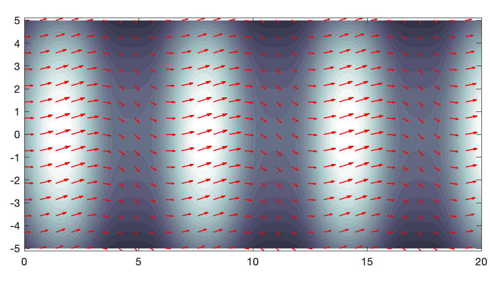
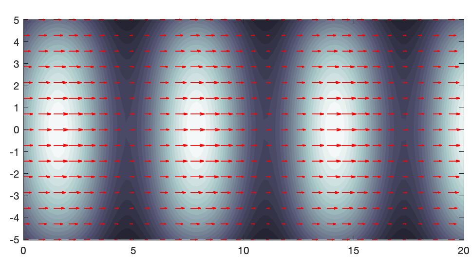
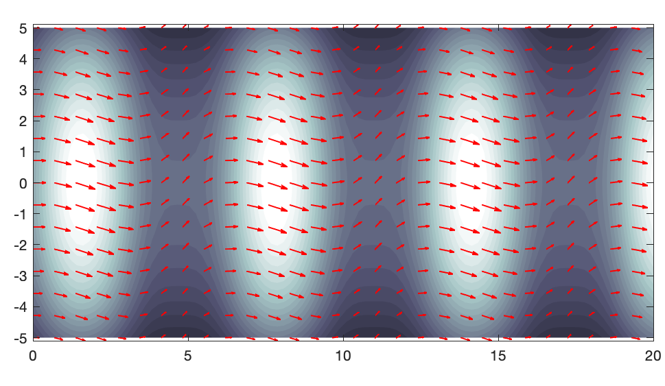
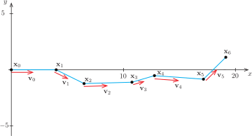
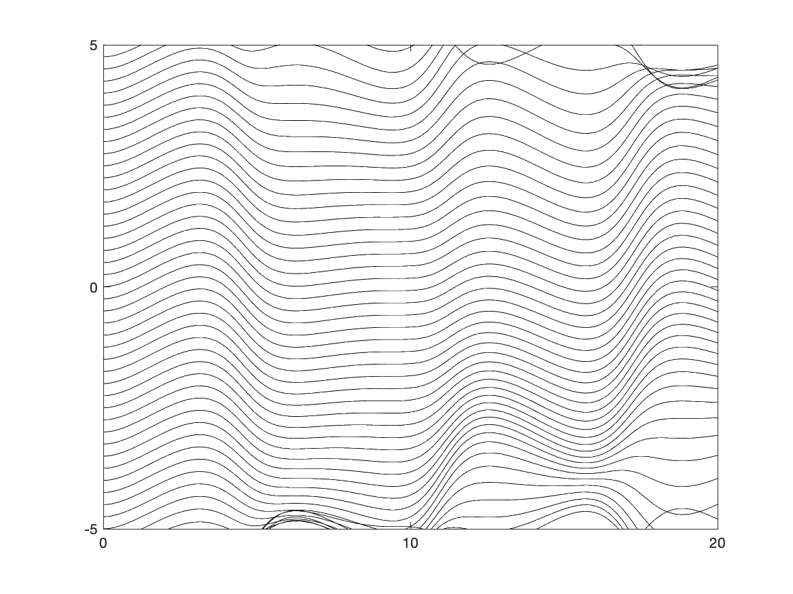

Wir betrachten nun den Fall, dass in der Aufgabenstellung mehrere unbekannte Funktionen gesucht werden. Dies ist öfter der Fall, als man denken mag, insbesondere, wenn die Aufgabe zunächst eine räumliche Diskretisierung erforderlich macht. Ein Beispiel hierfür ist die Simulation transienter (also über die Zeit veränderlicher) Wärmeleitungsprozesse.

## Beispiel: Partikel in einer Strömung

Als anschauliches Einstiegsbeispiel untersuchen wir die Bewegung eines Partikels (zum Beispiel eines Schadstoffpartikels) in einem vorgegebenen Strömungsfeld, @fig-partikel zeigt Anwendungsbeispiele.

::: {#fig-partikel}
{width="49%"} {width="49%"}

{width="60%"}

Möglichkeiten, die Bewegung von Partikeln in einem Strömungsfeld zu visualisieren (Quellen: STAR-CCM+, windfinder.com, cmatc.cn)
:::

Dabei stellt sich zunächst die Frage, wie eine solche Bewegung mathematisch erfasst werden kann. Hierzu gibt es zwei prinzipielle Möglichkeiten:

1. Ein Partikel wird gedanklich markiert und dann der Weg über die Zeit beschrieben. Für einen einzelnen Punkt (wie das Auto in @exm-auto-im-kreis) oder einen elastischen Körper (zum Beispiel eine Deckenplatte) macht diese Betrachtungsweise durchaus Sinn, für eine Strömung ist das zu unhandlich. Dieser Ansatz heißt [lagrangesche Betrachtungsweise]{.neuerbegriff} (nach Joseph-Louis Lagrange, 1736–1813).

1. Es wird für einen festen Ort beschrieben, mit welcher Geschwindigkeit und in welcher Richtung Partikel an dieser Stelle vorbeifließen (das kann sich natürlich über die Zeit ändern). Diese Sicht wird [eulersche Betrachtungsweise]{.neuerbegriff} genannt[^euler-lagrange].

[^euler-lagrange]: Ein kurioses Detail ist, dass die lagrangesche Betrachtungsweise von Euler und die eulersche Sicht von d'Alembert eingeführt wurde.

In der eulerschen Sicht beschreiben wir also eine Strömung durch ein Vektorfeld, das jedem Punkt $\mathbf{x} \in \Omega$ zu jedem Zeitpunkt $t$ einen Geschwindigkeitsvektor $\mathbf{v}(\mathbf{x}, t)$ zuordnet. Wir beschränken uns dabei auf ebene Strömungsfelder mit $\Omega \subset \R^2$ und gehen davon aus, dass wir das Strömungsfeld kennen (die Simulation von Strömungsprozessen ist eine wesentlich schwierigere Aufgabe).

Als Beispiel betrachten wir ein zweidimensionales Strömungsgeschehen mit dem Strömungsfeld $\mathbf{v} : ([0, 20] \times [-5, 5]) \times \R_+ \to \R^2$ mit
$$
  \mathbf{v}(\mathbf{x}, t)
  =
  \frac{50 - x_2^2}{50}
  \mmat{
    2 + \sin(x_1) \\[1ex]
    \cos(\pi / 10 \cdot t) \cdot \sin(x_1)
  },
$$
das auf einem Gebiet von $\SI{20}{\metre}$ auf $\SI{10}{\metre}$ definiert ist. @fig-flowfield zeigt das Richtungsfeld der Strömung zu verschiedenen Zeitpunkten.

::: {#fig-flowfield layout-ncol="1"}
{width="70%"}

{width="70%"}

{width="70%"}

Strömungsfeld für verschiedene Zeitpunkte. Die Fließgeschwindigkeit ist farblich dargestellt, die Farbe Weiß entspricht dabei einer Geschwindigkeit von $\SI{3}{\metre\per\second}$
:::

Wir verfolgen nun näherungsweise den Weg eines Schadstoffpartikels, das sich zum Zeitpunkt
$$
  t = 0 \quad\text{an der Stelle}\quad \mathbf{x}_0 = \mmat{0 \\ 0}
$$
befindet. Mithilfe der Gleichung des Strömungsfeldes stellen wir fest, dass sich das Partikel zum Zeitpunkt $0$ mit der Geschwindigkeit
$$
  \mathbf{v}_0
  =
  \mathbf{v}((0, 0)\mtran, 0)
  =
  \mmat{2 \\[1ex] 0}
$$
fortbewegt. In unserer näherungsweisen Berechnung nehmen wir nun an, dass sich das Schadstoffpartikel im Zeitintervall $[0, \Delta t]$ konstant mit dem Geschwindigkeitsvektor $\mathbf{v}_0$ bewegt. Dabei ist $\Delta t$ eine Zeitschrittweite, die wir in diesem Rechenbeispiel auf $\Delta t = \SI{2}{\second}$ festlegen. In den ersten zwei Sekunden legt das Partikel also den Weg
$$
  \Delta \mathbf{x}_0 = \Delta t \cdot \mathbf{v}_0
$$
zurück. Damit erhalten wir die Näherung
$$
  \mathbf{x}_1
  =
  \mathbf{x}_0 + \Delta t \cdot \mathbf{v}_0
  =
  \mmat{0 \\[1ex] 0} + 2 \cdot \mmat{2 \\[1ex] 0}
  =
  \mmat{4 \\[1ex] 0}
$$
für die Position des Schadstoffpartikels zum Zeitpunkt $t = 2$. Hierzu lässt sich wieder der Geschwindigkeitsvektor
$$
  \mathbf{v}_1
  =
  \mathbf{v}((4, 0)\mtran, 2)
  =
  \mmat{1.2432 \\[1ex] -0.6123 }
$$
berechnen. Analog zum ersten Schritt erhalten wir damit die Position des Partikels zum Zeitpunkt $t = 4$ zu
$$
  \mathbf{x}_2
  =
  \mmat{4 \\[1ex] 0} + 2 \cdot \mmat{1.2432 \\[1ex] -0.6123 }
  =
  \mmat{6.4864 \\[1ex] -1.2245}.
$$
Diese Prozedur setzen wir fort, bis das Schadstoffpartikel unser Berechnungsgebiet verlässt. Die Rechnung lässt sich leicht programmieren, @fig-flowfield-steps zeigt die einzelnen Schritte in einer graphischen Darstellung.

{#fig-flowfield-steps}

## Systeme von Differentialgleichungen

In unserem Beispiel war die Geschwindigkeit eines Partikels am Ort $\mathbf{x}$ zum Zeitpunkt $t$ durch die Gleichung des Strömungsfeldes gegeben. Wir können diesen Zusammenhang in der Form
$$
  \dot{\mathbf{x}}(t) = \mathbf{v}(\mathbf{x}(t), t)
  =
  \frac{50 - (x_2(t))^2}{50}
  \mmat{
    2 + \sin(x_1(t)) \\[1ex]
    \cos(\pi / 10 \cdot t) \cdot \sin(x_1(t))
  }
$$
festhalten und komponentenweise in der Form
$$
  \begin{aligned}
    \dot{x}_1(t) & = \frac{50 - (x_2(t))^2}{50} \cdot (2 + \sin(x_1(t))) \\[1em]
    \dot{x}_2(t) & = \frac{50 - (x_2(t))^2}{50} \cdot \cos(\pi / 10 \cdot t) \cdot \sin(x_1(t))
  \end{aligned}
$$
aufschreiben. Gleichzeitig war $\mathbf{x}(0) = (0, 0)\mtran$ vorgegeben. In unserer näherungsweisen Berechnung hatten wir die Vorschrift
$$
  \mathbf{x}_{i+1} = \mathbf{x}_i + \Delta t \cdot \mathbf{v}(\mathbf{x}_i, t_i)
$$
verwendet.

Wir erinnern uns nun nochmal an das Anfangswertproblem
$$
  y'(x) = F(x, y(x)) \quad\text{und}\quad y(x_0) = y_0
$$
und das Euler-Verfahren
$$
  y_{i+1} = y_i + h \cdot F(x_i, y_i)
$$
aus @sec-loesungsverfahren. Der Vergleich beider Aufgabenstellungen und Lösungsverfahren zeigt, dass kein grundlegender Unterschied besteht, wenn man von den unterschiedlichen Bezeichnungen absieht.

::: {#def-system}
## System von Differentialgleichungen

Ein Satz von Gleichungen der Form
$$
  \begin{aligned}
    y_1'(x) & = F_1(x, (y_1(x), y_2(x), \dots, y_n(x))) \\
    y_2'(x) & = F_2(x, (y_1(x), y_2(x), \dots, y_n(x))) \\
    & \;\; \vdots \\
    y_n'(x) & = F_n(x, (y_1(x), y_2(x), \dots, y_n(x)))
  \end{aligned}
$$
heißt [System von Differentialgleichungen]{.neuerbegriff} erster Ordnung. Gesucht sind also $n$ Funktionen $y_1, y_2, \dots, y_n: \R \to \R$, deren Ableitungen von $x$ und im Allgemeinen von allen Funktionswerten $y_1(x), y_2(x), \dots, y_n(x)$ abhängen[^bezeichnungen]. Zusammen mit den Anfangswerten
$$
  y_1(x_0) = y_{10}, \; y_2(x_0) = y_{20}, \; \dots, y_n(x_0) = y_{n0}
$$
ergibt sich ein Anfangswertproblem erster Ordnung mit $n$ unbekannten Funktionen.
:::

[^bezeichnungen]: Wenn die gesuchte Funktion eine zeitabhängige Position beschreibt, dann verwenden wir $x_i$ statt $y_i$ und $t$ statt $x$.

Eine sehr kompakte Darstellung erhalten wir mit der Vektorschreibweise
$$
  \mathbf{y}(x)
  =
  \mmat{y_1(x) \\ y_2(x) \\ \vdots \\ y_n(x)}
  \quad\text{und}\quad
  \mathbf{F}(x, \mathbf{y})
  =
  \mmat{
    F_1(x, \mathbf{y}) \\
    F_2(x, \mathbf{y}) \\
    \vdots \\
    F_n(x, \mathbf{y})
  },
$$
wobei $\mathbf{y}$ eine Abbildung $\R \to \R^n$ und $\mathbf{F}$ eine Abbildung $\R \times \R^n \to \R^n$ ist. Dann lautet nämlich das Anfangswertproblem
$$
  \mathbf{y}'(x) = \mathbf{F}(x, \mathbf{y}(x))
  \quad\text{mit}\quad
  \mathbf{y}(x_0) = \mathbf{y}_0.
$$
Abgesehen davon, dass einige Symbole nun fett gedruckt sind, hat sich gegenüber dem Anfangswertproblem mit einer unbekannten Funktion nichts geändert.

Damit ist unser Anfangswertproblem des Schadstoffpartikels durch die Angabe von
$$
  \mathbf{F}(t, \mathbf{x})
  =
  \frac{50 - x_2^2}{50}
  \mmat{
    2 + \sin(x_1) \\[1ex]
    \cos(\pi / 10 \cdot t) \cdot \sin(x_1)
  }
  \quad\text{und}\quad
  \mathbf{x}(0)
  =
  \mmat{0 \\[1ex] 0}
$$
vollständig definiert. Die Differentialgleichung lautet damit
$$
  \dot{\mathbf{x}}(t) = \mathbf{F}(t, \mathbf{x}(t)).
$$
In @fig-flowfield-all ist eine Visualisierung des gesamten Strömungsfeldes zu sehen.

{#fig-flowfield-all width="80%"}

Schließlich zeigt uns noch der Vergleich der Rechenvorschriften für das numerische Verfahren, dass wir letztlich bei der näherungsweisen Bestimmung des Wegs des Schadstoffpartikels das Euler-Verfahren verwendet haben.

::: {#def-euler-system}
## Explizites Euler-Verfahren für Systeme

$$
  \begin{aligned}
    \mathbf{k} &= \mathbf{F}(x_i, \mathbf{y}_i) \\[1ex]
    \mathbf{y}_{i+1} &= \mathbf{y}_i + h \cdot \mathbf{k}
  \end{aligned}
$$
:::

Der Unterschied besteht also nur darin, dass wir es jetzt mit Vektoren anstatt mit Zahlen zu tun haben. Das Halbschritt- und das Runge-Kutta-Verfahren lassen sich in genau derselben Form aufschreiben und werden daher hier nicht nochmals aufgeführt.
